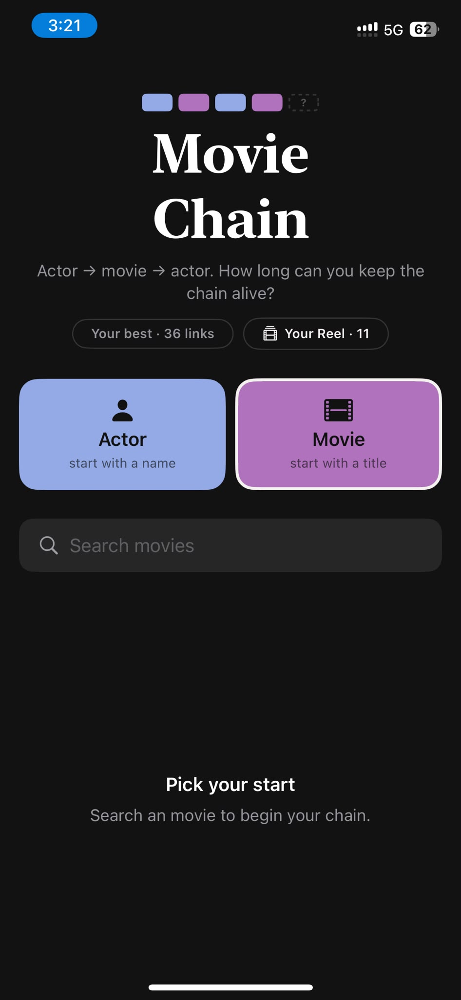
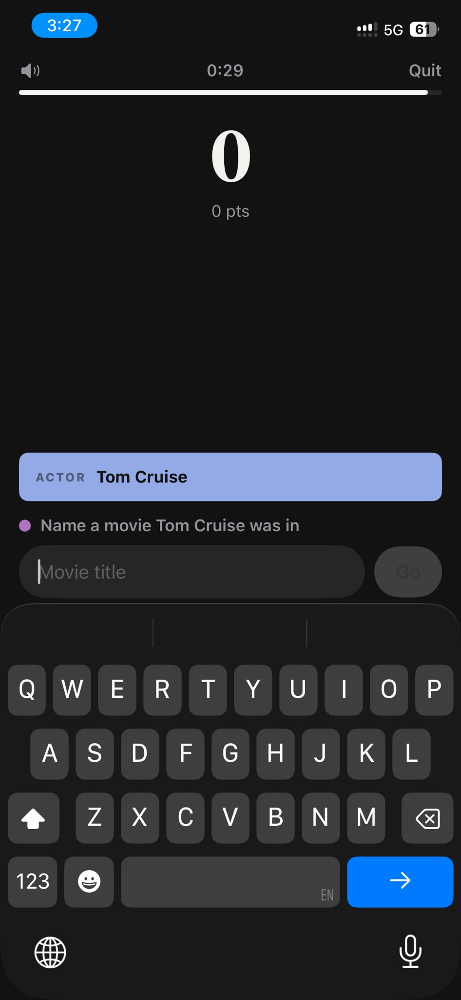
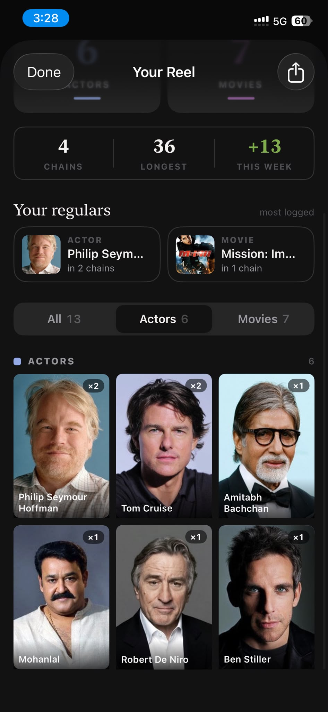
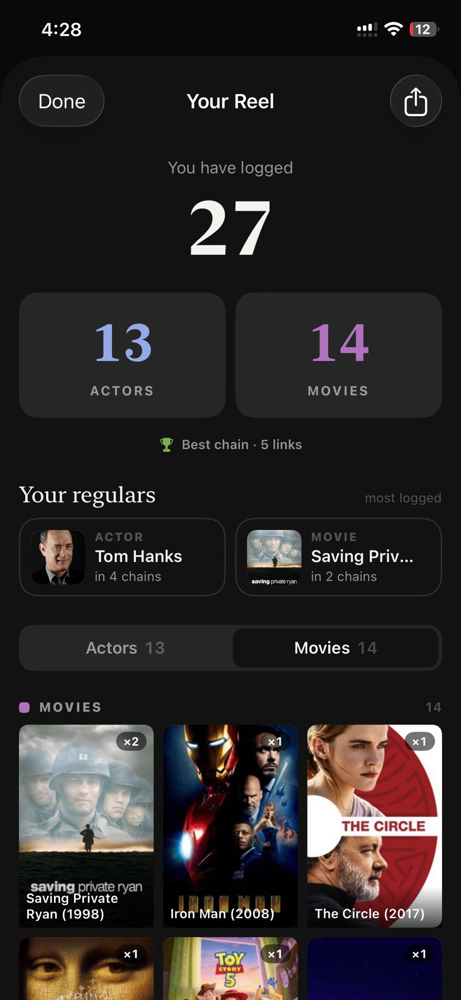
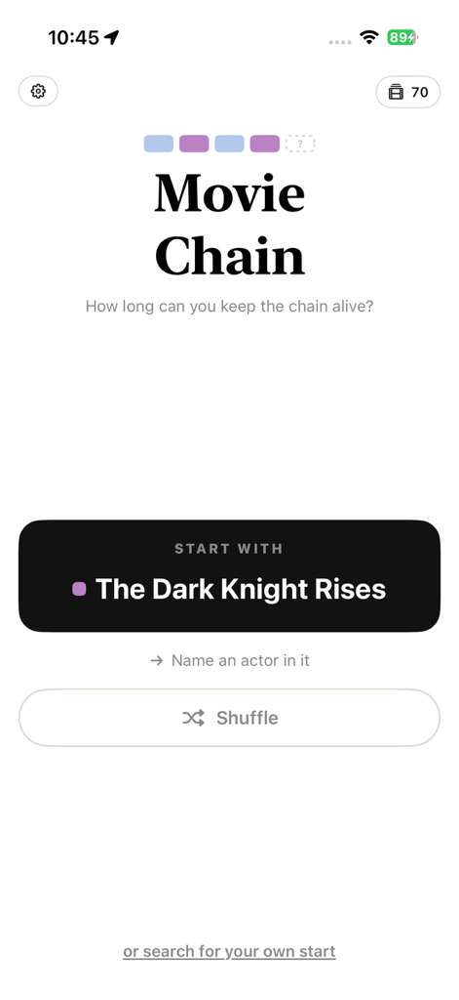
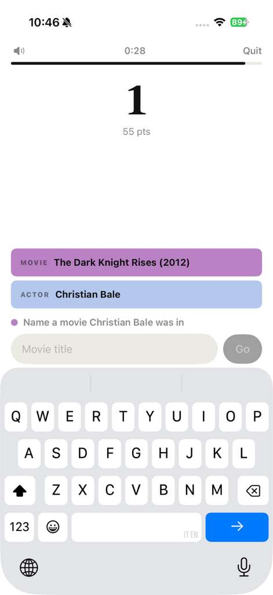
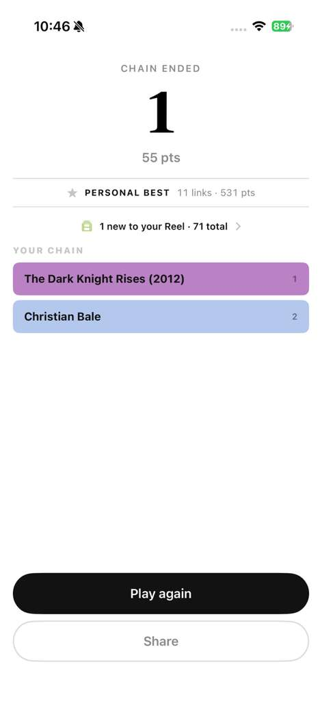
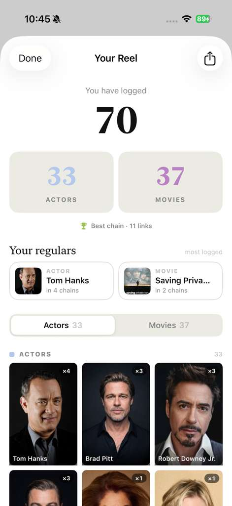
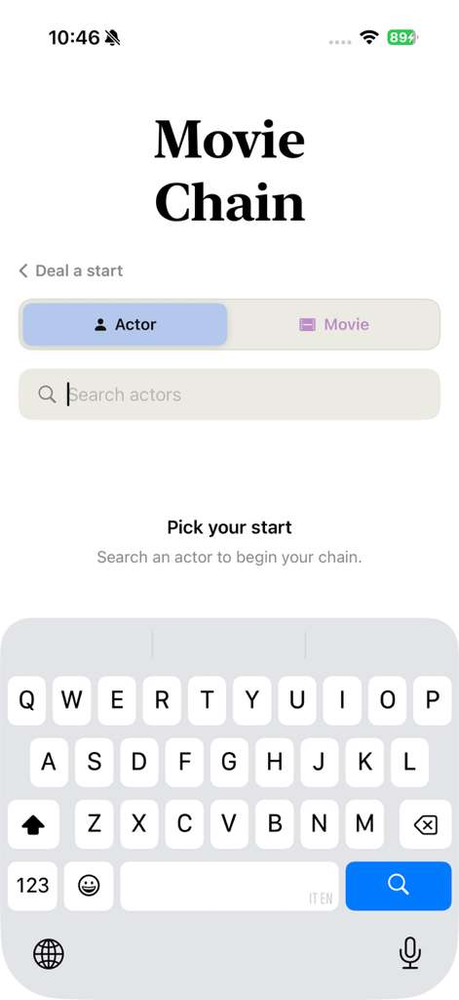

## Photo record: past builds (July & August 2026)

The filenames carry the capture date and time (local Barcelona time, UTC+2 in summer). WhatsApp stripped EXIF, so there is no device model. All of these are **real-device captures**: iOS status bars, real keyboards, and screen-recording indicators. None come from the simulator. Pixel sizes: the July photos are 946×2048 (WhatsApp-recompressed screenshots), the Aug 29 photos are 471×1024 (re-forwarded, smaller), and the videos are 576×1248.

**Versioning note:** versioning started at **0.4.0 on 2026-07-25** (`94153f8`). The CHANGELOG folds everything before that ("19 commits, 2026-07-09 → 2026-07-25") into the 0.4.0 entry; it does not split it into 0.1 to 0.3. So the July batches are labelled **pre-0.4.0** (that work is recorded under 0.4.0).

**Main finding:** **three of the four batches show uncommitted work-in-progress, hours or days before the commit that landed it.** Abraham was sharing builds from his phone ahead of committing. The screen text proves this: strings and layouts that only exist in a *later* commit.

### Mapping table

| File(s) | Captured (local) | Commit SHA | Version | Confidence + evidence |
|---|---|---|---|---|
| `PHOTO-2026-07-11-01-47-41/42/42-2` | 07-11 01:45–01:47 (status bar 1:45/1:46) | **WIP between `c057968` (00:57) and `dabe62e` (13:12)** | pre-0.4.0 | High. At `c057968` the home is `"MOVIE CHAIN"` in **heavy rounded** type, a 🔗 glyph lockup, an orange trophy "Best chain N" badge, and a radial-heat background. The photo instead has a **serif** "Movie Chain", blue/purple squares, and a "Your best · 13 links" pill, all of which belong to the NYT reskin. But its tagline ("Link actors and movies. How long can your chain run?"), its pill-style Actors/Movies toggle and its "2 links · 108 pts" header row are in **neither** commit. This is an early iteration of the NYT redesign. Game-over strings ("TIME'S UP", "You were one away", BEST CHAIN / BEST PTS) do exist at `c057968`. |
| `PHOTO-2026-07-11-15-29-30`, `-30-2`, `-30-4` | sent 07-11 15:29, but status bar reads **1:45/1:46** | same as above (re-sent 01:47 screenshots) | pre-0.4.0 | High. Visually the same as the 01:47 batch (not byte-identical, because WhatsApp re-encoded them). Treat as duplicates. |
| `PHOTO-2026-07-11-15-29-30-3`, `-31`, `-31-2…-31-7` | 07-11 15:27–15:28 (status bar 3:27/3:28) | **`dabe62e` (13:12) + uncommitted Reel WIP**, committed later as `a99333e` (16:13) | pre-0.4.0 | High. The home copy "Actor → movie → actor. How long can you keep the chain alive?", "Your best · N links", the big Actor/Movie tiles ("start with a name / title") and the centred serif score hero all match `dabe62e` `SeedView`/`GameView`. A **"Your Reel · 11" pill and a whole Reel sheet are on screen ~45 min before `a99333e` was committed**. The Reel differs from what was committed: the hero reads "LOOK HOW MANY YOU KNOW / 13 logged" (committed: "You have logged"), there's a stats strip "4 CHAINS · 36 LONGEST · +13 THIS WEEK", and the filter has **All / Actors / Movies** (committed: Actors/Movies; no "LONGEST"/"THIS WEEK" strings exist in any committed `CollectionView`). |
| `VIDEO-2026-07-13-16-29-22.mp4`, `VIDEO-2026-07-13-16-30-03.mp4`, `PHOTO-2026-07-13-16-30-03` | 07-13 16:27–16:30 (status bar 4:27/4:28) | **WIP of `439c2e3` ("deal a start", committed 07-16 16:54)**, on top of `af4ca14`/`0a74c5e` | pre-0.4.0 | High. The home shows a "START WITH ⟨name⟩" card, "Shuffle", and "or search for your own start". `git grep` finds none of these strings at `af4ca14`; they first appear in `439c2e3`, **three days later**. The committed `af4ca14` home is a hero + live-search with a "Your best" pill, which isn't on screen. The Reel ("You have logged 27", Actors/Movies tabs, "🏆 Best chain · 5 links") matches committed `CollectionView`. |
| `PHOTO-2026-08-29-10-47-34` ×6, `VIDEO-2026-08-29-10-50-04.mp4` | 08-29 10:45–10:50 | **`6ce9429`** (0.4.0 tag `94153f8` + iOS 18 target; later commits to 08-08 are docs/skills only) | **0.4.0** | High. The committed build, not a design exploration. Gear button top-left (Settings, from `3af5d28`/kept in `94153f8`), "START WITH" card, Shuffle, "or search for your own start", "‹ Deal a start" search view, "CHAIN ENDED" / "PERSONAL BEST" game-over, and the Reel. All of these strings are in `94153f8`. It is in **light mode** (warm paper + ink), the light variant of the NYT palette. Neither Cream Neobrutalist (10-21) nor any `DESIGN-BRIEF.md` work (first committed 10-21 in `f812f1b`) is visible. |

---

### Batch 1: 2026-07-11, 01:45–01:47: NYT reskin, first iteration (pre-0.4.0)

This is the night of the gamification commit (`c057968`, 00:57). The phone is already running a **dark-mode, serif, blue/purple** build that isn't committed yet. Mid-reskin (inferred): the 13:12 `dabe62e` commit message describes the finished version of this look ("paper-warm neutrals, near-black ink, blue = actor, purple = movie, a serif wordmark + system sans, no flame/confetti/radial-heat").

![Play screen, 01:46. A speaker icon and Quit, a slim white linear timer bar (the TimerBar that replaced the ring), "2 links · 108 pts" left and "0:15" right. The chain is drawn as full-width flat category tiles (ACTOR Tom Cruise / MOVIE Magnolia (1999) / ACTOR Philip Seymour Hoffman), periwinkle for actors and orchid for movies, the "Connections" look. Prompt "Name a movie Philip Seymour Hoffman was in", input docked above the always-up dark keyboard, grey "Go". There's no centred score hero yet; dabe62e added it.](media/past-builds/PHOTO-2026-07-11-01-47-42.jpg)

### Batch 2: 2026-07-11, 15:27–15:28: `dabe62e` look + Your Reel before it was committed (pre-0.4.0)

Captured on the same phone (now on 5G) about two hours after the NYT redesign commit and about 45 minutes **before** "Add Your Reel collection" (`a99333e`, 16:13). Three files in this batch (`-30`, `-30-2`, `-30-4`) are re-sends of the 01:45 screenshots and are not new captures.

### Batch 3: 2026-07-13, 16:27–16:30: the "deal a start" home three days early (pre-0.4.0)

This was captured after `af4ca14` (11:50, "hero+live-search home") and `0a74c5e` (12:00 docs). The home on screen is **not** `af4ca14`'s; it is the play-first **dealt start** that was only committed on **07-16** as `439c2e3`. Both videos are on-device screen recordings (red record pill, then 4:27). The Reel shows 27 logged and "Best chain · 5 links", much lower than the 36-link best two days earlier. That suggests a reinstall or wiped data, or possibly another phone (inferred). The battery is at 12–13%.

[▶ VIDEO-2026-07-13-16-29-22.mp4](media/past-builds/VIDEO-2026-07-13-16-29-22.mp4) (9.4 s): tapping **Shuffle** repeatedly deals The Hunger Games → The Dark Knight → Gary Sinise → Brett Cullen → Jessica Chastain → Inception.

[▶ VIDEO-2026-07-13-16-30-03.mp4](media/past-builds/VIDEO-2026-07-13-16-30-03.mp4) (7.4 s): scrolling the Reel sheet and switching Actors/Movies.

### Batch 4: 2026-08-29, 10:45–10:50: the 0.4.0 build in light mode

There are no commits that day. The last code commit was `6ce9429` (07-25, iOS 18 target) and the last commit overall `c2a2d90` (08-08, skills). What's on screen is the **committed 0.4.0 build**, not a design exploration: every string is in `94153f8`, and nothing of Cream Neobrutalist or the 10-21 `DESIGN-BRIEF.md` appears. This is a month-long pause between 0.4.0 and the 0.5.0 overhaul, and the app was being played (Reel at 70 → 78 logged).

Possibly someone else's phone (inferred). The keyboard is **Italian + English** ("IT EN"), the phone has a Dynamic Island, and it runs in **light mode**, whereas the July phone showed "EN" only and dark mode. The Reel stats (Tom Hanks / Brad Pitt regulars, best 11 links) also differ from Abraham's July numbers. On the other hand, a light-mode switch plus an added keyboard on the same phone would also explain it. The app-switcher label reads "movie-quiz", so it's a dev install, not TestFlight under a product name (inferred).

[▶ VIDEO-2026-08-29-10-50-04.mp4](media/past-builds/VIDEO-2026-08-29-10-50-04.mp4) (78 s): an on-device screen recording (red dot in the Dynamic Island), roughly 10:48–10:49 on the clock. It starts in the iOS app switcher on the "movie-quiz" card, plays two runs, opens search and the Reel, and ends in Control Center to stop the recording.

---

### Visual evolution notes (for a "how it looked then vs now" post)

- **Wordmark:** at `c057968` (07-11 00:57) it was "MOVIE CHAIN" in heavy rounded caps with a 🔗 glyph lockup. By 01:45 the phone showed a serif "Movie Chain" with a blue→purple two-square lockup. In dabe62e the lockup grew into a 4-tile mini-chain plus a dashed "?" slot. On 10-22 it became the "unspool" wordmark with blue/yellow circles (Claude Design export, below).
- **Palette:** pre-NYT used system colours with an orange trophy and a radial-heat background. From 07-11 it was the NYT/Connections palette: periwinkle = actor, orchid/purple = movie, near-black canvas in dark mode, paper white in light mode (Aug 29). From 0.5.0 (10-22) it is Cream Neobrutalist: cream canvas, ink borders, hard shadows, coral primary, and **movie yellow replaced purple**.
- **Home concept:** five homes in about three and a half months.
  1. Search-first with a pill toggle (07-11 01:45).
  2. Big Actor/Movie category tiles plus search (`dabe62e`, 07-11).
  3. A hero plus live search with a compact toggle (`af4ca14`, 07-13 commit; not photographed).
  4. A dealt "START WITH ⟨name⟩" card with Shuffle and search demoted to a link (WIP on 07-13, committed 07-16, shipped as 0.4.0).
  5. "The sentence": "⟨name⟩ *was in* / a movie…", where the blank itself is the start button (10-22 Claude Design export → `ca813f6`).
- **"Your best":** a pill on the home in July. It moved into the Reel ("Best chain · N links") with the deal-a-start home, and came back as a "BEST RUN 13 links" footer line in the sentence design.
- **Chain rendering:** flat full-width category tiles ("ACTOR Tom Cruise") stacked upward from the docked input (ChainStack, July–0.4.0; the overlap is visible mid-drop in the Aug video). Game over used the same tiles, numbered. In 0.5.x it became the physical **Deck** (cards with art, a pile peeking above) and compact cards in the recap.
- **Score:** "2 links · 108 pts" in a header row (01:45 WIP), then a big centred serif number hero (dabe62e onward). The serif numeral survived into the Cream Neobrutalist type system.
- **Timer:** a circular ring (`TimerRing`, until c057968), replaced by a slim linear bar (white in dark mode, black in light mode). The bar persists today (`TimerBar.swift`).
- **Reel:** first seen 45 min before its commit, with a richer stats strip (chains / longest / this week) and an All tab that were cut before commit. It stayed a stats + regulars + poster/headshot grid (×N badges, NEW badges) through 0.4.0. In 0.5.2 it became playing cards (actors) and framed posters (movies) with paper/inked/holo tiers, no numbers on the fronts.
- **Settings:** no gear in July. A gear top-left appears with the (later removed) Assisted mode work and stays in 0.4.0 (Aug 29). Now a gear pill sits beside the Reel pill, top-right.
- **Devices:** July captures are from Abraham's phone (EN keyboard, dark mode, home indicator). Aug 29 is a Dynamic Island phone in light mode with an IT/EN keyboard, possibly a tester's (inferred).

### Evening of 2026-10-22: external items

![The sentence · home: a Claude Design export (saved 22:36) titled "The sentence · home (try it: tap the blank, type, press Go)". Cream canvas, "unspool" lowercase serif wordmark with a blue+yellow double-o, a Reel pill "62" and a round gear button with ink borders. An actor avatar in an ink ring plus a blue "ACTOR" chip, the huge serif "Chris Hemsworth", italic grey "was in", a blank "a movie…" on an ink underline with a coral square → button, "⤨ Someone else" and "🔍 Pick your own" beneath, and a footer "BEST RUN 13 *links* · tap the blank to start". This is the design that `ca813f6` (23:00, "Make the home the first turn: a sentence that hands off into play") built 24 minutes later. In the build the shuffle/search labels became "Deal again" / "Pick your own" per CLAUDE.md.](media/external/The-sentence-home@2x.png)

*(Three other files dropped in at the same time — IMG_1926, IMG_1927, 347.jpg — were unrelated personal screenshots and have been removed from the diary.)*

### Media index

- `media/past-builds/PHOTO-2026-07-11-01-47-41.jpg`: 07-11 01:45, home, NYT reskin first iteration (WIP before dabe62e), dark.
- `media/past-builds/PHOTO-2026-07-11-01-47-42.jpg`: 07-11 01:46, play screen, 2 links / 108 pts, Tom Cruise → Magnolia → PSH.
- `media/past-builds/PHOTO-2026-07-11-01-47-42-2.jpg`: 07-11 01:46, game over "TIME'S UP 2", near-miss The Big Lebowski.
- `media/past-builds/PHOTO-2026-07-11-15-29-30.jpg`: duplicate (re-send) of the 01:45 home.
- `media/past-builds/PHOTO-2026-07-11-15-29-30-2.jpg`: duplicate (re-send) of the 01:46 game over.
- `media/past-builds/PHOTO-2026-07-11-15-29-30-4.jpg`: duplicate (re-send) of the 01:46 play screen.
- `media/past-builds/PHOTO-2026-07-11-15-29-30-3.jpg`: 07-11 15:21, dabe62e home, Movie tile selected, "Search an movie" copy bug, Reel pill (WIP).
- `media/past-builds/PHOTO-2026-07-11-15-29-31-7.jpg`: 07-11 15:27, dabe62e home, Actor tile selected, best 36, Reel · 11.
- `media/past-builds/PHOTO-2026-07-11-15-29-31-6.jpg`: 07-11 15:27, play turn 0, serif score hero, Tom Cruise seed.
- `media/past-builds/PHOTO-2026-07-11-15-29-31.jpg`: 07-11 15:28, play at 3 links (MI:III, PSH, Happiness).
- `media/past-builds/PHOTO-2026-07-11-15-29-31-2.jpg`: 07-11 15:28, game over "CHAIN ENDED 3", "2 new to your Reel".
- `media/past-builds/PHOTO-2026-07-11-15-29-31-5.jpg`: 07-11 15:28, Reel WIP top: "13 logged", stats strip, All tab.
- `media/past-builds/PHOTO-2026-07-11-15-29-31-4.jpg`: 07-11 15:28, Reel WIP, Actors grid.
- `media/past-builds/PHOTO-2026-07-11-15-29-31-3.jpg`: 07-11 15:28, Reel WIP, Movies poster grid with NEW badges.
- `media/past-builds/VIDEO-2026-07-13-16-29-22.mp4`: 07-13 16:27, 9.4 s, Shuffle cycling dealt starts (439c2e3 WIP).
- `media/past-builds/VIDEO-2026-07-13-16-30-03.mp4`: 07-13 16:28, 7.4 s, scrolling the Reel (27 logged).
- `media/past-builds/PHOTO-2026-07-13-16-30-03.jpg`: 07-13 16:28, Reel Movies tab, 27 logged, best chain 5.
- `media/past-builds/PHOTO-2026-08-29-10-47-34.jpg`: 08-29 10:45, 0.4.0 light home, START WITH Bob Gunton.
- `media/past-builds/PHOTO-2026-08-29-10-47-34-5.jpg`: 08-29 10:45, home, START WITH The Dark Knight Rises.
- `media/past-builds/PHOTO-2026-08-29-10-47-34-2.jpg`: 08-29 10:45, Reel, 70 logged, best 11 links.
- `media/past-builds/PHOTO-2026-08-29-10-47-34-3.jpg`: 08-29 10:46, play, TDKR → Christian Bale, IT EN keyboard.
- `media/past-builds/PHOTO-2026-08-29-10-47-34-4.jpg`: 08-29 10:46, game over "CHAIN ENDED 1", 71 total.
- `media/past-builds/PHOTO-2026-08-29-10-47-34-6.jpg`: 08-29 10:46, "Deal a start" search view.
- `media/past-builds/VIDEO-2026-08-29-10-50-04.mp4`: 08-29 ~10:48–10:49, 78 s screen recording of 0.4.0: two runs, search, Reel.
- `media/past-builds/frames/v0713a-01.jpg`: frame ~0 s of the 07-13 deal video, START WITH The Hunger Games.
- `media/past-builds/frames/v0713a-03.jpg`: frame ~3 s, START WITH Gary Sinise.
- `media/past-builds/frames/v0713b-01.jpg`: frame ~0 s of the 07-13 Reel video, Reel top (27 logged).
- `media/past-builds/frames/v0713b-03.jpg`: frame ~3 s, scrolled actor grid.
- `media/past-builds/frames/v0829-01.jpg`: ~0 s, app switcher with the "movie-quiz" card.
- `media/past-builds/frames/v0829-02.jpg`: ~5 s, fresh deal on resume (Gina Carano).
- `media/past-builds/frames/v0829-05.jpg`: ~20 s, "+56" floating gain, tiles mid-drop.
- `media/past-builds/frames/v0829-06.jpg`: ~25 s, 3 links, Up in the Air.
- `media/past-builds/frames/v0829-08.jpg`: ~35 s, search "M" → "No matches".
- `media/past-builds/frames/v0829-10.jpg`: ~45 s, Mohanlal → Thudakkam (2026), typing Vismaya.
- `media/past-builds/frames/v0829-11.jpg`: ~50 s, game over 2 links, 78 total.
- `media/past-builds/frames/v0829-12.jpg`: ~55 s, Reel 78 logged, Movies tab.
- `media/past-builds/frames/v0829-13.jpg`: ~60 s, actor grid with silhouette placeholders.
- `media/external/The-sentence-home@2x.png`: 10-22 22:36, Claude Design export "The sentence · home", the model for ca813f6.
