## Era: The design overhaul — 0.5.0 (2026-10-21 → 10-22 morning)

**Arc.** Two short sittings, about 2.5 hours of active work in total. On the evening of Tue 21 Oct, Abraham committed a roadmap re-cut that had sat uncommitted since 8 Aug. He then pasted three design specs from sleek.design. Claude recommended **Cream Neobrutalist**, and the palette, the bordered components and a card-style chain were built and pushed on a branch within about 10 minutes. Two typography passes followed: the first removed leftover styles, the second set every number in the serif. The next morning (Wed 22, 09:44–11:37 local) was a run of fast critique loops driven by Abraham's screenshots: bundle Fraunces, close the gaps with the spec, slim the Reel, rebalance the home screen, give game over a single card, fix the chain/link vocabulary, decide what "best" means, and prototype four "new record" cues before choosing one. It ended with **0.5.0 cut, PR #1 merged and `v0.5.0` tagged** at 11:37. Abraham's closing line: *"i think this is a decent visual overhaul, i'll address animatinos next"*. That next step became 0.5.1, the motion re-tune.

Session: `dd18d4e5`, 2026-10-21 17:18 UTC → 2026-10-22 09:37 UTC. All times below are local Barcelona time (UTC+2). There is an overnight gap from 19:49 to 09:44. A side session, `90b26be6`, installed the emilkowalski skills at 10:36 and listed them at 11:32.

Branch: `feature_cream-neobrutalist` (13 commits) → PR https://github.com/abematt/movie-chain/pull/1.

---

### 2026-10-21 ~19:18 — "we've been working on this for a while": committing the roadmap re-cut
- Abraham opened with *"we've been working on this for a while"*. Claude found a large docs re-cut that had sat uncommitted since 2026-08-08, more than two months:
  - a new ROADMAP: 0.5.0 foundations → 0.6.0 design overhaul → 0.7.0 "The service" (TMDB proxy) → 0.8.0 accounts → 0.9.0 Daily Chain → 0.10.0 friend groups → 1.0.0 launch;
  - new `docs/DAILY-CHAIN.md`, a spec for "longest route A→B", marked *not playtested, not built*;
  - new `docs/DESIGN-BRIEF.md`, a 159-line *look-agnostic* brief written "for Figma / a fresh redesign". It "deliberately says nothing about palette, type, shape language, the chain treatment, or motion — those are the open questions the redesign is meant to answer."
- Claude flagged stale versioning text in CLAUDE.md. It still said design overhaul = 0.5.0, and it linked to an anchor that no longer existed. Its point: "Any agent that reads that section first would pick the wrong version bump."
- Abraham switched the model to Opus (`/model opus`) and replied *"yes fix the stale stuff and recut yes"*. Claude fixed the anchors: the 0.7.0 "Backend I" heading had been renamed "The service". It also updated the version numbers and the leaderboard references, and a link checker reported 0 broken anchors.
- **Decisions:** global leaderboards are dropped and friend groups replace them; Pass & Play moves after 1.0; share images ship at 1.0.0. These were all in the re-cut being committed.
- Commit **f812f1b** (19:20): "Docs: re-cut the roadmap to 1.0 and add the Daily Chain spec", 7 files, +801/−270. Pushed to main at Abraham's request (*"go ahead and push commit"*).
- Small loose end: GROWTH.md still said "no git remote". Claude flagged it twice and fixed it only at the 0.5.0 cut.

### ~19:21 — Three design references, and the pick
- Abraham pasted three sleek.design DESIGN.md links: **Cream Neobrutalist**, **Soft Trophy** and **Parchment Brutalist Editorial**. He asked *"what do you think, first of all can you access them"*.
- Claude fetched all three with WebFetch. It noted that the tool returns a *summary*, not the raw file, though the hex values and tokens came through. It then checked them against the roadmap's design-overhaul constraints.
- **Decision: build on Cream Neobrutalist, borrow a few moves from Parchment, drop Soft Trophy.**
  - Cream fits because:
    - its cream background is close to the existing warm-paper look ("the app growing up, not a different app");
    - its 5 category colours leave a slot each for actor and movie;
    - white cards with ink borders and offset shadows read as a physical pile, which suits the cards idea for the chain;
    - thin borders and 44pt controls are compact, and room above the keyboard is the binding constraint;
    - the press effect (shift down 1px, shadow collapses) is cheap in SwiftUI.
  - Parchment was rejected as the base because:
    - it has no right/wrong colours;
    - it allows only one accent (chartreuse), which leaves no way to tell actor from movie;
    - its thick borders and 72pt display type cost the vertical room the play screen doesn't have.
  - Parchment moves worth borrowing: an italic last word in the wordmark, "one loud thing per screen", hazard stripes for low time, grayscale posters with only the newest in colour.
  - Soft Trophy was rejected because it needs 3D clay art, uses glass surfaces and 64pt buttons, and is the wrong register. One idea was kept: gold for rare items in the Reel.
- Problems flagged for every option: all three specs are light-only (dark neobrutalism is hard because black borders vanish), and the fonts (Fraunces, Inter) would need bundling.
- Abraham: *"Alright lets do it"*.

### ~19:23–19:32 — Prototype: palette, neoSurface, card chain
- New branch `feature_cream-neobrutalist`. Claude:
  - wrote the palette into the asset catalog with light and dark values;
  - added border, shadow and type tokens to `Theme.swift`;
  - added a shared `.neoSurface` modifier (2pt ink border plus hard shadow) in `Components.swift`, used by buttons, cards and inputs;
  - added a new `ChainCards.swift`: a hero card for the newest link with art and a serif name, two slim cards above it, and older links collapsed to "+N earlier".
- **Decision: movie moves from purple to yellow; actor stays blue.** Reason: blue/yellow is "the pairing that holds up best for colour-blind players".
- **Decision: dark mode is invented here, not taken from the spec.** Cream borders on warm charcoal.
- **Decision: keep the old tile stack behind a Settings "Chain style" switch (Cards/Tiles).** The roadmap says chain treatments get judged on a device.
- Gotchas:
  - The asset name "Primary" clashed with SwiftUI's generated `Color.primary` symbol ("resolves to a conflicting Color symbol"), so it was renamed **Coral**.
  - Two simulators were both named "iPhone 16", so builds had to target one by UDID.
  - Scripting the keyboard toggle failed: "osascript is not allowed to send keystrokes". So the fit above the keyboard was "measured, not seen" (about 8pt to spare on an iPhone 16; Claude predicted "+N earlier" would clip on an SE).
- Known rough edges Claude listed honestly:
  - dark-mode shadows are faint;
  - the home start button is ink on an ink shadow, so it "looks lopsided";
  - the type is a stand-in (system New York, not Fraunces);
  - the share card still uses 🟦🟪 emoji.
- Commit **871ea38** (19:32), 23 files, +783/−305. Pushed.
- (The screenshots from this step, play-light/dark and play-kb1–4, were overwritten or deleted in the scratchpad and are not in media.)

### ~19:35 — "the typography doesn't agree anymore"
- Abraham pasted 2 screenshots from a real game on the 871ea38 prototype and wrote: *"i think the typography doesn't agree anymore , there's a bunch of that stuff leftover from our previous design, can you first identify what they are and then we can discuss"*.

- Claude found six kinds of leftover:
  1. five different uppercase-label recipes (TIME'S UP / PERSONAL BEST / YOUR CHAIN / buttons, each with its own size, tracking and colour), plus two more on home and settings;
  2. "pts" styled two ways;
  3. no body token: 5 sizes and 3 weights across 2 screens;
  4. a game-over recap still drawn as old full-colour bars, so "the same chain looks like two different objects a second apart";
  5. movie years shown three ways;
  6. leftover hairlines, a borderless green "a new best" pill, and a plain grey top bar.
- It raised four questions: one label style or two, how years look, whether the recap reuses the play cards, and fixed spec sizes versus Dynamic Type.
- Abraham: *"Using now the design.md and refernece we discussed, overhaul those old ones that are still leftover and we can talk about pulling back"*. In other words, Claude makes the calls and they pull back afterwards.

### ~19:36–19:41 — One type system, three voices
- **Decisions (Claude's calls, listed for pull-back):**
  - three voices: a bold serif with an italic flourish word (the wordmark became "Movie *Chain*"), a sans body at two sizes, and **one** tracked uppercase label in place of seven;
  - years in italic everywhere ("The Departed *2006*" instead of parentheses);
  - the recap reuses the play-screen compact cards, so the chain is one object everywhere;
  - divider lines gone; personal best and Reel became two small cards side by side; the green pill got a border;
  - **text still scales with Dynamic Type.** Only the big numerals and the wordmark stay fixed. Following the spec's px sizes would silently turn scaling off.
- Places Claude offered for pulling back: too much italic, all-caps buttons, the unbordered top bar, the black start button.
- Commit **e94550e** (19:41) "Unify typography on the Cream Neobrutalist type system", 11 files.
- Abraham: *"can you rebuild it on the simulator?"*. Claude built into a scratch DerivedData folder and launched it.

### ~19:44 — "home screen's shuffle still has that sans serif"
- Abraham pasted 4 screenshots from a real run on the e94550e build (start: Ian Holm, ended at 0 links) and wrote: *"home screen's shuffle still has that sans serif type font doesn't it? as well as the points in the play screen / then game over screen's points as well, same for the reels page and its you have logged and number count"*.

- Claude: partly. The big "pts" were already serif, but the real clash was that **numbers inside cards were sans**. "0 pts" under the score was serif while "89 pts" in the card just below it was sans.
- Abraham: *"what is the specs split?"*. Claude laid out the spec: Fraunces for display, headlines, **card-numeral** and body-italic; Inter for body, labels, buttons and tab labels. It then admitted: "Keeping them sans was my misreading". The spec has a dedicated serif token for numbers inside cards.
- Abraham: *"okay follow the spec to get it consistent please, it looks weird now"*.
- **Decision:** a `Theme.Font.numeral` token puts every figure in the serif (timer, floating +N, card position, PB/Reel stats, home Reel count, Reel counts and chips). Buttons, labels and body stay sans. One deliberate exception: "+2 EARLIER" stays sans because it is a label.
- Commit **5f8b60a** (19:48). Rebuilt (*"alright rebuild right"*).

*(Overnight break, 19:49 → 09:44.)*

### 2026-10-22 ~09:44–09:58 — "according to you we are consistent with our design.md?" Fonts, and the iOS standard
- Abraham: *"Sorry can you biuild again, i closed the simulator"*, then *"Okay so according to you we are consistent with our design.md , colours, typoghraphy use?"*
- Claude: "No, not fully." Colours and structure matched; the type matched in roles but not in faces; and about a dozen small rules were broken:
  - secondary grey: iOS translucent instead of #6B7280;
  - red: system red instead of #EF4444;
  - no pressed coral #D4512F;
  - numbers above the spec's 30 size ceiling (wordmark 46, score 60/72, Reel total 64);
  - one label size instead of two;
  - body text 15 instead of 14;
  - 1.5pt borders in places;
  - timer bar 10pt bordered instead of 6pt;
  - press moves 2–4px instead of 1px;
  - stock iOS nav bars and segmented picker;
  - SF Symbols instead of Phosphor;
  - 16pt gutter instead of 24.
- Abraham quoted the line about fonts back: *"Bundling Fraunces and Inter. Both are free fonts, but they add files to the app. Talk to me about this, whats the standard for an app like this on ios"*.
- Claude's answer: the usual pattern is **a custom display font for identity plus the system font for body**. NYT Games, Duolingo and Headspace all ship their own faces, and Apple's HIG allows it.
  - **Bundle Fraunces, skip Inter.** "SF already plays its role", and Inter adds files for almost no visible change.
  - Costs walked through: a few hundred KB; the SIL OFL (commercial use is fine, the licence text has to ship); custom fonts need tying to text styles for Dynamic Type; Bold Text is ignored; and ship the **full** character set, because names have accents.
- Abraham: *"okay lets do that and … sure lets keep that deviation and then go ahead and make those small token or style fixes"*.
- **Decisions:** Fraunces yes, Inter no (SF is the iOS-native counterpart); keep the big scores above the spec ceiling; keep Dynamic Type. Both size choices are deliberate deviations from the spec.

### ~09:59–10:04 — Bundling Fraunces and closing the spec gaps
- fontTools wasn't installed, so Claude made a throwaway venv in the scratchpad and pulled Fraunces' variable TTFs and OFL.txt from the google/fonts repo. It instanced them into **four static cuts**: FrauncesDisplay-Bold/Italic (72pt optical size) and FrauncesText-Bold/Italic (24pt optical size). Total about **320KB**, full glyph set.
- It checked the OFL for a Reserved Font Name and found none, so the static cuts can keep the Fraunces name.
- Settings got the credit: "Set in Fraunces by Undercase Type, used under the SIL Open Font License 1.1."
- Spec fixes in the same commit:
  - Muted, Danger and CoralPressed colours;
  - `sed` swap of `.secondary`/`.tertiary` to `Theme.Color.muted`;
  - 2pt borders everywhere (the dashed "?" tile included, no longer faded);
  - 1pt press;
  - 6pt timer bar with a grey track;
  - 24pt gutter;
  - two label sizes;
  - split headings ("Your *regulars*", "Pick your *start*");
  - cream nav bar with an ink rule on the sheets;
  - a bordered segmented control.
- Gotchas Claude surfaced:
  - Fraunces' bold **4 has a ball-topped shape**. It checked the glyph table: no alternate exists (only `four`, `four.superior`; features `case`, `liga`, `ss01`).
  - Fraunces has no tabular digits, so the score shifts width as it changes.
  - The game-over list now scrolls sooner.
- Commit **02f32d8** (10:03), 20 files, +492/−116.

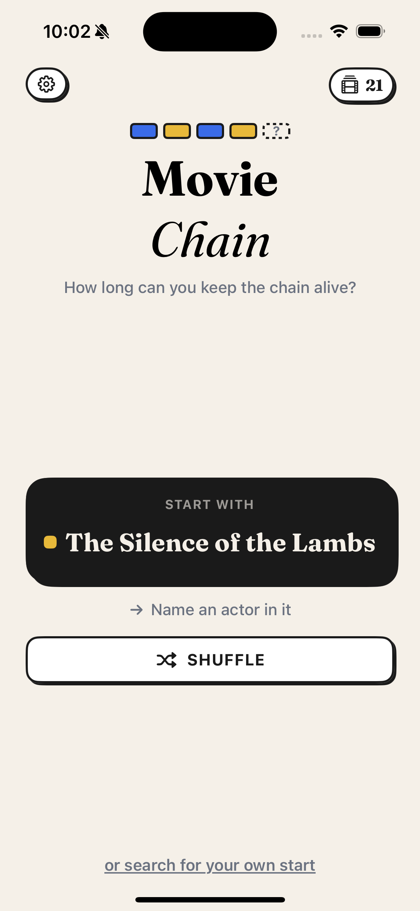
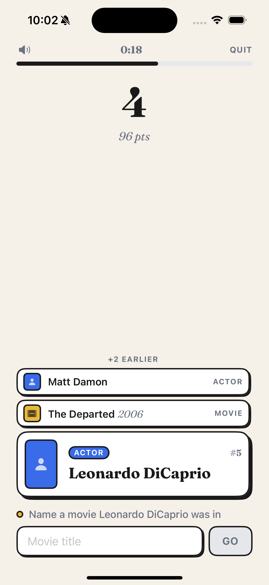
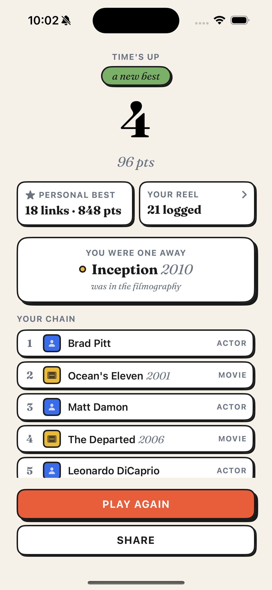

### ~10:06 — "here you go": checking the sheets Claude couldn't open
- Abraham pasted the Settings and Reel sheets, which Claude couldn't tap open in the simulator.

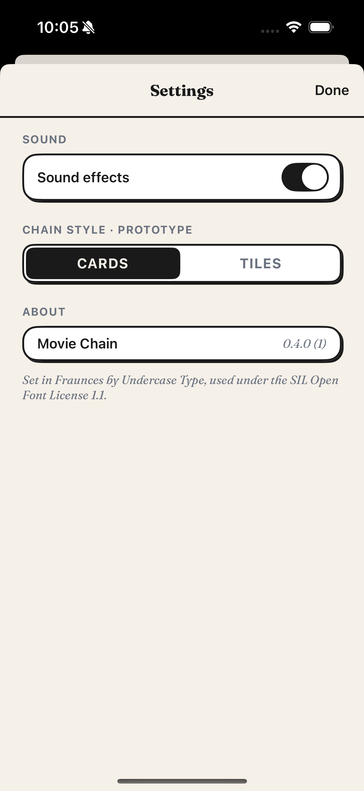
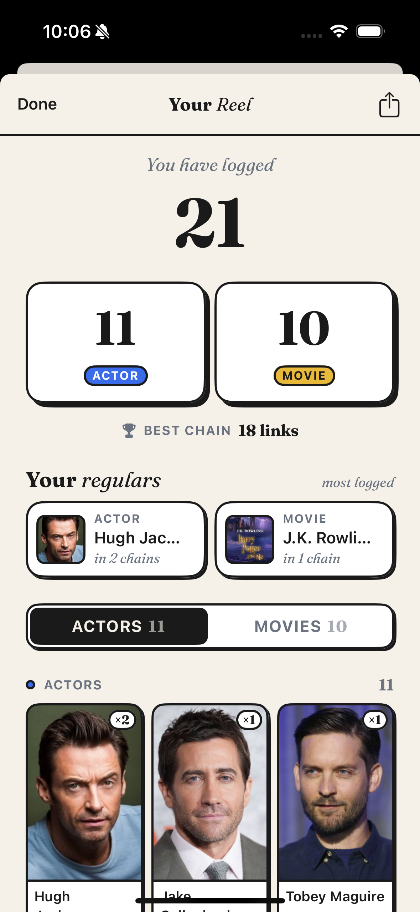

- Fix: let regulars names wrap to two lines. Commit **7f3e6b5** (10:06).
- Claude also noticed "J.K. Rowling's Harry Potter and Me" counts as a *movie*. It's a TV documentary that TMDB lists as a film, so it's a data quirk.

### ~10:10 — Reel notes: "There's too much on there"
- Abraham (verbatim, lightly joined): *"For the reel i have some notes , There's too much on there … we show the information of number of actors and number of movies thrice, then the your regulars is a good idea, but it again shows the information twice, Your regulars and most logged - saying the same thing / also the boxes don't stay the same size, ACtor hugh Jackman in 2 chains makes the box taller than Movie Brothers in 1 chain, so consistency problem there … in the grid the tab on top says actors 11 and right below it , actors 11"*

- **Decision: show each fact once.** The total stays as the hero; per-kind counts live only in the tabs (the count cards and grid header are gone); "most logged" is gone; both regulars cards take the taller card's height.
- Claude added a DEBUG `-uiOpenReel` launch argument "so I can screenshot it myself instead of relying on you".
- Commit **75f9ca3** (10:12), +28/−49.

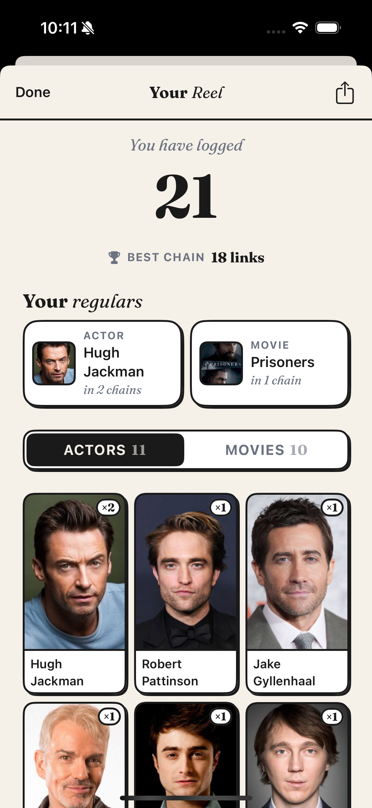

- Claude listed more things to trim and left them: Best chain is duplicated on game over, the ×N chips repeat the "in N chains" line, and the TMDB credit has to stay.

### ~10:13 — "CTA button should be front and center no?" The home rebalance
- Abraham: *"what do you think of the homescreen and its use of negative space, to me it looks a little lopsided, for example , CTA button should be front and center no?"*

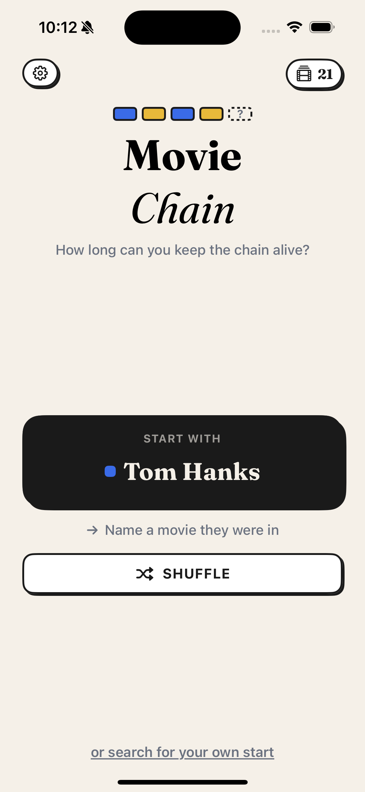

- Claude agreed it was lopsided but pushed back on dead centre. Three causes:
  1. two equal empty gaps make "three separate islands instead of one composition";
  2. the ink card on an ink shadow visibly reads as shifted 4pt right, "literal lopsidedness on the screen's most important element";
  3. no coral on the screen, so "nothing reads as the thing to press".
- On "front and center": horizontally yes. Vertically, the button belongs a little below centre where the thumb rests. It was already about 58% down; "it feels wrong because of the gaps around it, not its position."
- Abraham: *"sounds all good"*.
- **Decisions:** the start button goes coral (matching "Play again"); one control group with the hint under the button, then Shuffle, then the search link tucked under Shuffle; free space split **2:3** around the group; the title rests a little lower. The colour square next to the name gets an ink border so a yellow movie square still shows on coral.
- The intro animation uses the same 4 control slots, so it needed no rework.
- Gotcha: the intro flag's real key is `seedIntroPlayed`, and it lives in the app's sandbox container, not the global defaults domain. The intro still wouldn't replay in the sim (intro1/intro2 are identical, settled frames).
- Commit **b452695** (10:17).

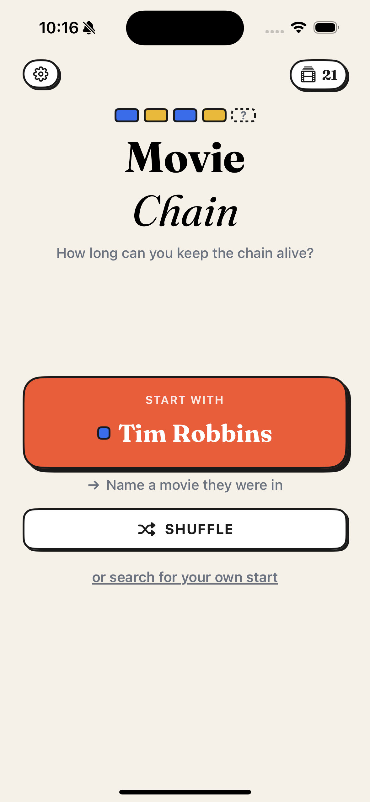
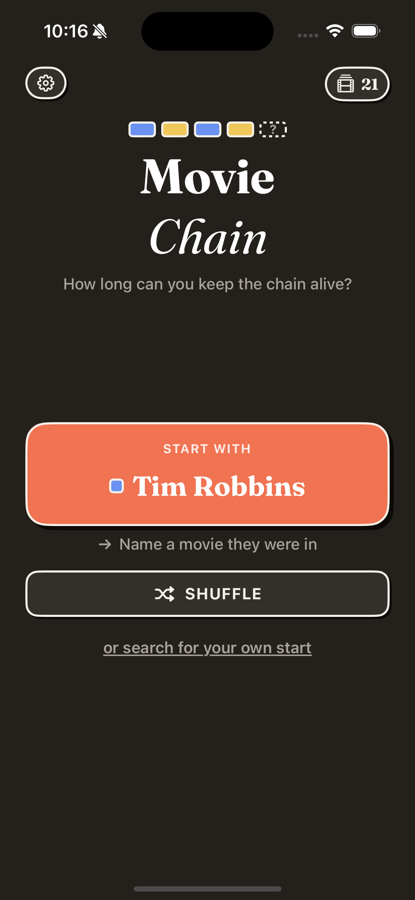
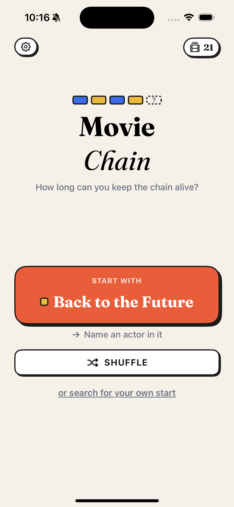
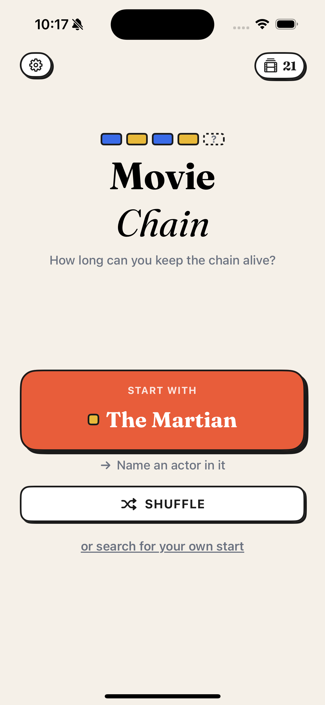

- Abraham: *"alright where are we on commits"*. Claude reported 7 commits ahead of main, all pushed. Gotcha: `gitstate movie-quiz` → "no repo matches" (this repo isn't tracked by gitstate).

### ~10:22 — Game over: "chain ended is kinda redudantant" + terminology
- Abraham: *"i think chain ended is kinda redudantant no, your reel should be on card that shows the information a a little concisely with the current chains number and points with more emphasis obviously on the current sessions link number and points, also we're a little all over the place with terminology, we use both links and chains in the same place, we need to make a call here / i think also showing personal best and points is good but should be a little de-emphasized there"*

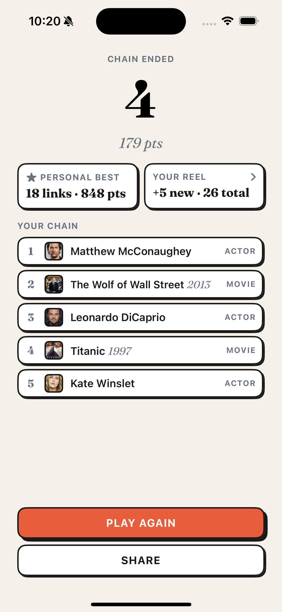

- **Decision (the vocabulary, made first because the layout depends on it):** a *chain* is one whole run; a *link* is one correct answer; the score counts links; **the dealt start isn't a link**. The recap marks the start with a 🏳 flag and numbers links from 1, so the last number equals the score. The play card reads "Link 4", or "Start" before the first answer.
- Claude checked the engine first: `score = chain.count - 1`, so the score really is the number of nodes after the start.
- **Decision:** one summary card. The hero is the link count with "links · N pts"; below a rule sit Best and Reel in small muted type; the Best cell is hidden on a new best ("it would only repeat this run"). The "Time's up"/"Chain ended" label is gone.
- Commit **96e3960** (10:24).

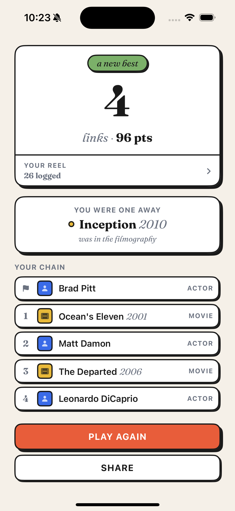
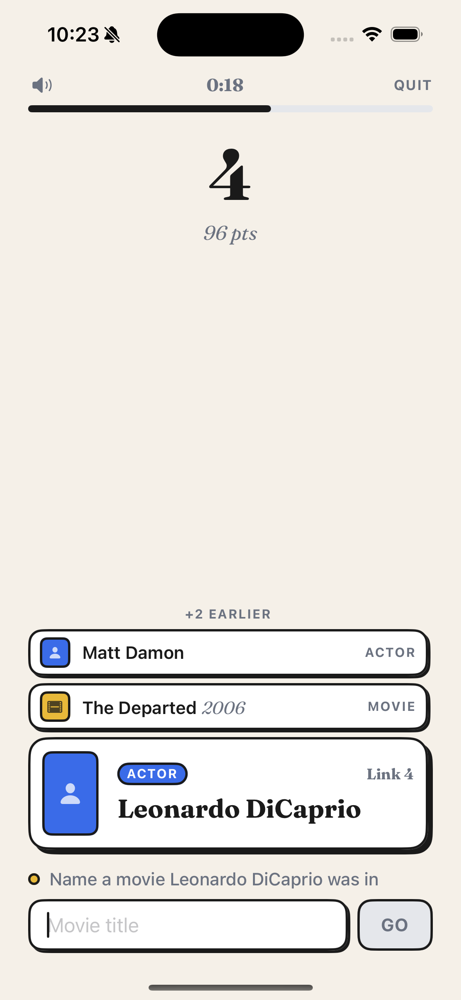
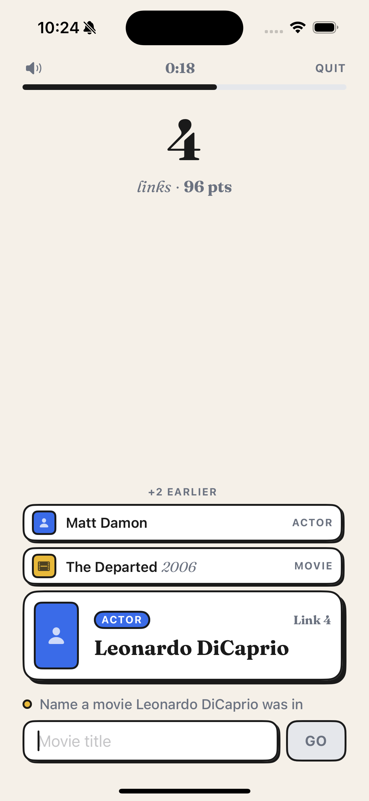

### ~10:29 — "as if links is some important thing on its own"
- Abraham: *"okay here i gueess main thing i'd say is the word links looks out of place , i just read / 2 / links / 89pts / as if links is some important thing on its own / do we have any styling for when the current score is higher than best, like does anything signify that"*

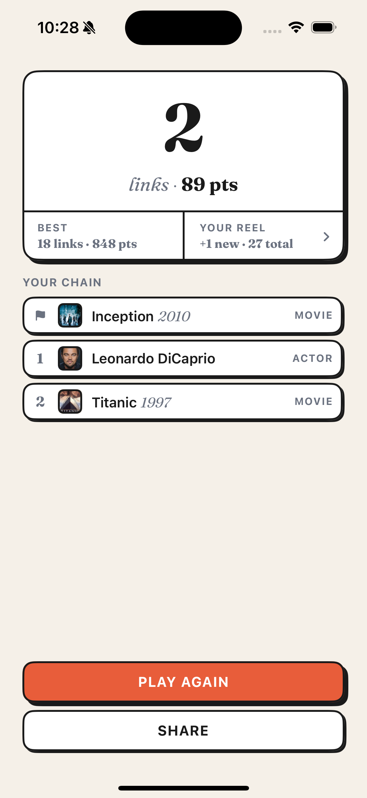

- Fix: "links" sits beside the numeral on the **same baseline** ("4 *links*"), with points on their own line. The floating "+N" moves to the end of the whole figure so it clears the unit. Commit **8238a1e** (10:31).

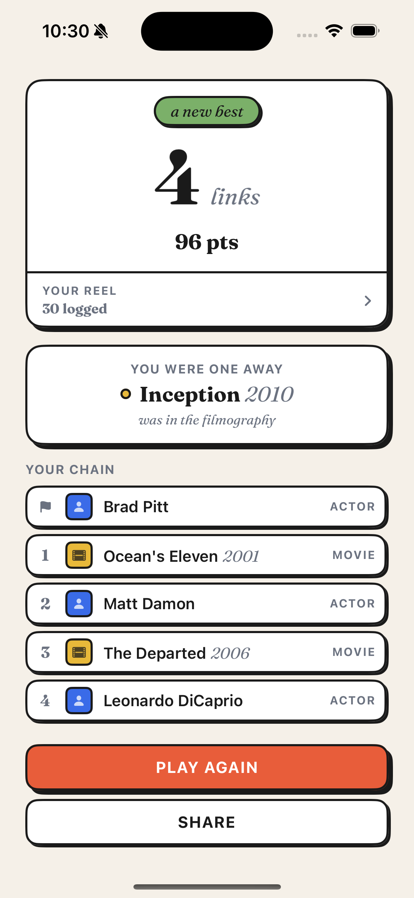
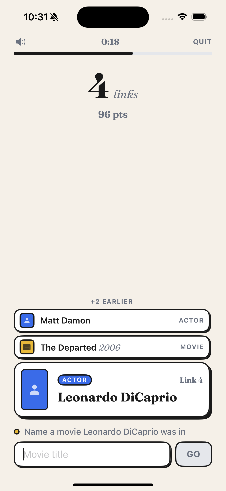

- On his question, Claude explained the existing new-best treatment (green pill, Best cell hidden, a one-shot bounce plus celebrate haptic, *only on game over, only for links*) and named three gaps:
  1. nothing happens *during* play;
  2. a points record is saved silently;
  3. **the Best line can mix two runs**: "18 links · 848 pts" pairs the best link count with the best points total, which may come from different games.

### ~10:34 — "we haven't agreed on what consitutes best right"
- Abraham: *"lets do that"* (the in-play cue). On the other two: *"this just means we haven't agreed on what consitutes best right, is it links, is it points, is it some combination?"*
- The first in-play cue: on the link that passes the record, a green "a new best" pill under the score, the celebrate haptic, and a brighter **two-note chime**. It fires once per run and never on a first game (`Scoring.passesRecord`, 2 tests); VoiceOver announces it; Reduce Motion fades instead of popping. Commit **52c382e** (10:36), with a DEBUG `-uiDemoRecordCue`.

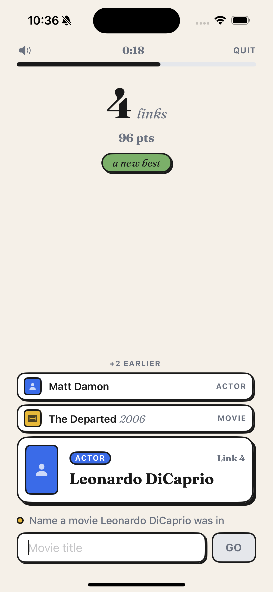

- Claude's recommendation on "best": **one record, the most links, with points breaking ties.** Links are already the big number everywhere, and the Daily Chain spec already ranks by links. The cost: points-only records go away. Existing saves keep both numbers until the next record overwrites them as a pair.
- (Side session `90b26be6`, 10:36: Abraham ran `npx skills add emilkowalski/skill`. It installed 15 skills into `.agents/skills/`, symlinked from `.claude/skills/`, and replaced 3 skills the repo already tracked (animation-vocabulary, apple-design, find-animation-opportunities) with newer differing versions. These changes were left uncommitted through the 0.5.0 cut. At 11:32 he asked "what are the skills we installed", and Claude grouped them by usefulness for SwiftUI: write-swift, emil-design-eng, review-animations, break-ui and apple-design are directly useful; animate-expo, ask-sonner and others are mostly irrelevant. This set up the "animations next" work.)

### ~10:38 — Record rule decided; four cue options
- Abraham: *"I didn't like the new best pill though, looks incomplete, show me some options and we'll decide on one together / yeah agreed -> chains is always record with points serving as tie breaker"*
- **Decision: the record is the most links; points break ties** (`Scoring.isNewRecord`, 4 tests). `bestChain` and `bestPoints` are now written together, so the Best line is always one run. Points-only records no longer exist. The roadmap's open friend-groups question ("links, points, or both?") was struck through as **"Decided 2026-10-22: links, with points breaking a tie"**.
- Claude built four cue prototypes, switchable in Settings ("Record cue · prototype") and via `-uiDemoRecordCue <style>`. It opened the screenshots in Preview on Abraham's Mac. Banner and card needed a second render pass to look right.

| Option | Look | Lasts |
|---|---|---|
| Banner | full-width green card: "NEW BEST · *Past your 18-link record*" | ~2 s |
| Stamp | tilted green "NEW BEST" stamp on the score's corner | rest of run |
| Score | score turns green, "96 pts · *new best*" | rest of run |
| Card | green "NEW BEST" chip on the newest card in place of "Link 4" | until next answer |

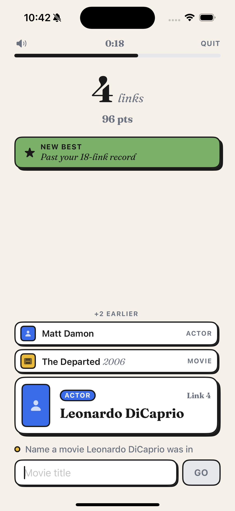
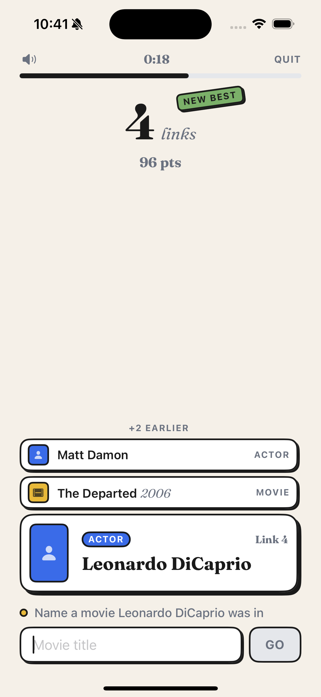
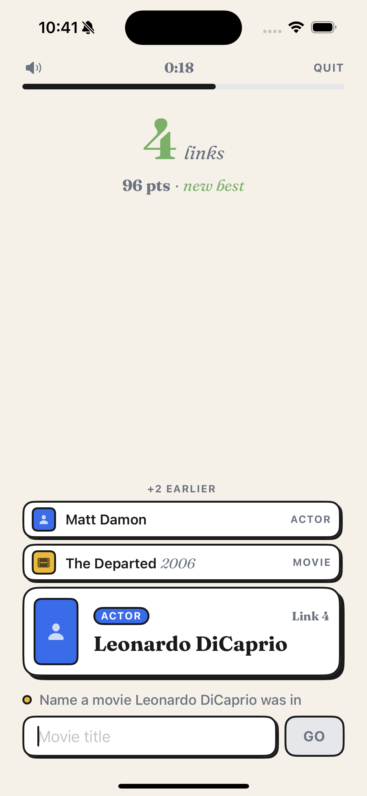
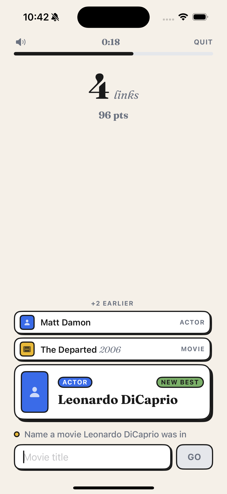

- Claude's recommendation was **Banner** ("the only one that says what you passed, which is what made the pill feel incomplete"), optionally paired with Score.
- Commit **94d54dc** (10:42).

### ~10:44 — "cleanest is score … bouncing in size, keeping it tasteful"
- Abraham: *"i think cleanest is score with some sort of haptic/animation feeding it (it getting bigger or sort of bouncing in size , keeping it tasteful of course)"*. He overrode Claude's Banner pick.
- **Decision: Score cue plus a bounce.** The score swells about 15%, dips just under its normal size and settles, in roughly 2/3 of a second, with the haptic and record chime landing on the beat. It stays green for the rest of the run. Reduce Motion keeps the colour and drops the bounce. Banner, Stamp, Card and the Settings switch were deleted (−130 lines). "If the bounce feels too big or too small, its size and timing are three numbers in one place."
- Commit **0f2f0ad** (10:45).

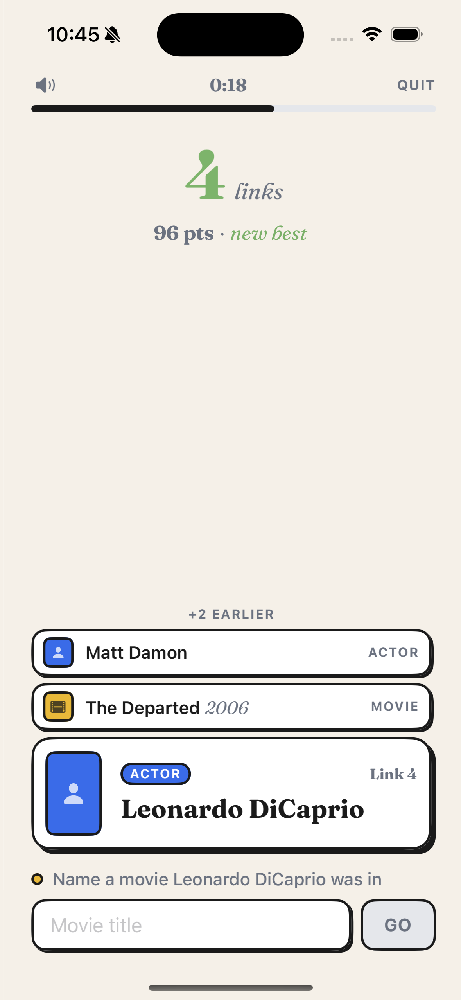

- Unverified in-session: the bounce, the haptic and the chime all need a real run on device.

### ~11:22 — Reset app state
- Abraham: *"okay lets reset our current apps state then"*. Claude uninstalled and reinstalled on the sim, which cleared the best, the Reel and the intro flag. It reminded him that the first game can't fire the cue because there's no prior best to pass.

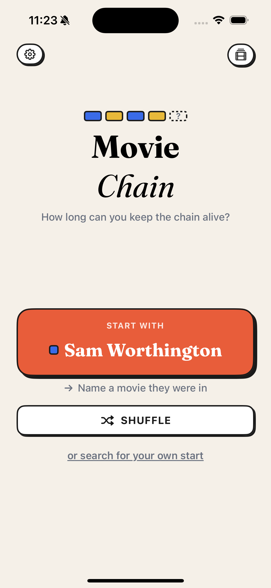

### ~11:33–11:37 — "lets commit push merge, update versions, changelogs, whatever"
- Abraham: *"alright i think we're kinda there so lets commit push merge, update versions, changelogs, whatever , cause i think this is a decent visual overhaul, i'll address animatinos next"*
- **Decision: the design overhaul takes 0.5.0, and Foundations moves to 0.6.0.** The overhaul was planned as 0.6.0, but the changelog rule is "the version follows the work". Shipping it as 0.6.0 "would have left a 0.5.0 that could never ship in order." The roadmap sections, tables, dependencies, CLAUDE.md and every doc anchor were renumbered, with link-check = 0 broken. Motion becomes the 0.5.x patches.
- CLAUDE.md dropped the "placeholder design" note and now records the chain/link vocabulary and the record rule.
- The build number stays 1, since it only bumps for a submitted build.
- 48 tests pass on iOS 26 **and on an iOS 18.0 simulator** (the deployment floor, per CLAUDE.md). Claude also launched the app on 18.0 to confirm Fraunces renders there, because tests don't draw screens.

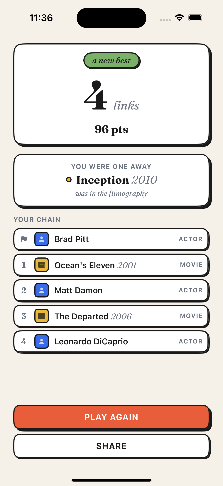

- Commit **ea02ecb** (11:36) "Cut 0.5.0: the design overhaul". PR **#1** (https://github.com/abematt/movie-chain/pull/1) merged as a merge commit **afc7277** (11:37), keeping all 13 commits. Tagged **v0.5.0**.
- Left as-is: the skills changes (uncommitted), the feature branch on the remote, and the Cards/Tiles switch ("stays until the animation work confirms the cards"). Owed checks on the phone: fit above the keyboard, the record bounce/haptic/chime, the first-launch intro.
- Note: the 0.5.0 CHANGELOG entry also carries the earlier, unrelated "Lowered the iOS deployment target from 26.2 to 18.0" change that was sitting under Unreleased.

---

## Decision log

| time (local) | decision | rationale | source |
|---|---|---|---|
| 10-21 19:20 | Commit the roadmap re-cut: foundations → design → service → accounts → Daily Chain → friend groups → 1.0; leaderboards dropped; Pass & Play after 1.0 | It had sat uncommitted since 08-08; stale CLAUDE.md would mislead agents on version bumps | f812f1b |
| 19:22 | Base the redesign on Cream Neobrutalist; borrow Parchment moves; drop Soft Trophy | Fits the existing warm paper, has category colours, compact for keyboard room; Parchment has no right/wrong colours and one accent; Soft Trophy needs 3D art and glass | chat |
| 19:32 | Movie purple → yellow, actor stays blue | Most colour-blind-safe pair | 871ea38 |
| 19:32 | Invent the dark mode (cream borders on charcoal) | Spec is light-only | 871ea38 |
| 19:32 | Card chain behind a Cards/Tiles Settings switch | Roadmap says judge chain treatments on device | 871ea38 |
| 19:32 | Rename the "Primary" asset to "Coral" | Clashed with the generated `Color.primary` symbol | 871ea38 |
| 19:41 | Three type voices; one label recipe replaces seven; italic years; recap reuses play cards | Leftovers made screens disagree; one chain should look like one object | e94550e |
| 19:41 | Keep Dynamic Type (not the spec's fixed px) | Fixed sizes would silently disable scaling | e94550e |
| 19:48 | Every number in the serif (`Theme.Font.numeral`); buttons and labels stay sans | Spec's card-numeral role; Claude admitted misreading it | 5f8b60a |
| 10-22 09:58 | Bundle Fraunces, skip Inter; keep the big scores above the spec's ceiling | iOS norm is custom display plus system body; SF covers Inter's role | chat → 02f32d8 |
| 10:03 | Fraunces as 4 static cuts (72pt/24pt optical, bold/italic), full charset, OFL in bundle, credit in Settings | Accented names; licence; ~320KB | 02f32d8 |
| 10:03 | Muted grey, spec red, pressed coral, 2pt borders, 1pt press, 6pt timer, 24pt gutter, split headings | Close the spec gaps | 02f32d8 |
| 10:12 | Reel: each fact once; drop "most logged"; equal-height regulars | Abraham: counts shown thrice, boxes uneven | 75f9ca3 |
| 10:17 | Coral start button; one control group; 2:3 space split; title lower | Ink-on-ink shadow read as shifted; no coral CTA; two equal gaps = three islands | b452695 |
| 10:24 | Vocabulary: chain = run, link = correct answer, start isn't a link | Recap showed 5 rows for score 4 | 96e3960 |
| 10:24 | One game-over summary card; PB/Reel de-emphasized; Best hidden on a new best | Abraham: "chain ended" redundant; emphasize this run | 96e3960 |
| 10:31 | "4 *links*" on one baseline | Abraham: "links" read like its own stat | 8238a1e |
| 10:36 | In-play new-record cue (haptic plus 2-note chime), once per run, never on a first game | Previously no signal until game over | 52c382e |
| 10:42 | Record = most links, points break ties; best links and points saved as a pair | Best line could mix two runs; links are the score; Daily Chain ranks by links | 94d54dc; ROADMAP friend-groups question closed |
| 10:45 | Score cue (green plus "new best") with a ~15% swell-dip-settle bounce; other 3 removed | Abraham: "cleanest is score"; Claude had recommended Banner | 0f2f0ad |
| 11:36 | Design overhaul is 0.5.0; Foundations becomes 0.6.0 | "Version follows the work" | ea02ecb |
| 11:36 | Keep the Cards/Tiles switch for now | Until the animation work confirms the cards | chat |

## Story material
- **The overnight "we've been working on this for a while".** The session opened with a roadmap re-cut that had sat uncommitted for 2.5 months (since 8 Aug). Committing it was the starting gun for the redesign.
- **Spec in, branch out in about 10 minutes.** From "Alright lets do it" (19:22) to a pushed prototype (19:32): a palette with dark variants, a neobrutalist component layer and a card chain.
- **Claude admitted a misreading.** It had kept in-card numbers sans; when Abraham asked "what is the specs split?", Claude found the spec's dedicated `card-numeral` serif token: "Keeping them sans was my misreading." Lesson: reading the spec through a summarizing fetch tool loses detail, and Claude said so.
- **"Talk to me about this, whats the standard for an app like this on ios"**: a good how-real-apps-do-it explainer (NYT Games, Duolingo, Headspace ship custom faces; custom display plus system body; SF is iOS's Inter). Inter was cut entirely.
- **The ball-topped 4.** Fraunces' bold "4" has a ball terminal; the big score "4" became a visual signature (visible in nearly every screenshot). Claude checked the font's glyph table to confirm there's no alternate.
- **Fraunces "for free".** About 320KB, four static cuts made with fontTools in a throwaway venv, OFL checked for a Reserved Font Name (none).
- **The off-by-one hiding in plain sight.** "5 rows for a score of 4" was the real root of the chain/link terminology muddle. Fixing the *numbering* (flag the start, links from 1) fixed the *words*.
- **"as if links is some important thing on its own"**: a typographic critique from reading the screen literally. Fixed by putting the unit on the numeral's baseline.
- **"Best" had never been defined.** Two independent records meant "18 links · 848 pts" could describe two different games. The conversation ended with one rule (links, points tie-break) that also closed a roadmap question for future friend groups.
- **Reversal: Claude picked Banner, Abraham picked Score.** "cleanest is score with … bouncing in size, keeping it tasteful of course". The chosen cue adds no new shapes on a screen short of room.
- **Prototype-then-delete as a pattern.** Four cue variants behind a Settings switch, chosen in about 2 minutes from screenshots, three deleted (−130 lines). Same pattern as Cards/Tiles.
- **Claude kept trying to see things itself.** It added DEBUG launch args (`-uiOpenReel`, `-uiDemoRecordCue`) "so I can screenshot it myself instead of relying on you", and verified fonts on the iOS 18.0 floor by launching the app there, not just running tests.
- **Version swap.** The overhaul was planned as 0.6.0 but shipped first, so it became 0.5.0 and Foundations slid to 0.6.0.
- **Numbers:** 13 commits on the branch; 48 tests green on iOS 26 and 18.0; Reel slimming −49 lines; ~320KB fonts; 7 label recipes became 1; about 12 spec rule breaks listed and closed; the first-shot keyboard fit had about 8pt to spare.
- Good quotes: *"we've been working on this for a while"* · *"i think the typography doesn't agree anymore"* · *"follow the spec to get it consistent please, it looks weird now"* · *"There's too much on there"* · *"CTA button should be front and center no?"* · *"chain ended is kinda redudantant no"* · *"we haven't agreed on what consitutes best right"* · *"I didn't like the new best pill though, looks incomplete"* · *"i think this is a decent visual overhaul, i'll address animatinos next"*.

## Media index
- `media/external/iPhone-16-2026-10-21-at-19.51.47.png`: Abraham's own simulator screenshot (19:51, 21 Oct): a real game from Deadpool 2 on the pre-Fraunces build (New York serif, bordered white-track timer, a single hero card).
- `media/dd18d4e5/f-seed.png`: home after Fraunces (10:02), with the ink start card and stranded search link. The "before" for the home rebalance.
- `media/dd18d4e5/f-uiDemoChain.png`: play screen in Fraunces (demo chain), hero card "#5".
- `media/dd18d4e5/f-uiDemoGameOver.png`: game over in Fraunces, before the summary-card redesign (TIME'S UP, side-by-side PB/Reel cards, recap 1–5).
- `media/dd18d4e5/pasted-7.png`: Abraham's paste: the Settings sheet (nav bar, Cards/Tiles control, Fraunces credit, v0.4.0).
- `media/dd18d4e5/pasted-8.png`: Abraham's paste: the Reel with truncated regulars names (bug evidence).
- `media/dd18d4e5/pasted-9.png`: Abraham's paste: the Reel with triple counts and uneven regulars cards (evidence for his notes).
- `media/dd18d4e5/reel.png`: the leaner Reel after 75f9ca3.
- `media/dd18d4e5/pasted-10.png`: Abraham's paste: the lopsided home ("Tom Hanks", ink card).
- `media/dd18d4e5/h-light.png`: rebalance first pass, light (coral "Tim Robbins").
- `media/dd18d4e5/h-dark.png`: rebalance first pass, dark mode.
- `media/dd18d4e5/h2.png`: rebalance final, centered ("Back to the Future").
- `media/dd18d4e5/intro1.png`: attempted intro capture; shows the settled home ("The Martian"). Uninteresting.
- `media/dd18d4e5/intro2.png`: **byte-identical duplicate** of intro1. Skip.
- `media/dd18d4e5/pasted-11.png`: Abraham's paste: game over with "CHAIN ENDED" and a 5-row recap for score 4 (off-by-one evidence).
- `media/dd18d4e5/go-best.png`: new single summary card, new-best state, flag-numbered recap.
- `media/dd18d4e5/go-play.png`: play screen with "Link 4" on the hero card, before the points-line change. Near-duplicate of go-play2.
- `media/dd18d4e5/go-play2.png`: play screen with "*links* · 96 pts" stacked under the score.
- `media/dd18d4e5/pasted-12.png`: Abraham's paste: a real 2-link game, with "links" on its own line and the Best/Reel cells shown.
- `media/dd18d4e5/u-over.png`: game over with "4 *links*" on the baseline.
- `media/dd18d4e5/u-play.png`: play screen with "4 *links*" on the baseline.
- `media/dd18d4e5/cue.png`: the first in-play "a new best" pill (rejected as "incomplete").
- `media/dd18d4e5/cue-options_banner.png`: cue option A, Banner (Claude's pick; final render).
- `media/dd18d4e5/cue-options_stamp.png`: cue option B, Stamp.
- `media/dd18d4e5/cue-options_score.png`: cue option C, Score (Abraham's pick).
- `media/dd18d4e5/cue-options_card.png`: cue option D, Card chip (final render).
- `media/dd18d4e5/pop-mid.png`: settled green score cue; **near-duplicate** of pop-end (slight offset), not viewed in-session.
- `media/dd18d4e5/pop-end.png`: the final chosen cue, settled (green "4 links", "96 pts · new best").
- `media/dd18d4e5/fresh.png`: home after an uninstall/reinstall reset (empty Reel pill, "Sam Worthington").
- `media/dd18d4e5/ios18.png`: game over on the iOS 18.0 simulator, a Fraunces render check before the 0.5.0 cut.
- `media/dd18d4e5/chat-01-2026-10-21T1735.png`: Abraham's paste 1 (19:34): play screen on the first prototype (871ea38), with a Hugh Jackman hero card, years in parentheses and sans chrome.
- `media/dd18d4e5/chat-02-2026-10-21T1735.png`: Abraham's paste 2 (19:34): game over on the first prototype, with the old colour-bar recap, hairlines, a borderless pill and sans "89 pts". Key "leftovers" evidence.
- `media/dd18d4e5/chat-03-2026-10-21T1744.png`: Abraham's paste 3 (19:43): home on e94550e, with the ink "Ian Holm" card and sans SHUFFLE.
- `media/dd18d4e5/chat-04-2026-10-21T1744.png`: Abraham's paste 4 (19:43): play screen at 0 links, with a sans timer and "#1".
- `media/dd18d4e5/chat-05-2026-10-21T1744.png`: Abraham's paste 5 (19:43): game over at 0, with sans PB/Reel figures under a serif score (the numeral clash).
- `media/dd18d4e5/chat-06-2026-10-21T1744.jpg`: Abraham's paste 6 (19:44): Reel sheet on e94550e, with a stock nav bar, sans counts, truncated regulars and triple counts.
- **Not in media:** Claude's early captures (play-light/dark, play-kb1–4, over, seed, t-*, n-*). They were overwritten or deleted in the session scratchpad.
