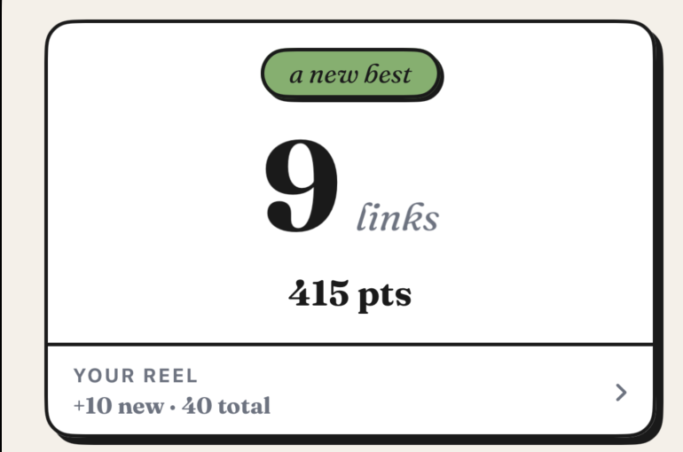
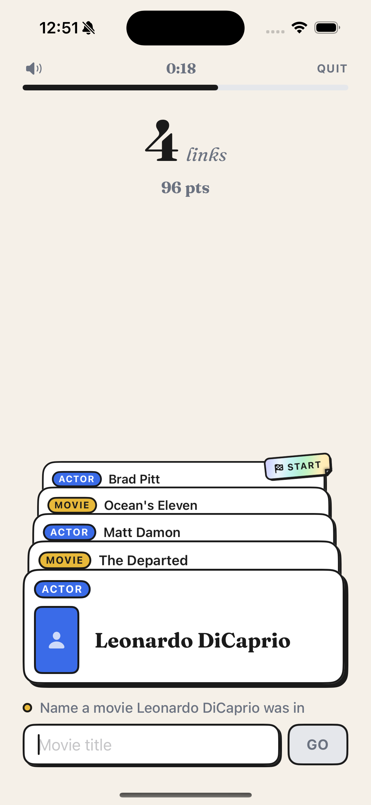
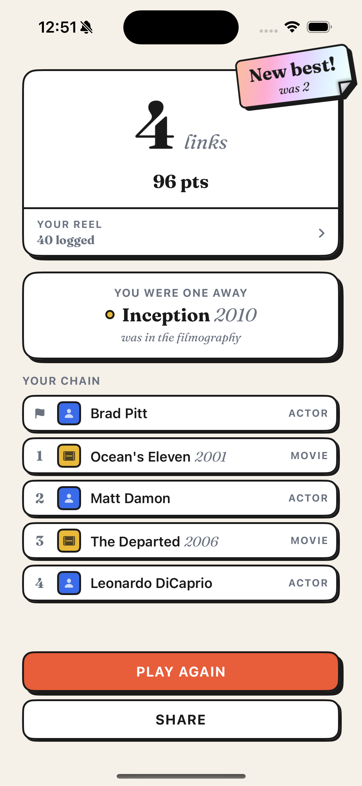
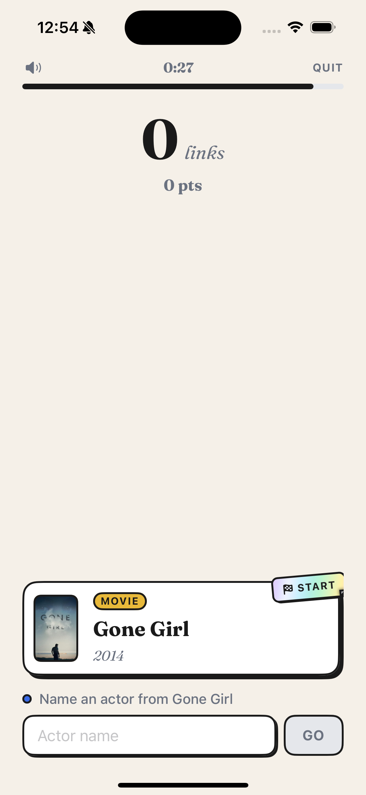
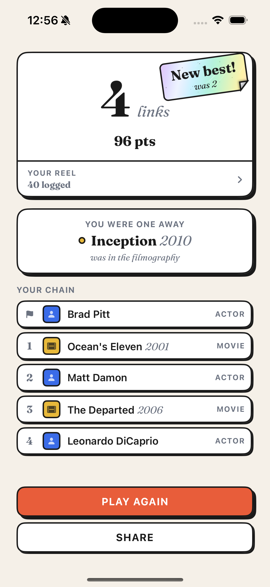
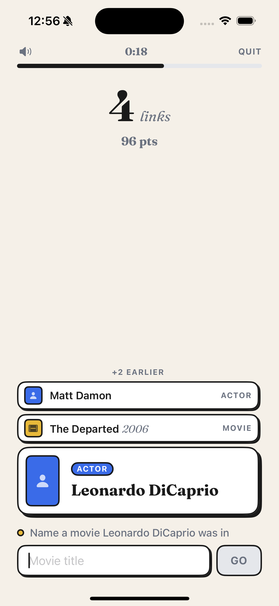
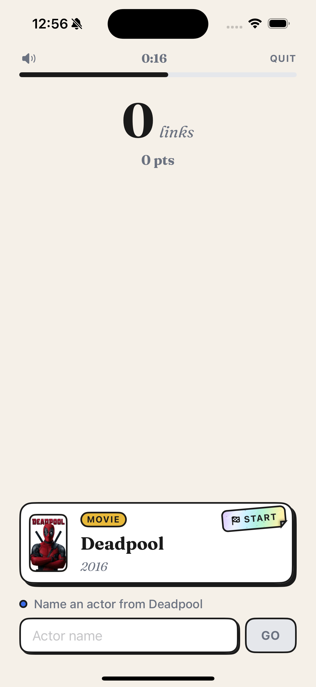
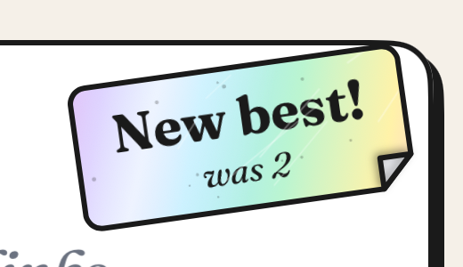
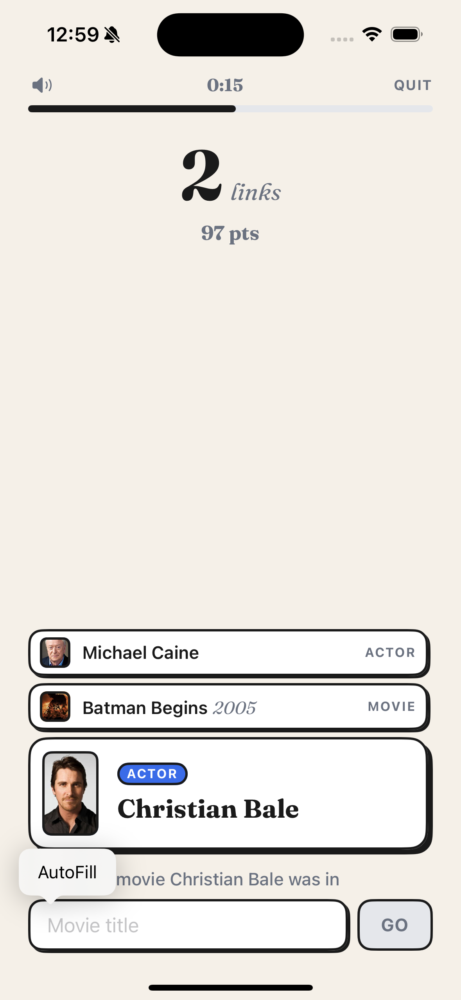

## Era: Swift hardening + the motion re-tune — 0.5.1 (2026-10-22 morning)

**Arc.** The morning after 0.5.0 (Cream Neobrutalist) landed, Abraham sat down to do "animation checks" — and immediately swerved into a full `/write-swift` review of the codebase instead. In ~20 minutes that review found that the TMDB decode helper, whose comment proudly said it ran off the main thread, had been running *on* main all along (Approachable Concurrency makes `nonisolated async` run on the caller's actor). The fix snowballed: Swift 6 language mode, Swift Testing, warnings-as-errors, a grep-able convention checker wired into both a Claude Code hook and a git pre-commit hook, and a `/swift-review` command (PR #2). Then, with the guard rails up, he went "back to motion/animation/design": an Emil-Kowalski-style motion review of every animation, a round of fixes, and then — triggered by Abraham disliking cards that *fade* as the chain grows — the invention of the **Deck** (the chain as a physical pile), holographic foil stickers for START and "New best!", and a "time's up" beat. All of it shipped as 0.5.1 by 13:18 local. Two sessions, ~3.5 hours wall clock.

Sessions: `d53e0d7a` (09:42→10:03 UTC = 11:42→12:03 local) did **all** the Swift work; `bf8eda3d` (10:10→11:18 UTC = 12:10→13:18 local) did the motion overhaul and the 0.5.1 cut. Times below are Barcelona local (UTC+2).

---

### 2026-10-22 ~11:42 — "animation checks" → abandoned for a Swift review

- Opening line: *"Hi we're going to do some animation checks here"*. Claude listed the Swift files, grepped motion usage, and offered an AskUserQuestion ("Audit existing motion (Recommended)…") — Abraham **rejected the tool call** and instead invoked `/write-swift`, then: *"can you jsut review our entire code using /write-swift"*.
- Claude read all 29 Swift files (~5.7k lines), then did a clean build into the scratchpad to read the **actual compiler flags** before reporting a concurrency claim. Flags found: `swift-version 5`, plus upcoming features `NonisolatedNonsendingByDefault`, `InferIsolatedConformances`, `DisableOutwardActorInference`, etc. One warning: `GameView.swift:177: main actor-isolated property 'reduceMotion' can not be referenced from a Sendable closure`.

**The review (11:45), "Fix these":**
1. **JSON decoding runs on the main thread.** `TMDBProvider.decode` was `nonisolated async` with a comment saying it moved off main. Under `NonisolatedNonsendingByDefault` (on via Approachable Concurrency) it runs on the caller's actor — main. So "the 18 cast fetches behind the deal pool and every large filmography all decode on main, which is the stutter the comment was trying to prevent." Fix: `@concurrent`.
2. **The compiler isn't checking most concurrency code** — `SWIFT_VERSION = 5.0`, no strict concurrency. "Bug #1 is exactly what complete checking surfaces."
3. The `reduceMotion` read inside a `@Sendable` `keyframeAnimator` closure → capture list `{ [reduceMotion] view, scale in … }`.
4. **Seed pools can be fetched twice at once** — `shuffleSeed()` and `dealFreshOnResume()` each spawn an untracked `Task { await loadSeedPoolsIfNeeded() }`; a Shuffle during the first load sends the full ~24 requests twice (matters given TMDB rate limits). Also: page 1 of `discover/movie` fetched twice; 5 movie pages fetched serially.
5. **Turkish locale breaks sequel matching** — `FuzzyMatch` folded with `locale: .current`; in Turkish "III" → "ııı" (dotless i), no longer a Roman numeral, so "mission impossible 3" stops matching. Plus 3 normalizations per candidate per submit.
- "Worth doing": (6) per-run state reset by hand in two drifted places (`startGame` vs `reset`); (7) `onAppear { Task {…} }` → `.task` (a 450ms-sleeping celebration task never cancelled → stray haptic after quick "Play again"); (8) all 7 test files on XCTest, and `GameEngineTests` calling `quit()` could write `bestChain` into the real simulator `UserDefaults.standard`.
- Small stuff: `any MovieDataProvider`, a stale "Add one in Config.swift" error message, plist parsed twice, sort-to-take-first, a lying `upsert` comment, countdown drift from 1s sleeps, `FuzzyMatch.Result` shadowing Swift's `Result`.

**Abraham (11:46):** *"lets do 1-8 and the small stuff if you think they're all improvements, will there be signifacnt physical improvements?"*
Claude's honest answer: "a couple of these will be noticeable, but most won't" — #1 reads as "a bit smoother", not a transformation; #4 only on a slow first launch; #7 a rare haptic; the rest is correctness/maintenance.

### ~11:47–11:54 — Applying the review (commit `8696814`)

- Branch `feature_swift-review`. `@concurrent` decode; capture-list fix; `endedByQuit` turned out to be **dead code** (no view read it) and was deleted; game-over facts moved into `Phase.gameOver(Summary)`.
- Turned on `SWIFT_STRICT_CONCURRENCY = complete` first (the write-swift migration order), test build failed — but **only on the old `XCTestCase` classes** ("main actor-isolated initializer 'init()' has different actor isolation from nonisolated overridden declaration"). App code flagged nothing. Migrated all tests to Swift Testing, then flipped both targets to `SWIFT_VERSION = 6.0`: zero warnings.
- **44 tests in 6 suites pass on iOS 26.4 and the iOS 18.0 floor** (~1.1 s each).
- **Decisions:**
  - **Run state: one `resetRun()`, not a `Run` struct** — "A struct would make the per-second clock tick redraw every view that reads any run field." (Rejected the review's own suggestion after looking closer.)
  - **Left the duplicate page-1 fetch** — removing it would couple the provider protocol (actor pool built from movie pool) to save one request; "The 0.7.0 caching proxy makes it moot anyway."
  - Engine gets injectable `UserDefaults`; one new test: a new best saved and read back through it.
- Claude trimmed its own CLAUDE.md wording: "decoding sat on the main thread **for months**" → cut "for months" because it was "a guess I can't back up".

### ~11:56 — "how do we ensure that future code changes will adhere…" (commits `b17d63d`, `24581a0`, PR #2 → `acd0dfb`)

- Abraham: *"how do we ensure that future code changes will adhere to the standards set by /write-swift"*
- Claude's layered answer ("Nothing makes Swift code follow a style guide on its own, so I'd stack a few checks. Each one catches what the one before it misses"):
  1. Compiler: Swift 6 + `SWIFT_TREAT_WARNINGS_AS_ERRORS = YES`.
  2. Make sure the guide is loaded: **commit the skill** (it was a symlink into an untracked `.agents/` folder — a worktree/fresh clone/claude.ai/code session wouldn't have it) + a "Swift conventions" section in CLAUDE.md listing the rules *this codebase was actually burned by*.
  3. A check script for grep-able patterns, run as a Claude Code PostToolUse hook and a git pre-commit hook. **SwiftLint rejected**: "this is a solo Xcode project with no package dependencies, so a 30-line script is lighter."
  4. `/swift-review` slash command for the judgment calls (value vs reference, `some`/`any`, reentrancy).
  5. CI later (0.6.0).
- Abraham: *"yeah no cic job, but impleement whatever you suggested, all sounds good"*
- `scripts/swift-check.py` written in **Python, not grep**, because "a multi-line rule like '`Task` inside `onAppear`' is fragile in grep". Rules: `XCTestCase`, `Task.detached`, `DispatchQueue.main`, `locale: .current`, `print(`, `ObservableObject`/`@Published`, `nonisolated … async` without `@concurrent`, `Task` inside `onAppear`. Skips comments; escape hatch `// swift-check:ignore — <why>`. Tested against a fixture breaking every rule (all six caught) and verified the pre-commit hook exits 1.
- First run on real code: one hit — SeedView's intro `onAppear { if introTask == nil { introTask = Task { await runIntro() } } }`. **Marked as a deliberate exception** rather than rewriting intro motion "you're still tuning".
- Gotcha: slash commands substitute plain `$ARGUMENTS`, not shell `${ARGUMENTS:-main}` — fixed in `swift-review.md`.
- Committed the 15 installed skills (`.agents/`, symlinks, `skills-lock.json` — all from `emilkowalski/skill` plus write-swift) separately in `b17d63d`.
- Abraham (12:02): *"yeah open pr and merge we're going back to motion/animation/design improvements"* → PR #2 merged, `main` at `acd0dfb` (12:03).

---

### 12:10 — New branch for the "desing/animation overhaul"

- *"Alright we're going to start a branch to do some desing/animation overhaul"* → `feature_motion-overhaul` from 0.5.0. Claude summarised the roadmap's 0.5.x constraints: settle the chain style (Cards default, old Tiles behind Settings "until motion confirms the cards, and then it gets deleted"), **vertical room vs the docked keyboard is the binding constraint**, Reduce Motion must keep working, use `Theme.Motion` tokens only.

### 12:10–12:12 — `/emil-design-eng` motion review (code-only, not run)

- *"Lets do a review of what we have with /emil-design-eng"*. Claude read every UI/motion file and produced Before/After/Why tables. Framing: "Most of the problems sit in **the moments you see most often**: a link landing, the timer, and a wrong answer."
- **High** (play loop): link landing was a cross-fade between two different objects (hero fades out, compact copy fades in) → propose `matchedGeometryEffect`; `drop` spring `dampingFraction: 0.62` ≈ 0.38 bounce driving the whole stack "so everything wobbles on every link" → `.spring(duration: 0.35, bounce: 0.2)`; **TimerBar animated `.linear(0.25)` against a once-a-second integer — "moves for 0.25s and then sits still for 0.75s, a visible stutter"**; the header `0:27` had `.contentTransition(.numericText())` **but no animation, so it never played**; a wrong answer inserted a feedback line that grew the docked input and shoved the chain; the shake was constant-amplitude linear with **no Reduce Motion check**.
- **Medium**: poster `AsyncImage` popping mid-drop; Reel art on `.easeIn` ("starts slow at exactly the moment the eye is on it"); `FloatingGain` appearing from nowhere; the "a new best" pill's transition never ran (inserted with the whole screen, and `.scale` from 0); game-over recap stagger finished *under* the screen push; three different press timings → one `Theme.Motion.press` token.
- **Low**: Reduce Motion set `.animation(nil)` ("Reduce Motion means gentler motion, not none"); **the 30s clock started while the keyboard was still rising — ~1s of the first turn lost**; next-turn hint changed ahead of the card.
- Left as-is: first-launch intro, record bounce, shuffle, screen-push spring, the 1pt shadow-collapse press under Reduce Motion.

### 12:16–12:24 — Implement all of it

- *"Alright lets implement all the high medium low changes and then tell me what exactly and where exactly to look for once we implement it"*
- Found along the way: **a second identical miss didn't shake or buzz** — the reaction keyed off the error *text*, which doesn't change between two identical misses → added a `rejections` counter. Also: a failed load no longer fires the "wrong answer" buzz.
- Swift 6 bit immediately: the keyframe closure is nonisolated, so `Theme` statics (`md`, `danger`) had to be captured up front — the new warnings-as-errors/Swift 6 setup caught it within 20 minutes of being merged.
- Claude handed back a 12-item **"what to look at"** checklist (Slow Animations ⌘T, Reduce Motion on/off, `-uiDemoChain`/`-uiDemoGameOver`/`-uiDemoRecordCue`), explicitly noting "I haven't watched any of it run".

### 12:31 — Abraham: art slides the wrong way; cards fade instead of stacking

> *"When starting a game and the actor or movies image loads in, it slides in from the opposite direction of when the slide of the screen is, to me it looks a little off , i'd prefer something else*
> *also i don't like the fading of the cards as the stack grows, i'd prefer it to be a little physical almost stacking or something , keeping in line with /emil-design-eng … Everything else looks good"*

- **Art bug — Claude owned it:** "this is my bug, from the previous round." The animated `Transaction` on `AsyncImage` likely made the card's new `matchedGeometryEffect` re-measure mid-push, animating from a stale position against the slide (inferred from code at the time).
  - Fix: **pre-fetch the dealt start's art** on the home screen (new `ArtCache.swift`) so the first card arrives with art in place; scope later art animation to the image only; change the arrival to a **blur-to-sharp "develop"** (~0.22s, blur 6→0) — "a picture developing fits a film game better than a plain fade."
- **The Deck idea** — "The fading comes from the structure, not from the timing." Two different views (hero vs compact) can only ever cross-fade; for physicality "a card has to stay the same object for its whole life." Sketched as a pile: new card dealt in from below the input, the current hero pushed back (scale 0.95, up ~12pt, shadow sinking), backmost slides off, "+N earlier" ticks up. "Nothing fades." One spring moves the whole deck so a fast answer interrupts cleanly; depth via shrinking hard shadow fits neobrutalism; two peeks ≈ 25pt vs ~90pt for two compact rows.
  - **Decision: build it as a third Chain style (Deck) next to Cards and Tiles**, in its own file, "so going back is just a matter of deleting it."
- Abraham (12:36): *"okay on 1 and lets try 2 jsut to compare but easily able to go back to the original"*

### 12:39 — First Deck screenshot (Claude's own check)

- 44 tests green. Known rough edges flagged: fixed 122pt card height; "a lot of space between the score and the pile."

### 12:43 — "honestly this is better"

> *"honestly this is better, Wondering if we can get away with showing a longer chain than 3 there, thoughts?*
> *also showing Link N looks very sterile and corporatey instead of the game , also don't like how a new best is shown here"*

- Claude's proposals: (1) **fit the pile to the space** — count how many peeks fit up to ~6, recede gradually (peeks 28→24→20→17pt, ~3% shrink per step: "a pile seen in perspective rather than a ladder"); (2) **remove "Link N"** — the score already counts; only the dealt start (not a link) needs marking, with a small tilted sticker (🏁 / "START"); (3) replace the pill with a **"NEW BEST — was 7" sticker stamped on the card**, slamming down like a rubber stamp — "A hard landing breaks the usual 'ease out' rule … but this happens rarely and is meant to be a celebration, so that's justified." Showing the beaten record ("was 7") "means more than the label alone."
- Abraham (12:46):
  > *"1. Agreed on both*
  > *2. Agreed, remove and add the flag , make the sticker's styling almost holographic if you can, would be a cool little polish*
  > *3. can you also build that as a holographic sticker type thing that moves with the app's gyro? i think the animation should be more of a sticker that is slgihtly peeling off"*
- Built `HoloSticker.swift` (CoreMotion, foil gradient, peeled flap), engine records the previous best, Deck reads the play screen's available height. Cards style also lost "Link N" for consistency.

### 12:51 — Deck v2 + the holo sticker, first look

- Claude's own caveat: **"those screenshots overstate how much fits"** — the simulator used the Mac keyboard, so no on-screen keyboard; on a real iPhone 16 expect 1–2 named peeks. "Please judge the depth on your phone, not the simulator."
- Gyro note: no motion-permission prompt needed; gyro runs only while a sticker is on screen; foil identical in dark mode on purpose ("it's a material rather than a surface colour").

### 12:52 — "floating awkwardly and moves on its own"

> *"currently on the simulator the sticker is floating awkwardly and moves on its own, is that normal?"*

- Cause: since the simulator has no gyro, Claude had added a fake figure-of-eight "tilting" loop that moved the *sticker itself* (3D tilt + breathing peel). Claude agreed it was wrong in principle: **"A real sticker never moves on the card. Only the light on it changes."**
- **Decision:** kill the stand-in loop, and on device too: no 3D tilt, no moving peel — gyro only drives foil hue + a sliding sheen. Only self-motion left: the one-time new-best landing. Abraham: *"rebuild please"*.

### 12:54 — "respects the geometry … slight scratches or imperfections"

> *"it looks like its floating on it, it'd be cool if it kida respects the geometry of it and sticks on it with some slight scratches or imperfections"*

- Diagnosis: "The sticker hangs past the card's edge into empty space, and it has its own hard drop shadow. Both say 'separate layer hovering above the card'. A real sticker sits flat inside the card's edges and only casts a shadow where it's peeling up."
- Fix: stickers moved inside the card's top-right; drop shadow only while landing (shrinks to nothing as it presses flat); only shadow left is under the curl; +8pt headroom on the score card on a new best. **Wear**: fine diagonal scratches + grime flecks, **deterministic per sticker** (no reshuffle per redraw), scratches brighten with tilt on device.

### 12:58 — "the fold has some lines sticking out"

> *"the fold has some lines sticking out or somethin"*

- Cause: **miter joins**. The flap is a triangle with two sharp 45° corners; the 2pt stroke's default miter join extends past tight corners as thin spikes. Fix: rounded line joins on both the sticker outline and the flap.

### 12:59 — "wait, why is back to the stack instead of the deck ?"

- Explanation: Claude had launched with a one-time `-chainStyle deck` argument for its screenshot; the app default was still `.cards`. **Decision: Deck becomes the default** in all three `@AppStorage("chainStyle")` sites; cleared the saved choice on the simulator.

### 13:02 — `/find-animation-opportunities`

- *"okay lets find some /find-animation-opportunities now that we've done some of the stuff we've done"*. Verdict: "The play loop has as much motion as it should have." Four survivors:
  1. **Time's-up beat** (~450ms before the game-over push: input dims, timer holds red, pile dips 4pt, miss buzz; Quit skips it) — "the most emotional moment of a run, losing, isn't shown at all; the screen just slides away."
  2. **Reel pill count rolls up** after a run (the retention hook's growth was never *seen*).
  3. "You were one away" card joins the game-over deal-in.
  4. Retry ⇄ input cross-fade.
- **Rejected** (with reasons): typed answer flying into the new card (keyboard-triggered, dozens per run — adds delay to every turn); animating the Go button enable (tied to typing → feels laggy); pulsing/shaking timer in the last 25% ("information you're reading while racing to type"); animating the empty-Reel illustration; search results (already done).
- Abraham (13:04): *"okay from your suggestions okay lets do al l4"*
- Implementation gotcha: **disabling the text field during time's-up would dismiss the keyboard mid-pause and jump the layout**, so it isn't disabled — the engine just ignores answers. `Config.timeUpPause = 450ms` as a single tunable ("450ms is a guess"). First Reel roll-up after install goes 0 → 40 because no "last seen" count existed yet.

### 13:11–13:18 — Commit, keep the styles, merge, cut 0.5.1

- *"okay lets commit these, i like em all"* → `8f53bd4` "Re-tune motion: deck chain, holo stickers, time's-up beat" (one commit: the changes overlapped the same files).
- Claude suggested deleting Cards and Tiles now the Deck had won. Abraham (13:12): *"yeah don't delete, i might leave htat in as a feature"* → *"yeah sure update htem"* → `3d878ab` "Treat chain style as a player setting, not a prototype" (Settings label lost "· prototype"; CLAUDE.md/ROADMAP/CHANGELOG reworded).
- *"okay lets coommit and push and merge"* → PR #3 merged, `85f5d33` (13:15). 19 files, +1117/−112; new files `ArtCache.swift`, `ChainDeck.swift`, `HoloSticker.swift`.
- *"yeah man cut it it 0.5.1"* → `MARKETING_VERSION` 0.5.0→0.5.1 in all four configs, changelog section renamed, tag `v0.5.1`, `1fe1ee8` committed straight to `main` (version/docs only), 13:18.
- **Postscript (reversal):** the "leave it in as a feature" call lasted ~3.5 hours. In 0.5.3 (`d05e7f8`, 16:46 the same day) the Chain style setting was **removed** — "The Deck is the chain" — Cards and Tiles deleted along with the Reel-cards setting: "Two settings that had served their purpose."

---

### Decision log

| Time (local) | Decision | Rationale | Source |
|---|---|---|---|
| 11:42 | Drop "animation checks", do a full `/write-swift` review first | Abraham's call (rejected the audit prompt) | d53e0d7a |
| 11:47 | `@concurrent` on TMDB decode | `nonisolated async` runs on caller's actor (main) under Approachable Concurrency | 8696814 |
| 11:48 | `resetRun()` instead of a `Run` struct | struct would redraw every run-field reader on each clock tick | d53e0d7a |
| 11:48 | Keep duplicate page-1 fetch | protocol coupling not worth one request; 0.7.0 proxy makes it moot | d53e0d7a |
| 11:49 | `locale: nil` in FuzzyMatch | Turkish dotless-i breaks Roman numeral sequels | 8696814 |
| 11:51 | Swift 6 mode + Swift Testing; test-only `UserDefaults` | only warnings were XCTest classes; tests were writing real records | 8696814 |
| 11:57 | Warnings as errors, Python checker (not SwiftLint), edit hook + pre-commit, `/swift-review`; no CI | layered checks; solo project, no deps → 30-line script lighter | 24581a0 |
| 11:58 | Commit the `.agents/` skills | symlinks to untracked folder vanish in worktrees/clones | b17d63d |
| 11:59 | SeedView intro `onAppear` Task marked `swift-check:ignore` | intro motion still being tuned | 24581a0 |
| 12:16 | Apply every high/medium/low motion fix | Abraham: "implement all" | 8f53bd4 |
| 12:32 | Pre-fetch dealt-start art; "develop" blur-to-sharp for later art | art arriving mid-push slid against it; film-fitting effect | 8f53bd4 |
| 12:36 | Build Deck as a 3rd chain style in its own file | compare on device, easy rollback | bf8eda3d |
| 12:46 | Remove "Link N"; START flag + "New best — was N" as holographic gyro stickers | "sterile and corporatey"; record is rare → can celebrate | 8f53bd4 |
| 12:53 | Sticker never moves; only light/foil reacts to gyro; no simulator fake loop | "A real sticker never moves on the card" | bf8eda3d |
| 12:55 | Sticker inside card edges, no drop shadow at rest, deterministic wear | floating layer vs stuck-on object | bf8eda3d |
| 12:58 | Rounded line joins on sticker/flap stroke | miter spikes at sharp fold corners | bf8eda3d |
| 12:59 | Deck becomes default | Abraham preferred it | 8f53bd4 |
| 13:04 | Time's-up beat, Reel roll-up, one-away deal-in, Retry cross-fade; reject 4 others | frequency/purpose gate | 8f53bd4 |
| 13:05 | Don't disable the field during time's-up | would drop keyboard, jump layout | bf8eda3d |
| 13:12 | Keep Cards/Tiles as a player setting | "i might leave htat in as a feature" (reversed in 0.5.3) | 3d878ab |
| 13:18 | Cut 0.5.1, commit directly to main | version/docs-only commit | 1fe1ee8 |

### Story material

- **The comment that lied.** The decode helper's comment said it ran off main; it didn't, because Swift 6.2's Approachable Concurrency quietly changed what `nonisolated async` means. ~24 responses for the first deal, all parsed on main. Great hook for a "your concurrency comments are lies until the compiler checks them" post. (Claude even refused to write "for months" in CLAUDE.md since it couldn't back it up.)
- **Strict checking found nothing in the app** — only the old XCTest classes complained. The value of Swift 6 mode here was the future, not the past… and it paid off within the hour: the motion work's new keyframe closure failed the Swift 6 build on `Theme` statics.
- **Guard rails before paint**: Abraham's order of operations — harden the language layer, *then* "we're going back to motion/animation/design improvements".
- **"The fading comes from the structure, not from the timing."** The key insight that produced the Deck: two different views can only cross-fade; a physical feel requires one card being one object for its whole life.
- **Abraham's design instincts drove every turn**: "Link N looks very sterile and corporatey instead of the game"; wanting a holographic sticker "that moves with the app's gyro… slightly peeling off"; then catching that it looked like it was floating; then asking for "slight scratches or imperfections". Each round of feedback came with a screenshot.
- **"A real sticker never moves on the card. Only the light on it changes."** — the reversal after Claude's simulator stand-in animation made the sticker wobble on its own.
- **Miter joins** — a nice tiny-bug anecdote: 2pt outline on a 45° triangle flap = thin spikes.
- **Simulator lies about space**: the Mac keyboard means no on-screen keyboard, so the Deck looked roomy in screenshots; Claude warned to judge on a phone.
- **Restraint list**: the find-animation pass rejected more than it accepted (typing-tied motion, timer pulsing while you race to type).
- **The keep-then-cut reversal**: "don't delete, i might leave htat in as a feature" at 13:12 → settings removed in 0.5.3 at 16:46 the same day.
- **Numbers**: 29 Swift files / ~5.7k lines reviewed; 44 tests in 6 suites green on iOS 18.0 and 26.4; PR #3 = 19 files, +1117/−112; time's-up pause 450ms; deck peeks 28→24→20→17pt; sticker drop starts ~1.4× in the original stamp idea; Deck card fixed at 122pt in v1; timer bar previously moved 0.25s of every 1s.
- **Cadence**: PR #2 merged 12:03; PR #3 merged 13:15; 0.5.1 tagged 13:18 — the whole 0.5.1 story is one morning.

### Media index

- `media/bf8eda3d/deck.png` — 12:39, Claude's screenshot of Deck v1 (Link N labels, +2 EARLIER, big empty gap).
- `media/bf8eda3d/pasted-1.png` — 12:43, Abraham's crop of the 0.5.0 green "a new best" pill (9 links, 415 pts, +10 new · 40 total).
- `media/bf8eda3d/deck2.png` — 12:51, Deck v2: 4 peeks with names, foil START flag overhanging, no Link N.
- `media/bf8eda3d/over.png` — 12:51, game over with first foil "New best! / was 2" sticker overhanging the card.
- `media/bf8eda3d/pasted-2.png` — 12:54, Abraham's screenshot: Gone Girl card, START sticker floating past the edge.
- `media/bf8eda3d/over2.png` — 12:56, game over with sticker moved inside the card, wear specks.
- `media/bf8eda3d/deck3.png` — 12:56, Claude's check screenshot that opened in Cards style (compact rows).
- `media/bf8eda3d/pasted-3.png` — 12:58, Abraham's screenshot: Deadpool card, START sticker with spikes at the fold.
- `media/bf8eda3d/fold.png` — 12:58, close-up of the fixed fold (rounded joins) with scratches.
- `media/bf8eda3d/over3.png` — 12:58, full game over after the fold fix.
- `media/external/iPhone-16-2026-10-22-at-12.59.10.png` — 12:59, Abraham's Desktop simulator shot in Cards style with real headshots (Caine/Batman Begins/Bale); likely prompted "why is back to the stack instead of the deck?" (inferred).
