## Era: Your Reel becomes a card collection — 0.5.2 & 0.5.3 (2026-10-22 afternoon)

Session `066d1467`, 2026-10-22 13:17 → 18:08 local (11:17 → 16:08 UTC). Times below are Barcelona local (UTC+2), and so are the git commit times.

**Arc.** The holo sticker from the morning's work gave Abraham an idea: turn "Your Reel" (the list of every actor and movie you've logged) into something you *collect*, like Pokémon or baseball cards, or stamps. Within about five hours it went through these stages:
1. A preview-only prototype: playing cards with A–K ranks, perforated stamps, and three tier models behind a toggle.
2. Wired into the real Reel.
3. Abraham trimmed it back: no numbers on the cards, movies as **framed posters**, plus decade and genre filters.
4. An animation review added a `matchedGeometryEffect` lift.
5. Shipped as **0.5.2** (PR #4).
6. Abraham played it on his real iPhone 16 Pro and found a run of problems: missing sounds, a stuttery Reel load, the keyboard closing late before game over, points lingering after Play again, and a messy card close.
7. Those fixes became **0.5.3** (PR #5), after a long fight with the lift animation. It ended with `matchedGeometryEffect` thrown out for a card that flies itself.

The session closes with Abraham declining to start 0.6.0: "no okay so we're done here no".

---

### 2026-10-22 13:17 — The idea: the Reel as a card collection

**Abraham (verbatim):**
> "As we implemented the gyro friendly hologram sticker type thing , it gave me the idea to rework the reels page as a sort of ccollection of pokemon/basball card type thing or even like a stamp or a hybrid of all those ideas where its not like we show the actor or movie stats, its more like you know how we collect the x1 x2 counts , so it could be an extension of that, like a small indication of the filmography of the actor and change the cards to some version of a playing card type thing and then you can click on each to expand and see how mayn films of theirs you've collected (no need to do this for movies i think since the cast probaly sometimes also includes smaller actors, so yuou'd never theoretically complete it) maybe just having the reverse reerence of the actors we've collected on the movies without a progress or anything"
>
> "we'd have to think a little better aboutthe design before implementing and also talk through if this addfs server or load problems for the data"

Claude read `Collection.swift`, `CollectionView.swift`, `HoloSticker.swift`, `TMDBProvider.filmography`, `GROWTH.md` (request-rate section) and the ROADMAP, then proposed a design. It wrote no code at this point.

- **Why it fits:** the old tile's ×N said "how often you used someone, not how well you know their films". A card with a filmography count gives the Reel "a reason to come back that it doesn't have yet."
- **What counts as "collected":**
  - **A.** Films you linked *through* the actor (Sam Jackson → Pulp Fiction in a chain).
  - **B.** Any of their films anywhere in your Reel.
  - Claude recommended **A**. B "inflates the count with films you never connected to that actor." A also gives movies their reverse reference for free: store the adjacent actor↔movie pairs from each chain, and the same data answers both directions.
- **The denominator problem:** TMDB's `movie_credits` for someone like Sam Jackson is about 190 entries, and "3 / 190" feels hopeless. Three options:
  1. No total.
  2. Only well-known films (a `vote_count` threshold).
  3. Tiers, where the finish improves: paper → stamped → holo.

  Claude suggested 3 on the front and 2 on the back, and **never listing missing titles**, because that would turn the Reel into a study sheet, the "hint-shaped drift" trap from `ASSISTED-MODE.md`.
- **Server load is close to free.** `loadCandidates` already fetches an actor's full filmography when they land in a chain, so the count can be saved at play time with **zero extra TMDB requests**. The thing to avoid is fetching filmographies when the Reel opens: a 300-actor Reel would be a 300-request burst, the launch-concurrency problem `GROWTH.md` §8 warns about. Images come from the `image.tmdb.org` CDN, not the rate-limited API.
- **The real cost is on the device:** running `HoloFoil` from the gyro at 60 Hz on every grid card would make scrolling stutter. Keep the grid still and make only the expanded card live.
- **First design direction:**
  - Actor = playing card with a corner index, mirrored like a real card.
  - Movie = stamp or ticket stub with a perforated edge.
  - Tap = lift with `matchedGeometryEffect`, then flip to a "ledger" back.
  - ×N moves to the back as "in N chains".
- It also flagged that CLAUDE.md says the Reel is "pure count stats only (no rarity)". Tiers based on your *own* counts keep the spirit of that rule but change its wording.

### 2026-10-22 14:28 — "maybe it doesn't need to be gamified?" → a prototype

**Abraham:**
> "i like tiers but then how do we decide on the diffeerent actor's tier system or number, some sort of algorithm thats dervied from their popular movies?
> 1.and yes go with A filsm linked throguh them only
> 2. that is my open question i guess? - i dunno maybe it doens't need to be gamified?
> 4. yeah might be a tangent honestly and need to be filed away as an idea but maybe why don't you build the preview first and we see"

How the preview was built:
- Claude loaded the `write-swift` skill. It also found the project's `prototype` skill, but that one is user-invoke-only.
- It pulled real TMDB data with a Python script. Only image paths were printed, never the token. Sample counts: Keanu 149 credits / 48 "well-known", Hanks 188 / 52, Uma Thurman 89 / 20, Margot Robbie 38 / 20, Florence Pugh 37 / 14.
- It made a **worktree** at `../movie-quiz.feature_reel-cards` (branch `feature_reel-cards`), so Abraham's uncommitted motion work in the main checkout stayed untouched.
- It wrote `ReelCardsPrototype.swift` and made `HoloFoil` non-private so the cards could reuse it.

**Three tier models, behind a segmented toggle:**
- **Rank:** the same rule for everyone. Links are the card's rank: 1 = Ace, 11 = J, 12 = Q, 13+ = K. 5+ links is "inked", and face cards (11+) go holo. Nothing comes from TMDB.
- **Share:** the "derived from popular movies" version. It counts each actor's films with **1,000+ TMDB votes**. Inked comes at a quarter of those films, clamped to 2–5 links; holo at half, clamped to 4–10.
- **Plain:** no tiers, just the count.

Claude's finding: "Even 'well-known' films are a lot… Without the caps, holo for Hanks would need 26 links." With the caps, almost everyone lands at 5 and 10, which is nearly the Rank rule. Florence Pugh was the only card the two models treated differently. **Recommendation: Rank.**

How the screenshots were taken: Claude temporarily pointed the app root at the prototype, used launch-arg hooks (`rank`, `share`, `detail`, `back`), and grabbed frames with `simctl io screenshot`.

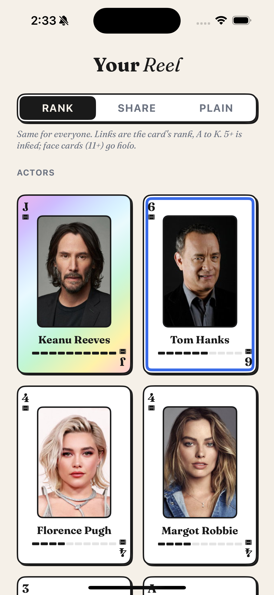

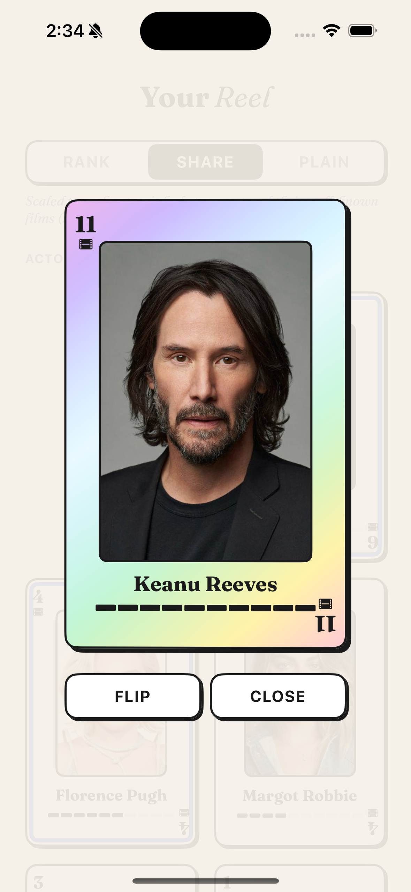

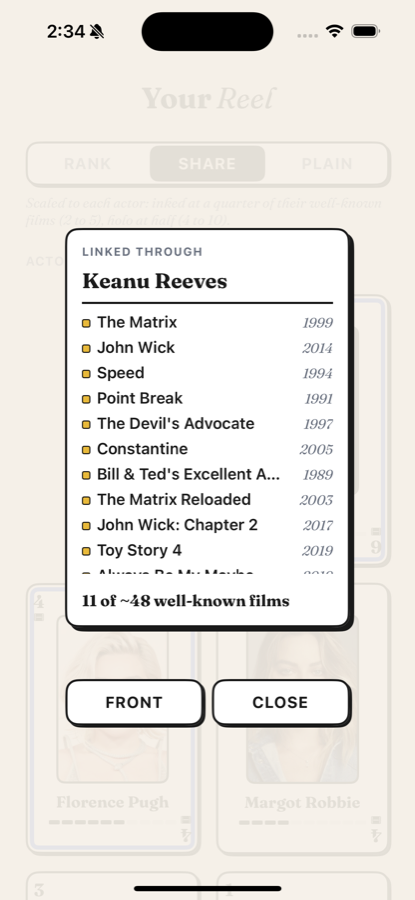

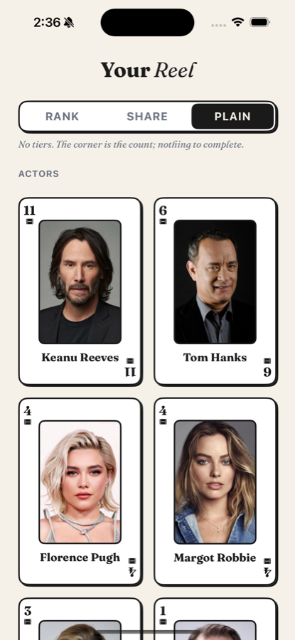

Bugs and gotchas in this round:
- The rotated bottom-corner index ran into the pips.
- The flipped back's hard shadow was mirrored onto the left side.
- Launch args didn't get through because **zsh doesn't word-split an unquoted variable**. Fixed with `${=args}`.
- A crop missed because `sips` had already resized the screenshot in place.
- Claude never got a shot of the stamps. An incremental build **failed to link**, the app was removed from the simulator, and two relaunches crashed. Abraham then pasted the macOS crash dialog. Claude: "That crash dialog was my fault. The last two builds I installed on the iPhone 16 simulator had failed to link…" A clean build fixed it.

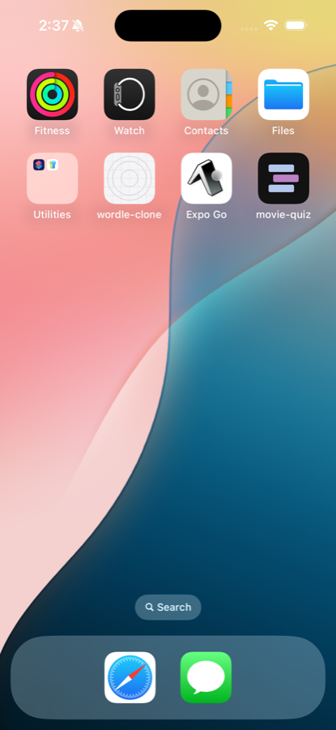

Claude noted that "a rotated 6 reads as a 9 in the bottom corner."
**Commit:** `e15aee0` (14:38), "Prototype Your Reel as collectible cards (preview only)".

### 2026-10-22 15:03 — "can you do the wiring and load up the app"

Claude wired the cards into the real Reel on the worktree:
- **Data:** `Movie.voteCount`, `Config.wellKnownVoteCount`, and `CollectedEntity.links` (adjacent pairs, stored both ways). The engine snapshots each actor's well-known count from the filmography it already loads.
- **Old saves:** old Reels decode with empty links rather than failing, "because a failed load would have emptied it". There's a test for this.
- **New views and settings:** `ReelCards.swift`, a Settings → Reel cards toggle (Rank / Share / Plain), and a DEBUG `-uiDemoReel -uiOpenReel` hook backed by an in-memory demo Reel with **13 real actors and 29 films**.
- **Tests:** 59 passed.
- **Release-build gotcha:** a `var` that's never mutated in Release would warn, and warnings fail the build here, so it became `#if/#else` with `let`.
- **Pre-existing bug found:** a Release build of `main` was already failing, because the `#Preview` blocks in `GameOverView`/`GameView` call debug-only demo functions. That would have blocked an App Store archive. It was flagged repeatedly through the session but not fixed here.

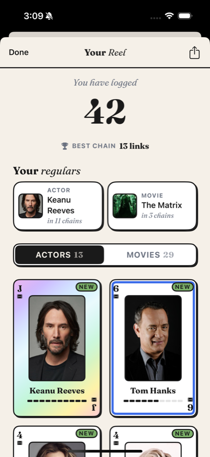

**Commit:** `fc70b49` (15:11), "Turn Your Reel into a deck of playing cards and stamps".

### 2026-10-22 15:27 — "i gotta say i like, it" → no numbers, framed posters, filters

**Abraham:**
> "i gotta say i like, it ,
> we can get rid of the number on the cards
> and the , also no need to say when the next card is or something
> i think changing the posters into a simple frame (like framing it in your house) instead of the stamp aesthetic maybe is also good and then you click on those and flip to see the actors at the back also
> additionall i think giving some filters like year, genre etc will be good too"

**Decisions:**
- **Numbers come off the fronts, and the "next tier" line goes.** The finish (paper / inked / holo) is the only reward shown. Claude read "and the ," as the corner film icon and removed that too, and asked whether the pip bar was what Abraham meant.
- **Movies become framed posters:** a black frame, a white mat, and the title and year underneath "like a gallery label". They flip to show the actors linked through them, with faces. The back is now always the same size as the front.
- **Decade and Genre menus:**
  - Films match on decade and genre directly. An actor matches when a film linked through them matches (`ReelFilter`). With the 1990s selected, that gives 10 films and the 9 actors linked through them.
  - The menus only offer values the Reel actually has.
  - Genre costs nothing: TMDB sends `genre_ids` on every movie response, and the names come from a fixed table. Films logged earlier have no genre until they come up again.

Tests: 62 passed. Claude still couldn't tap the simulator, so it added temporary launch-arg hooks for the tab, filter and flip, then reverted them.

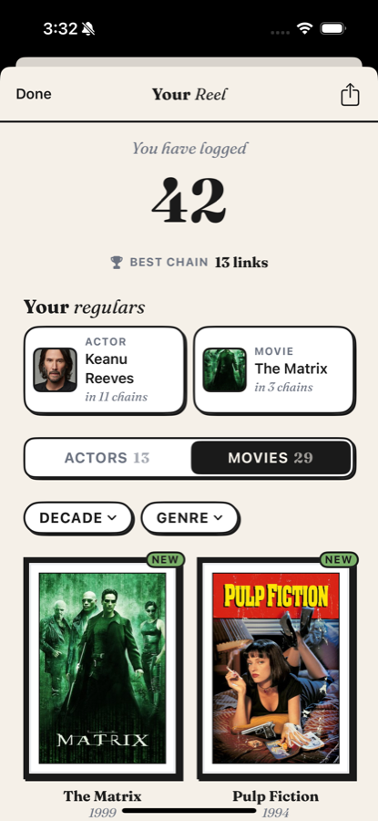

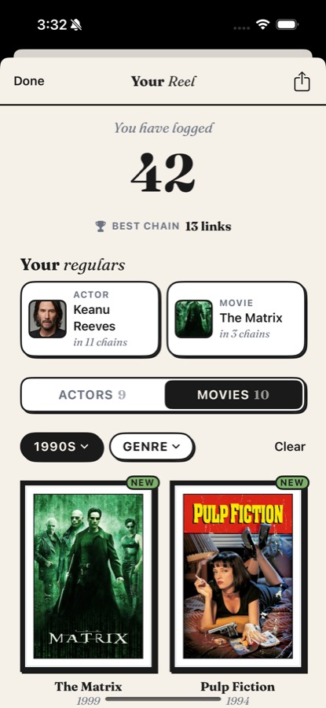

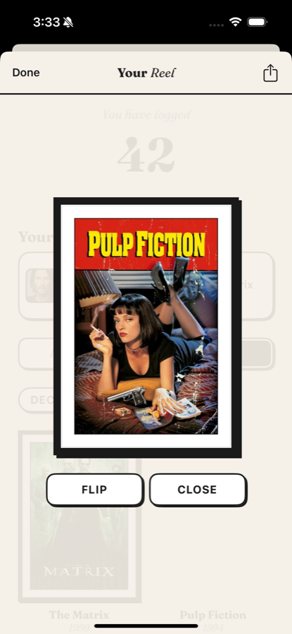

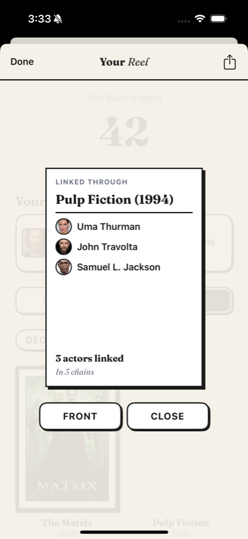

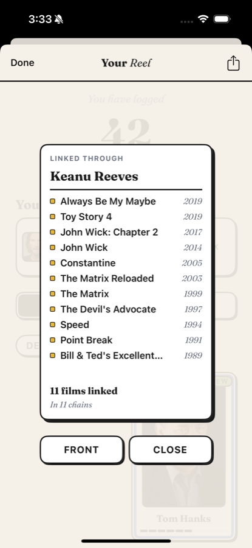

**Commit:** `5bb160a` (15:34), "Frame the Reel's movies, drop card numbers, add decade/genre filters".

### 2026-10-22 15:35 — "review using /emil-design-eng and /review-animations"

Claude reviewed the motion as a Before / After / Why table. **Verdict: Block**, on two feel-breaking problems:
1. **The lift ignored where the card came from.** The dim background and the card scaled in together from 0.6 at the centre of the screen, so it "reads as a modal popping up instead of a card picked up from the deck." Fix: `matchedGeometryEffect` from the grid slot, with the dim as its own fading layer.
2. **Cards faded in late while scrolling.** `.appear(i)` gave each lazy cell a delay of up to `min(i,16) × 30ms = 480ms`. Fix: stagger only the first 6.

Tuning rows:
- **Open/close:** open on `.spring(0.4, bounce 0.15)`, close snappy with no bounce. "Picking a card up is the deliberate moment. Putting it back is the system responding."
- **Flip:** 0.55s → 0.42s, bounce 0.1.
- **Tilt:** reading `TiltMotion` in the detail's body redrew the whole view (including the film list) 30×/s. It moved into a `LiveHoloCard` subview.
- **Images:** the grid and the lifted card loaded different image sizes, so the lifted card flashed initials. They now share one size.
- **Tab counts:** `.numericText` so they roll when a filter changes.
- **Haptics:** a light impact on lift, a selection click on flip.

**Abraham: "apply"** (15:38).

Claude found `ffmpeg` installed and began **recording the simulator and reading contact sheets frame by frame**, rather than assuming the motion worked. This became the verification method for the rest of the day.

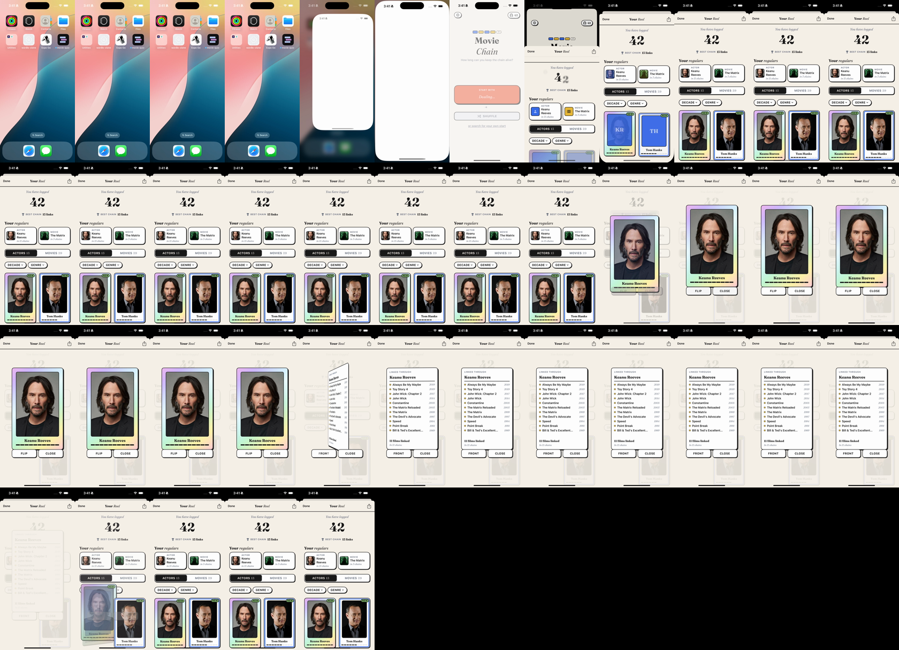

[▶ lift-actor.mp4](media/066d1467/lift-actor.mp4) · [▶ lift-frame.mp4](media/066d1467/lift-frame.mp4): the first `matchedGeometryEffect` lift/flip/close recordings, for an actor and for Pulp Fiction.

**Commit:** `730d24a` (15:42), "Lift Reel cards out of their slot and snap them home". The card is laid out once at full size and scaled, so text never reflows mid-flight.

### 2026-10-22 15:46 — "did you rebuild" / "why the buttons like this here"

Claude explained that the build came from the worktree. Opening the main `movie-quiz.xcodeproj` in Xcode would build `main` and replace it on the simulator.

Abraham then pasted a screenshot:

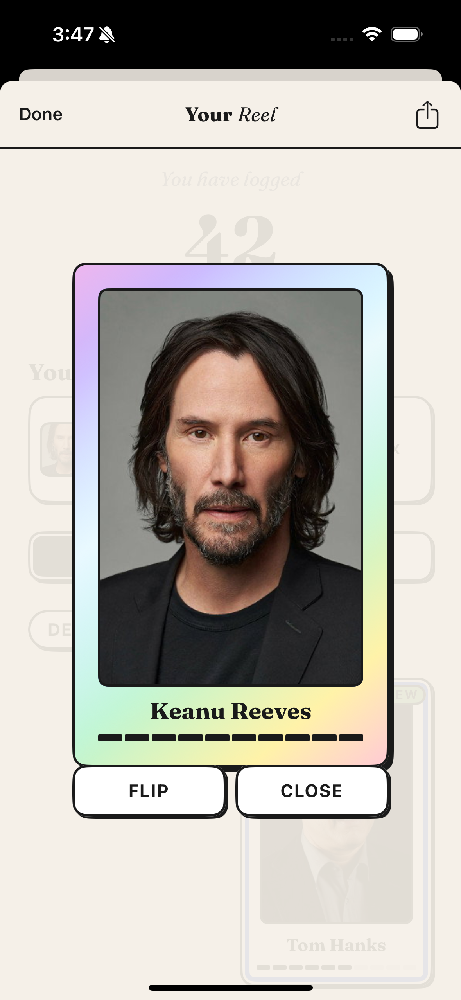

**Cause:** the new lift container fixed the card at a 5:7 playing-card ratio (378pt at 270 wide). But the photo was locked to 4:5 and filled its ZStack, so the card really rendered at about 270×428 and spilled about 25pt over the 24pt gap. **Fix:** draw the art as an overlay on its colour backing, so only the backing sets the size. Grid cards also became true 5:7. They had been stretching the same way.

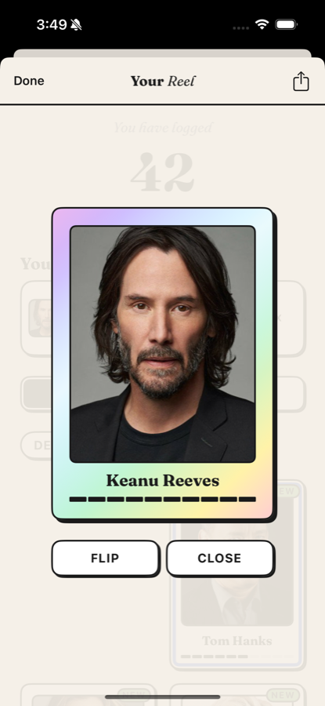

**Commit:** `bb17c93` (15:49), "Keep Reel cards at 5:7 so the lifted card clears its buttons".

### 2026-10-22 15:57 — "a little bit of a tangent but lets commit push merge and mark version for this too" → 0.5.2

- **PR #4:** https://github.com/abematt/movie-chain/pull/4, merged as `611d7fd`.
- **Cut commit on `main`:** `7706529`, "Cut 0.5.2: Your Reel as a collection", following the 0.5.1 pattern. The changelog's Unreleased entries became `[0.5.2]`, `MARKETING_VERSION` became 0.5.2 in all four configurations, and CLAUDE.md now says "Currently 0.5.2". The build number stayed at 1.
- **Tag:** annotated `v0.5.2`. 62 tests green on the merged `main`.
- **Cleanup:** the worktree was removed. Claude deleted the copy of the TMDB token plist it had made in the worktree first.

**Decision — patch, not minor:** "the minor numbers are reserved for roadmap milestones, and 0.6.0 is Foundations." The changelog says the same: "Not a roadmap milestone, so a patch: the minors stay reserved for them."

Skipped before merging: `/swift-review`. The tier setting (Rank / Share / Plain) also shipped still undecided.

### 2026-10-22 16:00 — "how do i get it on my actual 16 pro phyiscal mobile"

- **Setup:** automatic signing with team `8ZDTABCQFP`. The phone was running **iOS 27.0.1** with Developer Mode on.
- **Install:** `xcodebuild … -allowProvisioningUpdates` then `devicectl device install`. The launch failed with "invalid code signature… not explicitly trusted".
- **Trust step:** Abraham trusted the developer certificate in **Settings → General → VPN & Device Management → Trust**.
- **Notes Claude gave him:**
  - The phone has its own empty Reel, and the demo Reel is simulator-only.
  - Haptics can only be felt here.
  - With a free personal team, a build like this stops opening after 7 days.

**Abraham: "done"**, and Claude launched the app on the phone.

### 2026-10-22 16:37 — First real-device feedback

**Abraham:**
> "btw im noticing while testing on my real appp
> first of all , sounds don't always play
> also lets drop the chain style and reelcards option, also the loading the actor cards don't really work that well , the loading up animation kinda skips/staggers into loading , i need it to be smooth like the rest, also the card grid, we can get away with having smaller cards and hence more cards in a row and columns"

Work went onto a new branch, `feature_reel-polish`, in the main checkout.

- **Sounds (a real bug):**
  - iOS stops `AVAudioEngine` by itself on a call, Siri, AirPods connecting or disconnecting, or sometimes a trip to the background. `Sound.swift` only checked a flag it set at launch, so after the first interruption "every chime went nowhere until you relaunched".
  - Fix: check `engine.isRunning` before each sound, restart it if needed, and re-warm it when the app returns to the foreground, so the first chime after an interruption isn't late.
  - This can't be tested on the simulator.
- **Reel loading stutter (two causes):**
  - `AsyncImage` keeps nothing in memory, so every card showed initials and then swapped to its photo, every time the Reel opened.
  - The grid cascade animation sat on top of that.
  - Fix: `ArtCache` became the app-wide image cache: an 80MB decoded-image memory limit, a **150MB disk `URLCache`**, decoding off the main thread, and shared in-flight loads. The Reel's first screen is warmed at launch, the cascade is gone, and a first load goes from colour straight to photo in one fade.
- **Smaller cards:** **three across**. Each card is drawn once at `ReelLayout.designWidth = 110` and scaled by `ReelCanvas`, so the lift (to `liftedWidth = 240`) "is a pure zoom — the same card brought closer". Grid art is `w342`, and a lifted card swaps to `w780`. Claude checked with curl that TMDB serves w780 for profile photos too: about 110–200KB, loaded only for the one lifted card.
- **Both settings removed:**
  - The chain is always the Deck. Gone: `ChainStack`, the Cards style, `ChainCardStack`/`HeroChainCard`.
  - Tiers are always Rank, with **inked at 5 and holo at 11** (`ReelTier.inkedAt` / `holoAt`). Share, Plain, `voteCount` and the well-known count all went.
  - 59 tests, three fewer.

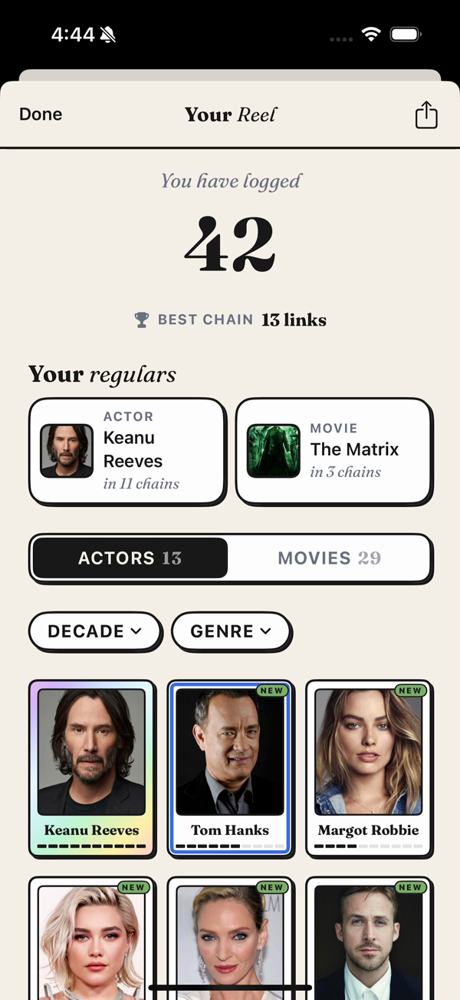

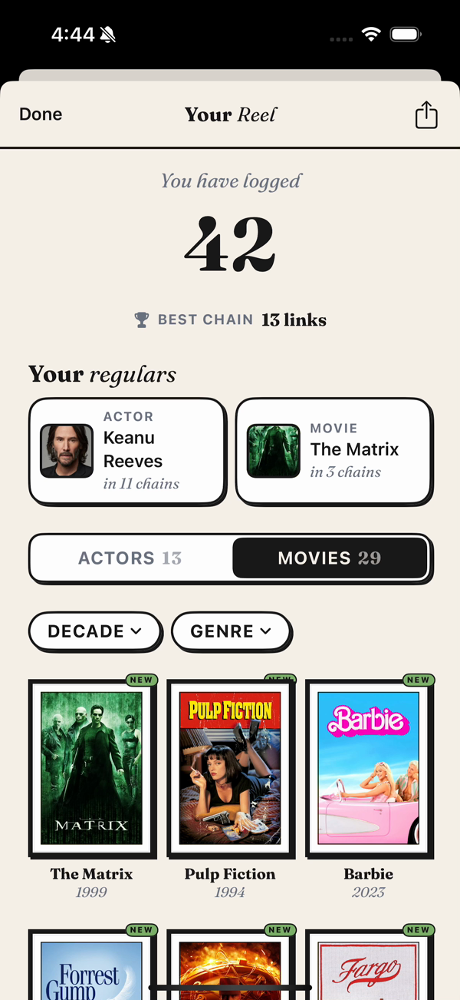

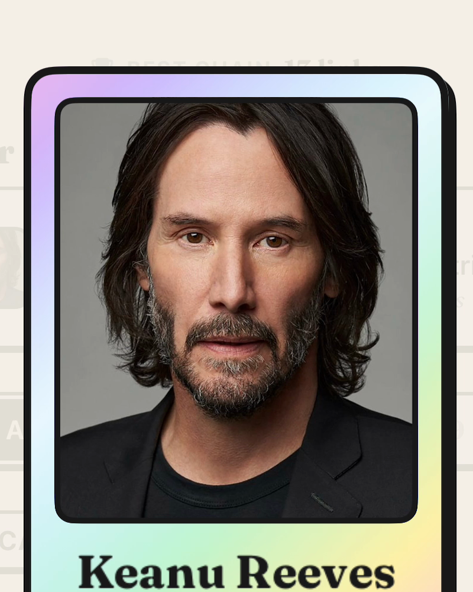

[▶ p-actors.mp4](media/066d1467/p-actors.mp4) · [▶ p-movies.mp4](media/066d1467/p-movies.mp4): the three-across lift/flip recordings. Their contact sheets show the app still titled **"Movie Chain"** on the home screen.

**Commit:** `d05e7f8` (16:46), "Fix missing sounds, cache Reel art, three-across cards, drop two settings". Installed on the phone.

### 2026-10-22 16:51 — The keyboard should leave before game over

**Abraham:**
> "i think i guess i only noticed again on the real device, moving from game screen to game over screen , the keyboard only closes whne its on that screen, and that creates a flash and distracting keyboard movement, would be nice if we do that before moving to the game over screen"

**Cause:** focus only dropped when `GameView` was torn down mid-transition, so the keyboard slid down over the incoming game-over screen. That screen was also laid out around the keyboard, so it jumped as the keyboard left.

**Fix:**
- **Time's up:** focus drops at the start of the **450ms** `timeUpPause` beat, which outlasts the keyboard's exit of about 250ms.
- **Quit:** focus drops first, and the run ends about 250ms later.
- **Go during the beat** no longer raises the keyboard again.
- **`GameOverView` ignores the keyboard safe area**, so a late keyboard can't re-lay it out.

The simulator has a hardware keyboard connected, so the software keyboard never appeared. The recordings only confirm the timing.

[▶ quit.mp4](media/066d1467/quit.mp4) · [▶ timeout.mp4](media/066d1467/timeout.mp4) (36.5s: the full 30-second turn running out).

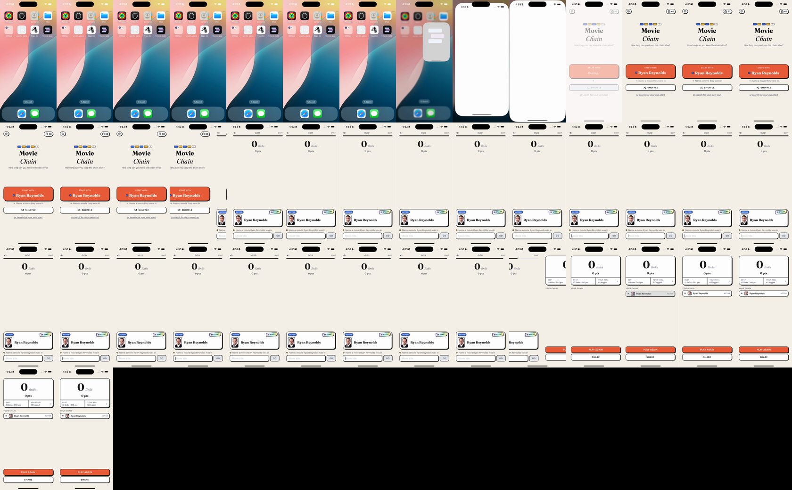

**Commit:** `38b2bc5` (16:54), "Lower the keyboard before the game-over screen comes in". Claude also removed a stray doc comment left behind by the `visibleLinks` removal.

### 2026-10-22 16:57 — Points linger on Play again; the card close looks bad

**Abraham:**
> "noticed another bug moving from game end screen to play again, the pts amount stays on screen and stays a while while the sliding happens
> also in the actors card screen
> when you press close , the transition back is not very clean and i can see the buttons flash a little longer on scren making it look bad , same for movies"

1. **Points.** `GameOverView` read score, points and chain live from the engine. Play again resets those while the screen is still sliding out, so the points cross-faded to "0 pts". **Fix:** `Summary` now carries the frozen run (chain, links, points, share text), stored on `.gameOver(Summary)`, and the screen reads only that. This follows the CLAUDE.md rule "state that only exists in one phase lives on that phase". A new regression test brought the count to 60.
2. **The close.** Three things overlapped: the lifted card and its buttons faded out in place while the grid's copy faded in as it flew home, giving "two half-transparent cards with the buttons hanging over them." **Fix:** the controls became their own layer that leaves in 100ms, and the backdrop clears in 150ms.

At 4 fps the recording looked wrong in a way that only slowing it down explained. Two intermediate attempts failed:
- **A zero-length removal (`.identity`)** gave SwiftUI nothing to animate the matched hand-off against, so the card *snapped* home.
- **Another attempt** flew both faces of a flipped card home at once.

The final version uses an 80ms `handOff` exit on the lifted copy. Claude switched to `ffmpeg select='gt(scene,0.003)'` to keep only the frames that changed.

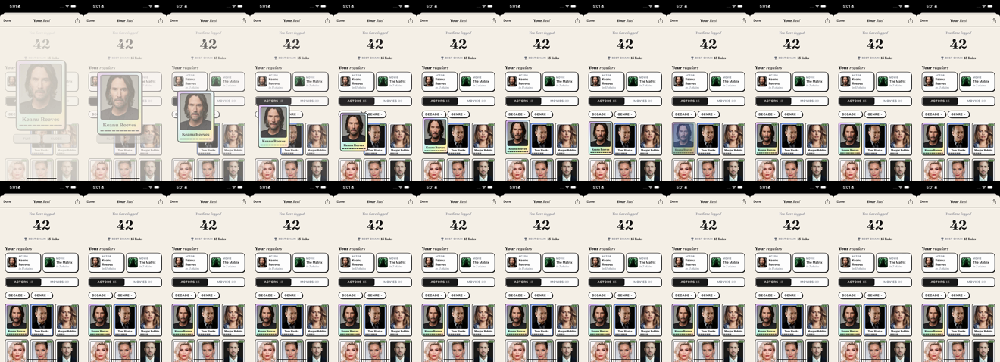

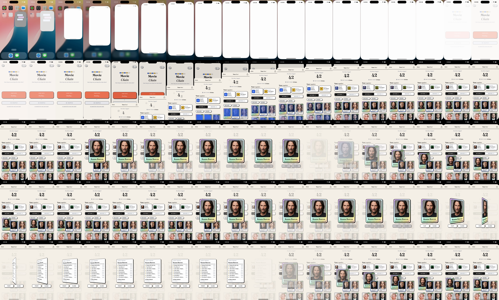

[▶ c-actors.mp4](media/066d1467/c-actors.mp4) · [▶ c-movies.mp4](media/066d1467/c-movies.mp4) · [▶ c2.mp4](media/066d1467/c2.mp4) · [▶ c3.mp4](media/066d1467/c3.mp4) · [▶ c4.mp4](media/066d1467/c4.mp4) · [▶ again.mp4](media/066d1467/again.mp4). The Play again recording couldn't show the bug, because "nothing can type there, so every test run scores 0".

**Commit:** `9c45e5f` (17:06), "Freeze the finished run for game over; clean up the Reel card close". Claude tried to start `/review-animations` but was refused: the skill is user-invoke-only (`disable-model-invocation`).

### 2026-10-22 17:15 — "Don't you think the the press… is too sudden"

**Abraham:**
> "Don't you think the the press of the film/movie loading is too sudden based on what we've set up, take a look at that with /review-animations as the main anchor for that and the rest of the changes we've done"

Claude admitted the regression: "Yes, it was too sudden. In the last round I broke the lift so it didn't animate at all." Removing the grid card's fade had left the swap with zero duration, so the lifted copy appeared full size in a single frame. **Fix:** the same 80ms `handOff` exit as the lifted copy.
**Commit:** `19a0a66` (17:18), "Make the Reel lift fly again instead of appearing in one frame". The phone was locked, so the app wouldn't auto-launch.

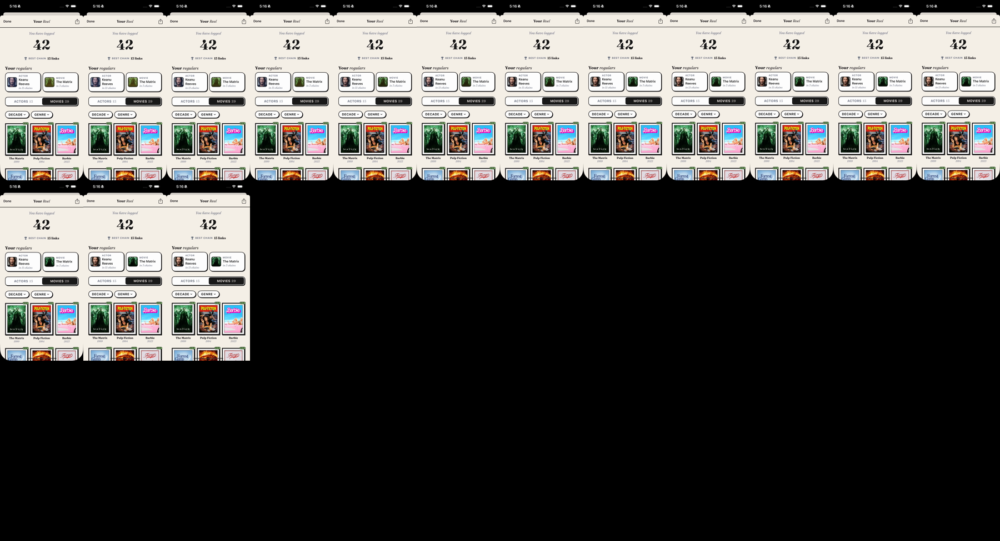

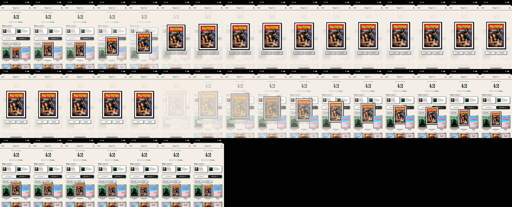

Claude then ran a review from the standards loaded earlier. **Verdict: Approve with tuning**, with four rows:
- **Press:** pressing dimmed the card to 85% (and scaled it to 97%), so it popped back to full brightness as the lift started. Fix: a Reel-only press style that only scales.
- **Close:** the dim cleared over 150ms, so the returning card looked washed out. Fix: 60ms.
- **Sharper image:** it swapped in with a visible pop. Fix: a 150ms cross-fade.
- **Open:** bounce 0.15 on a 2.2× zoom made "a noticeable wobble". Fix: bounce 0.08, with the dim on a plain `easeOut(0.2)`, because "a dim layer should never bounce".

**Abraham: "apply yes"** (17:20).

Gotcha: the first version of the image fade made the lifted card **start as a blank coloured block**, with the photo fading in during the lift. A child's insertion transition also ran when the lifted card itself was inserted. Fixed by fading only when a photo actually arrives or gets sharper.

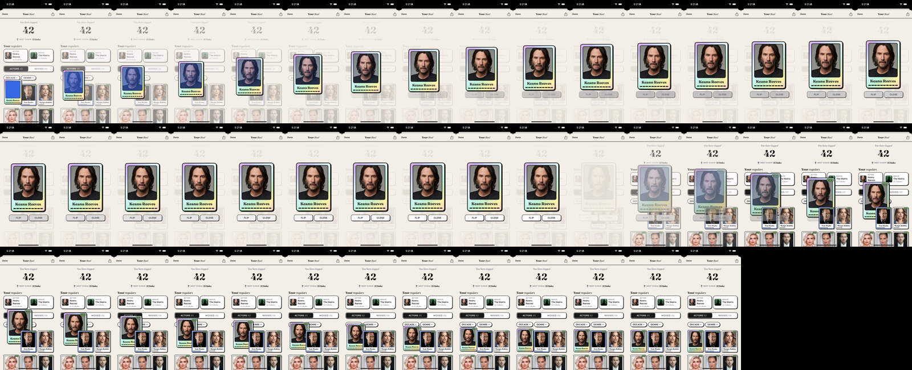

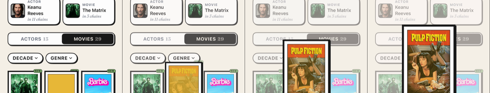

**Commit:** `57c665e` (17:23), "Tune the Reel lift: press without dim, quick un-dim, sharper-art fade".

### 2026-10-22 17:28 — The blue/yellow flash and cards passing behind the grid → throwing out matchedGeometryEffect

**Abraham:**
> "there's a flash of blue and yellow when opening a actor card and film card and when you close them, they temporarily pass through behind the existing grid cards, both look weird"

Diagnosis:
- **Passing behind:** the card flying home was the *grid's own cell*, and a lazy grid draws later cells on top. **`zIndex` is ignored in a lazy grid.** "I tried, and it didn't work."
- **Blue/yellow:** those are the backing colours behind actor and movie art. Two likely causes: (a) the sharper-image swap briefly left neither image fully drawn; (b) `NSCache` eviction meant a freshly rebuilt card started blank.

**The rework (the key reversal of the day):** drop `matchedGeometryEffect` and let the lifted card **make the whole trip itself, drawn above everything**.
- Each grid card records its on-screen frame.
- The grid card stays hidden in place and is never rebuilt, so its photo is simply there when it returns.
- `LiftFlight` starts the card exactly over its slot at slot size, grows it to the centre, then shrinks it back onto the slot, turning to the front on the way if it was flipped. Only then does the grid card reappear.
- **Art:** the base image is always drawn, and the sharper one fades in *on top* by opacity, so the backing can never show through.
- **Cache:** `ArtCache` holds the **64 most recent images strongly**, in a list `NSCache` can't evict.

Claude's summary: "My earlier patches were each working around one of these." Matched geometry was the shared root cause of all three problems: under the dim layer, under the next cells, and rebuilt at every hand-off.

Bug along the way: the first self-flying version still jumped straight to the centre (`f-`, `g-` rounds; the `g-` round tried waiting about 17ms before take-off). Claude stretched the wait to 300ms (`dbg.png`) and added logging:
```
DBG expand slot=Optional((24.0, 578.67, 108.33, 151.67))
DBG geometry first=true frame=(76.67, 270.67, 240.0, 336.0) … travels=true arrived=false
DBG geometry first=false frame=(24.0, 578.67, 108.33, …
```
The card was measuring its resting position *while already being transformed*, so it kept chasing its own position. **Fix:** measure an untransformed, invisible stand-in of the same size.

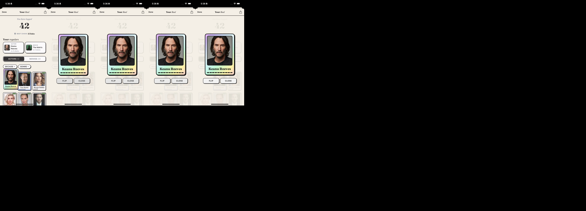

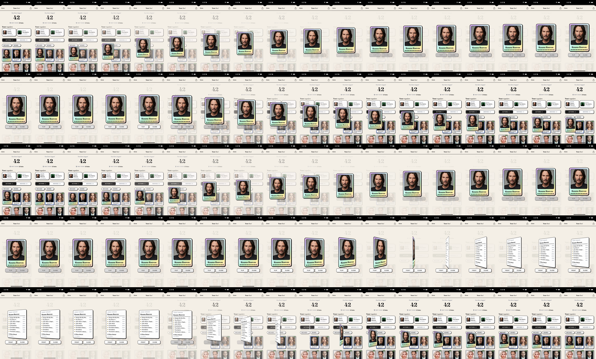

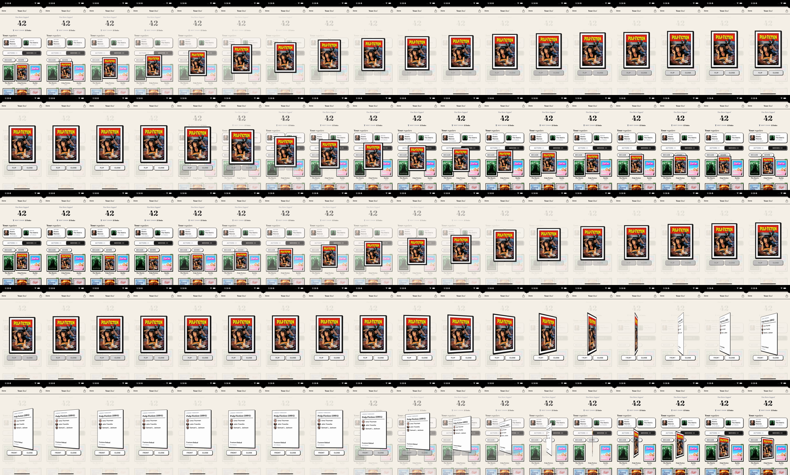

[▶ z-actors.mp4](media/066d1467/z-actors.mp4) (an earlier attempt in this round) · [▶ f-actors.mp4](media/066d1467/f-actors.mp4) · [▶ g-actors.mp4](media/066d1467/g-actors.mp4) · [▶ dbg.mp4](media/066d1467/dbg.mp4) · [▶ h-actors.mp4](media/066d1467/h-actors.mp4) · [▶ h-movies.mp4](media/066d1467/h-movies.mp4)

CLAUDE.md and ARCHITECTURE.md were updated: "**not** `matchedGeometryEffect`, which flew the grid's own card under the dim layer and its neighbours" (this text is in the current CLAUDE.md).
**Commit:** `7367269` (17:39), "Fly the lifted Reel card itself, above everything, out and back". Installed and launched on the phone.

### 2026-10-22 18:05 — "Yeah all good" → 0.5.3, then stop

**Abraham:** "Yeah all good, i think its also time to move to the other steps on our plan"

- **PR #5:** "Reel polish, missing-sound fix, keyboard and transition fixes", merged as `c430be8`.
- **Cut:** `4d296ee` (18:07), "Cut 0.5.3: Reel polish and real-device fixes". Tag `v0.5.3`, 60 tests.
- **0.6.0 scoping:** Claude read ROADMAP 0.6.0 (Foundations & safety net) and audited the code: no OSLog `Logger` anywhere, and about 24 `try?` across files. It then asked an `AskUserQuestion` about the TestFlight pipeline, which Abraham rejected.

**Abraham:** "no okay so we're done here no"

Claude's wrap-up: nothing half-finished. Its suggested 0.6.0 order: fix the Release build (the two old previews), then logging, then the deal-pool disk cache and device ids, then the TestFlight pipeline.

---

### Decision log

| Time | Decision | Rationale | Source |
|---|---|---|---|
| 13:17 | Count films linked *through* the actor (A), not any of their films in the Reel (B) | B "inflates the count with films you never connected to that actor"; A gives movies their reverse reference for free | Claude proposal; Abraham "yes go with A" 14:28 |
| 13:17 | Never list missing films | It would make the Reel a study sheet: the hint-shaped drift from ASSISTED-MODE.md | Claude proposal; CHANGELOG 0.5.2 |
| 13:17 | Take the filmography count during play; never fetch on Reel open | Zero extra TMDB requests; a 300-actor Reel would mean a 300-request burst | Claude proposal |
| 13:17 | The grid foil is static; only the lifted card reads the gyro | 60 Hz `HoloFoil` on every grid cell would stutter scrolling | Claude proposal; review 15:37 |
| 14:28 | Build a preview on a worktree before committing to the design | Abraham: "why don't you build the preview first and we see"; keeps the main checkout's motion work untouched | Transcript |
| 14:38 | Recommend Rank over Share | Share's caps converge on about 5/10 anyway; Hanks would need 26 links for holo uncapped | Claude, after real TMDB counts |
| 15:27 | Remove numbers and the next-tier line; the finish is the only reward | Abraham: "get rid of the number on the cards… no need to say when the next card is" | Abraham |
| 15:27 | Movies become framed posters, not stamps | Abraham: "like framing it in your house" | Abraham |
| 15:27 | Decade and genre filters; actors match through linked films | Genre ids already arrive on every TMDB movie response, so no new requests | Abraham ask + Claude |
| 15:37 | Lift from the slot via `matchedGeometryEffect`; open with a bouncy spring, close snappy | "A card picked up from the deck", not a modal | Review table |
| 15:37 | Stagger only the first 6 cells | Lazy cells were fading in late during scrolling (up to 480ms) | Review table |
| 15:49 | Make the card a true 5:7 (art as an overlay on its backing) | The photo was sizing the card past 5:7 and spilling over the buttons | Abraham's screenshot |
| 15:58 | 0.5.2 is a patch, not 0.6.0 | Minors are reserved for roadmap milestones | Claude; CHANGELOG |
| 16:37 | Drop the Chain style and Reel cards settings; Deck + Rank (5/11) for everyone | Abraham: "lets drop the chain style and reelcards option" | Abraham |
| 16:37 | Three across; draw at 110pt and scale to 240pt | More cards per screen; the lift becomes a pure zoom | Abraham ask + Claude |
| 16:37 | `ArtCache` becomes the app's image cache (memory, 150MB disk, off-main decode); warm the first screen at launch | `AsyncImage` has no memory cache, which caused the initials → photo stutter | Claude |
| 16:37 | Check the audio engine before every sound, and re-warm on foreground | iOS stops the engine on interruptions and route changes | Claude |
| 16:51 | Drop keyboard focus at the start of the 450ms time's-up beat; on Quit, close the keyboard then end the run 250ms later | The keyboard was closing over the incoming screen | Abraham ask |
| 16:57 | Freeze the finished run into `Summary` | Play again was resetting live state mid-slide | Abraham bug |
| 17:15 | Press style: scale only, no dim | The dim → full-brightness jump read as "sudden" | Review |
| 17:20 | Open bounce 0.08, dim easeOut 0.2, close un-dim 60ms, sharp art cross-fade 150ms | "A dim layer should never bounce"; avoid the washed-out return and the sharpness pop | Review; Abraham "apply yes" |
| 17:33 | **Abandon `matchedGeometryEffect`; the lifted card flies itself above everything** | It flew the grid's own cell: under the dim, under later cells (lazy grid ignores zIndex), and rebuilt at each hand-off (colour flash) | Abraham bug 17:28; commit 7367269 |
| 17:33 | `ArtCache` keeps the 64 most recent images strongly; layer the sharp art by opacity | `NSCache` eviction plus view swaps let the accent colour flash through | Same |
| 18:07 | Stop after 0.5.3; don't start 0.6.0 | Abraham: "no okay so we're done here no" | Transcript |

---

### Story material

- **Origin:** one feature seeded the next. The gyro holo sticker made Abraham think "Pokémon / baseball card", and the Reel turned from a stats list into a collection the same afternoon.
- **"Maybe it doesn't need to be gamified?"** Abraham's doubt led to three tier models being built and toggled side by side in real play. In the end the simplest rule (Rank: inked at 5, holo at 11) won, and the setting was deleted the same day. The data argument for it: well-known film counts (Hanks 52, Keanu 48, Buscemi 48, Thurman 20, Robbie 20, Pugh 14) make any per-actor scaling converge on the same thresholds once you cap them.
- **The number vanishes.** It started as a playing card with A–K ranks and mirrored corner indices ("a rotated 6 reads as a 9"). Two hours later the fronts carry no numbers at all: "no numbers on the fronts; the finish is the reward."
- **Stamps → frames.** "Like framing it in your house." The poster gets a black frame, a white mat and a gallery label, and when lifted its label stays on the "wall" under the gap. Claude: "it reads like a picture taken off its hook."
- **Zero-request design** is the through-line: filmography counts come from turns already played, genres from responses already received, art from the image CDN.
- **The crash dialog that was Claude's fault:** an incremental simulator build failed to link, the app crashed at launch, and Abraham pasted the macOS crash dialog. The "stamps" screenshot is literally the simulator home screen.
- **Verification by ffmpeg.** Claude can't tap the simulator, so it wrote temporary launch-arg hooks (`-uiDemoReel -uiOpenReel`, tab/flip hooks), recorded with `simctl io recordVideo`, and read contact sheets. It escalated from fps=4 to fps=20 to `select='gt(scene,0.003)'` to catch transitions only a few frames long. Several bugs were only visible this way: the snap home, both faces flying, the blank block.
- **The matchedGeometryEffect saga (the big reversal):**
  - 15:37 — the review recommends it to fix a modal-looking lift.
  - 15:47 — it exposes the 5:7 sizing bug.
  - 17:06 — the close shows two half-transparent cards.
  - 17:18 — a zero-length transition makes the lift appear in one frame ("I broke the lift so it didn't animate at all").
  - 17:28 — the card passes behind its neighbours and flashes blue/yellow.
  - Final answer: the lifted card "makes the whole trip itself". "My earlier patches were each working around one of these."
  - Lesson: a lazy grid ignores `zIndex`, and matched geometry moves the *grid's* view, not yours.
- **Measuring yourself while moving:** the first self-flying card measured its rest position after being transformed and "kept chasing its own position". The fix was an invisible, untransformed stand-in.
- **The real device finds what the simulator can't:** missing sounds (audio interruptions), the keyboard flash (the simulator has a hardware keyboard), haptics, the colour flash (cache timing), and the points linger (the simulator can't type, so every run scored 0).
- **The phone:** iPhone 16 Pro on iOS 27.0.1. First install needed Settings → General → VPN & Device Management → Trust. The app was still called "Movie Chain" on screen in these recordings, before the Unspool rebrand.
- **Two releases in one afternoon:** 0.5.2 at 15:58 and 0.5.3 at 18:07, both patches, because "the minors stay reserved" for roadmap milestones.
- **Numbers:**
  - Data: demo Reel of 13 actors and 29 films; well-known = 1,000+ TMDB votes; Share clamps inked 2–5 and holo 4–10.
  - Cards: 5:7 card aspect (the bug had 270×428 instead of 270×378); grid 2 → 3 across; design width 110pt, lifted 240pt; art w342 for the grid, w780 lifted (about 110–200KB).
  - Cache: `ArtCache` 80MB decoded memory, 150MB disk, 64 strong recents.
  - Grid timing: stagger was up to 480ms (min(i,16)×30ms), then the first 6 only, then removed.
  - Lift timing: flip 0.55 → 0.42s; open spring 0.4s, bounce 0.15 → 0.08; close `homeFlight` 0.38s with no bounce; `handOff` 80ms; controls exit 100ms; dim clear 150 → 60ms; sharp-art fade 150ms.
  - Keyboard timing: time's-up beat 450ms against a keyboard exit of about 250ms.
  - Tests: 59 → 62 → 59 → 60.
- **Quotes:**
  - Abraham: "i gotta say i like, it"; "i need it to be smooth like the rest"; "both look weird".
  - Claude: "That crash dialog was my fault."; "Yes, it was too sudden. In the last round I broke the lift so it didn't animate at all."; "A dim layer should never bounce."; "Picking up and turning a card is the physical moment of this screen."

---

### Media index

All files are in `media/066d1467/`. MP4s are screen recordings (gitignored, on disk). Rounds by prefix:

| Prefix | Round |
|---|---|
| (unprefixed) rank/back/detail/share, `v2-`/`v3-`, `crop`, `stamps` | Prototype, 14:33–14:37 |
| `wired` | First wiring |
| `r-` | Frames + filters |
| `lift-*`, `sheet-*` | First matched-geometry lift |
| `fix-`/`fix2-` | 5:7 button-overlap fix |
| `p-`/`ps-`/`still-`, `full-lift`/`crop-lift` | Three-across polish |
| `quit`/`timeout`/`qs` | Keyboard |
| `c-`/`cs-`/`close*`/`c2`–`c4`/`again` | Close cleanup + Play again |
| `m-` | "Too sudden" diagnosis |
| `o-` | Lift-restored check |
| `t-`/`u-`/`uf-`/`ufc-` | Tuning round |
| `z-`/`f-`/`g-`/`dbg`/`h-` | Self-flying card rework |

- again-all.png — contact sheet of again.mp4: game over → Play again ("Movie Chain" home, 0 pts runs); Play-again points check (c-round batch)
- again.mp4 — recording of a run → game over → Play again, to check the lingering points (couldn't show it: score is always 0 on the simulator)
- back.png — prototype enlarged Keanu "11" holo card (Share mode); meant to be the back but taken too early
- back2.png — retake of the flipped prototype card at full resolution (inferred: same as back2s)
- back2s.png — downsized retake: the prototype back, "LINKED THROUGH Keanu Reeves… 11 of ~48 well-known films"
- c-actors.mp4 — close-cleanup round 1 recording, actor lift/flip/close
- c-movies.mp4 — close-cleanup round 1 recording, poster
- c2.mp4 — close round 2 recording (after the zero-length removal attempt)
- c3.mp4 — close round 3 recording
- c3-changes.png — scene-change contact sheet of c3.mp4 (launch → lift → flip → close)
- c4.mp4 — close round 4 (final 80ms handOff) recording
- c4-changes.png — scene-change contact sheet of c4.mp4; the verified close
- close-fine.png — 20 fps strip of the first close: washed-out double card at the centre while the grid copy flies home
- close2.png — 20 fps strip from c2.mp4, starting after the card was already home
- close2b.png — 20 fps strip of c2's flipped close; the window overran the video (inferred)
- close3.png — 20 fps strip from c2.mp4 at 5.6s: the lifted Keanu card sitting static (two rows of identical frames)
- crop.png — zoomed crop of the prototype's back: "LINKED THROUGH" list, checking the mirrored shadow
- crop-lift.png — full-res crop of a lifted card in the three-across round, showing crisp text after scaling
- cs-actors.png — contact sheet of c-actors.mp4 (4 fps): the close looked like a jump
- cs-movies.png — contact sheet of c-movies.mp4 (inferred, same as cs-actors for posters)
- dbg.mp4 — debug recording with a 300ms take-off wait
- dbg.png — frames from dbg.mp4: the card still appears at the centre with no flight from the slot
- detail.png — prototype Rank mode back: "11 films linked", no denominator
- f-actors.mp4 / f-actors.png — first self-flying version (still jumped to the centre)
- f-movies.mp4 / f-movies.png — same, poster
- fix-grid.png — grid after the first 5:7 attempt
- fix-lift.png — first 5:7 attempt: lifted card still overlapping the buttons
- fix2-grid.png — grid after the final 5:7 fix: true playing-card proportions
- fix2-lift.png — lifted Keanu card with a 24pt gap above FLIP/CLOSE
- fix2-liftframe.png — lifted Pulp Fiction frame after the 5:7 fix
- full-lift.png — full-resolution frame at 7s of p-actors.mp4 (lifted card)
- g-actors.mp4 / g-actors.png — self-flying retry with the ~17ms take-off wait; still jumped
- g-movies.mp4 / g-movies.png — same, poster
- h-actors.mp4 / h-actors.png — final LiftFlight: Keanu flies out of the slot, flips, returns above neighbours
- h-movies.mp4 / h-movies.png — final LiftFlight for Pulp Fiction, including the flipped close turning to front
- lift-actor.mp4 — first matchedGeometryEffect lift/flip/close recording (10.2s)
- lift-frame.mp4 — same for a framed poster
- m-lift.png — scene-change sheet from m-open.mp4 after 4s: the close is clean (one frame flying home)
- m-open.mp4 — recording used to diagnose "too sudden"
- m-open-changes.png — first scene-change sheet of m-open.mp4 (only reached the sheet opening)
- m-open2.png — the open in m-open.mp4: poster appears lifted with no flight
- o-actors.mp4 / o-actors.png — after 19a0a66: actor card flies out of its slot again
- o-movies.mp4 / o-movies.png — after 19a0a66: poster grows from its slot, flips, returns
- p-actors.mp4 — three-across polish recording, actor lift/flip
- p-movies.mp4 — three-across polish recording, posters
- pasted-1.png — Abraham's screenshot at 15:47: lifted card overlapping FLIP/CLOSE ("why the buttons like this here")
- ps-actors.png — contact sheet of p-actors.mp4 (Movie Chain home → Reel → lift → flip)
- ps-movies.png — contact sheet of p-movies.mp4
- qs.png — contact sheet of quit.mp4 (keyboard round)
- quit.mp4 — keyboard round: a run quit after a few seconds
- r-actors.png — frames round: Actors tab with DECADE/GENRE pills, numberless cards
- r-liftactor-back.png — actor back after the trim: 11 films, "11 films linked · In 11 chains"
- r-movies.png — frames round: Movies tab with framed posters
- r-movies-lift.png — lifted Pulp Fiction frame
- r-movies-lift-back.png — poster back: the three actors linked through Pulp Fiction
- r-movies-nineties.png — 1990s filter: Actors 9 / Movies 10, "Clear"
- rank.png — prototype grid in Rank mode (J holo, 6 inked, 4 paper), explainer text
- sheet-actor.png — 4 fps contact sheet of lift-actor.mp4
- sheet-frame.png — 6 fps contact sheet of lift-frame.mp4 (Pulp Fiction lift → back → return)
- share.png — prototype enlarged card in Share mode (front)
- stamps.png — meant to show the stamps; actually the simulator home screen after the linker-failure crash
- still-actors.png — three-across Actors grid (polish round)
- still-movies.png — three-across Movies grid (polish round)
- t-actors.mp4 / t-actors.png — tuning round first try: the lift starts as a solid blue block (fade bug)
- t-movies.mp4 / t-movies.png — same, poster (inferred: yellow block)
- timeout.mp4 — keyboard round: a 36.5s run left to time out
- u-actors.mp4 / u-actors.png — tuning round after the fade fix: clean actor lift/close
- u-movies.mp4 / u-movies.png — same for a poster
- uf-01.png … uf-06.png — full-res scene-change frames from u-movies.mp4 after 3s (poster lift step by step)
- uf-row.png — the four frames in a row: yellow grid slot (art not yet downloaded) → poster fades in mid-lift
- ufc-01.png … ufc-04.png — crops of those frames (ufc-02: the yellow slot under the faded poster)
- v2-share.png — prototype Share grid after the corner/pip overlap fix (launch args didn't apply: zsh word-split)
- v2-share-detail-back.png — attempted back shot from the same round (args failed)
- v3-plain.png — prototype Plain mode grid: raw counts, "nothing to complete"
- v3-share.png — prototype Share grid, retaken with `${=args}`
- v3-share-detail-back.png — prototype Share back, retaken (the source of crop.png)
- wired.png — first wired build: real Reel sheet, 42 logged, Actors 13 / Movies 29, deck with NEW badges
- z-actors.mp4 / z-actors.png — first attempt in the colour-flash/behind-grid round (cache + layered art + raise the returning cell), before the self-flying rewrite
- z-movies.mp4 / z-movies.png — same, poster
