## Era: Becoming Unspool — design system, rebrand, the handoff (2026-10-22 evening → now)

**Arc.** On the same day 0.5.3 was cut (`4d296ee`, 18:07), Abraham turned the app's existing Cream Neobrutalist code into a **Design System artifact** so he could iterate on the logo and home screen in Claude Design. About ninety minutes later he came back with four exported explorations under a new name, **Unspool**: a two-circle mark, a wordmark, a film strip and a "dealt card" home screen. In one evening the app got renamed, re-iconed and given a new home screen. The roadmap gained a new 0.6.0, which pushed every later milestone down one. The dealt-card home was built, shipped to the simulator, and **thrown away the same night** for a better idea Abraham pasted in: the home screen *is* the first turn, written as a sentence with a blank, and tapping the blank flies the pieces into the play screen (the "handoff"). Three PRs (#6, #7, #8) went to `main` before midnight. They were followed by two animation audits, a `/swift-review` that found a real double-tap bug, and a fix to the "Pick your own" swap. The night ended with a new thread, holographic gyro-tilting Reel cards, and that work is uncommitted on `feature_reel-tilt` right now.

All times are local Barcelona time (UTC+2). Transcripts are in UTC, so 16:21 UTC = 18:21 local.

---

### 2026-10-22 ~18:21 — "create a design system for this app … so i can work with claude design"

**Ask (verbatim):** "I want to create a design system for this app on whatever we have so i can work with claude design, whats the best way to do this"

- Claude recommended a **Design System artifact** (a claude.ai artifact type: README, tokens in light and dark, components with live previews, assets), built from the repo. Designs and decks made in Claude build on top of it.
- **Rejected:** syncing a component library into a standalone claude.ai/design project. Claude's reason: "standalone Claude Design closes on December 14, 2026, now that Claude Design lives inside Claude."
- **Flagged trade-off:** the artifact redraws the SwiftUI views in HTML and CSS, so it's a *copy*. `Theme.swift` and the asset catalog stay the source of truth.
- Abraham, on why: "yes pleaes cause the reaosn i want to do this is i want to iterate through some designs on the home/play screen and the logo"
- **Hiccup:** Claude had already created the artifact ("Movie Chain Design System", https://claude.ai/artifact/QtUBJFdqC8sNWHqYsSna6Y) when Abraham interrupted: "sorry i want you to connect to a diffrent claude account of mine". Claude can't switch accounts itself, so he ran `/login` and replied "done". The real one was rebuilt on his personal account as **"Movie Chain"**: https://claude.ai/artifact/Ba9rkPwbqAvpgQe9HUtZnz (published ~18:34). The empty work-account one was left in place, with an offer to delete it.
- **What went in:** 15 colours with light and dark values (Canvas `#f5f0e8`/`#24211d`, Coral `#e85d3a`, ActorBlue `#3a6be8`, MovieYellow, Ink…), 5 holo foil colours, three type groups (Fraunces Display, Fraunces Text, SF), spacing, radii, the 2px border and two hard shadows. There were **22 components**, including whole `HomeScreen` and `PlayScreen` at iPhone size "to start new designs from", plus a brand-book README (vocabulary: chain/link/start; motion curves; failing contrast pairs, e.g. white on coral 3.5:1, green on cream 2.2:1).
- **Gotchas noticed on the way:**
  - The app icon (`icon-1024.png`) "still shows the old pre-0.5.0 look, with three blue and purple bars on near-black". It didn't match the palette, so it was "a clear place to start when you try logo designs".
  - The share card still used 🟪 for movies, a leftover of the old purple, even though movies are yellow in the app.
- Not drawn: the Reel cards, game over, search results and Settings.

### 2026-10-22 ~19:56 — The Unspool explorations arrive

**Ask (verbatim):** "Look i want to move on from 0.5 version but i did some explorations on some now logos and a new name and apossible new full feeling home screen, look at the latest 4 pngs in downlaods all with name unspool"

At 19:56 only two PNGs (Brand, Home) plus `unspool-icon.svg` and `unspool-strip.svg` were in Downloads. Claude's first read:
- **"The good news: this is a re-skin, not a redesign."** The hex values are exactly the current tokens, and the wordmark looks like the bundled Fraunces.
- On the name: "'Unspool' fits well. It means film coming off a reel and a chain playing out, it's one word, it's ownable, and it's much better than 'Movie Chain'."
- On the mark: "Blue (actor) and yellow (movie) overlap, and the black overlap *is* the link. That's the game's rule as a symbol."
- **Real risk raised:** "two overlapping circles on a red-orange tile, one of them yellow, read as Mastercard at icon size." Suggested fixes: an ink or cream tile, sprocket holes, or explicit reels. It also said to check that "Unspool" is free on the App Store and as a trademark (still open; it's listed as a trap in ROADMAP).
- Gaps in the home mock: empty states, the best score coming back onto the home (undoing a 0.5 decision to fold it into the Reel), the card height on an iPhone SE, Shuffle needing a "deal the card away" motion, and TMDB attribution needing a path from Settings.
- **Roadmap proposal:** the rebrand isn't a milestone in the roadmap, and 0.6.0 was Foundations, so make 0.6.0 the rebrand and shift everything else down one.

### 2026-10-22 ~20:06 — The answers come back: SE, first run, the asset pack

Abraham pasted the filenames "Unspool · Home on iPhone SE@2x.png", "Unspool · Home, first run@2x.png" and "Unspool-Assets.zip". Claude Design had already answered most of the flagged gaps.

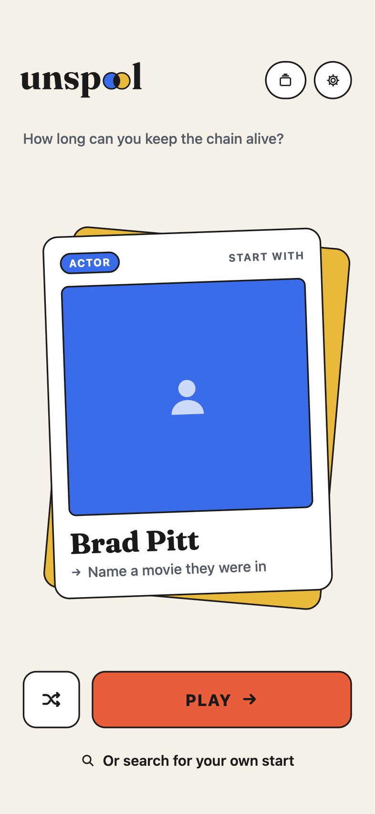

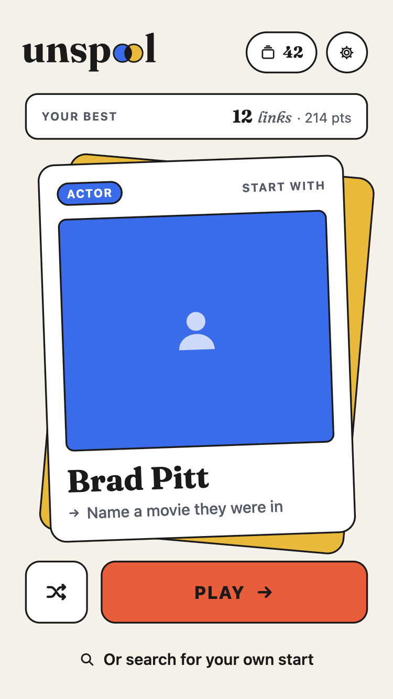

The zip held icon variants. Claude resized them to 300px to compare:

| | |
|---|---|
| 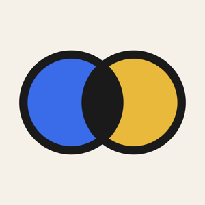 |  |
| 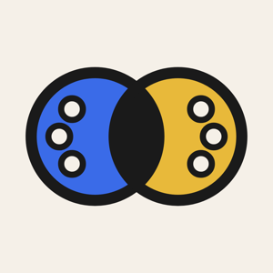 |  |

**Decisions**
- **Cream two-circle icon** — moving the circles onto a cream tile kills the Mastercard read, which "depends on a warm, saturated tile". **Rejected:** the reels alternate: "At 29–60 px the reel holes look like buttons or a face, and the plain mark is the one that matches the wordmark's 'oo'." Abraham: "sounds good, and yes two circle is good"
- **The bundle id stays `abe.movie-quiz`** and the code vocabulary stays "chain" (`ChainNode`, `bestChain`). The rename is user-facing only.
- **The film strip is a supporting graphic** (launch screen, store screenshots, share card), "never the logo" (ROADMAP).

### 2026-10-22 ~20:08–20:17 — Build #1: rename + dealt-card home (`feature_unspool`)

- Replaced the AppIcon, added the `Wordmark`, `LogoMark` and `FilmStrip` image sets, and set `INFOPLIST_KEY_CFBundleDisplayName = Unspool`. The "Movie Chain" strings changed in SettingsView, the Reel share text ("My Unspool reel 🎬") and the game share text, where **🟪 became 🟨**.
- `SeedView.swift` was rewritten into the dealt-card home. `ArtCache.warm` gained a size parameter, because `w185` art "would look soft on a card about 300pt wide".
- Small bug: the wordmark sat left of centre in the intro. Claude checked whether the SVG had empty space on its right edge, then fixed it by overlaying the pills on the header instead of laying them out beside the wordmark.

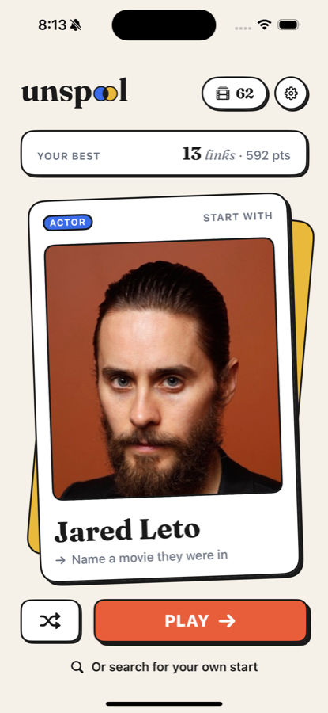

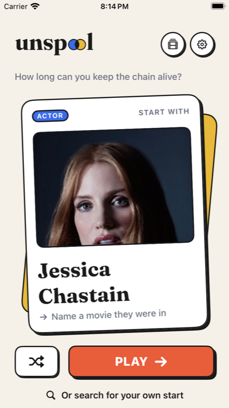

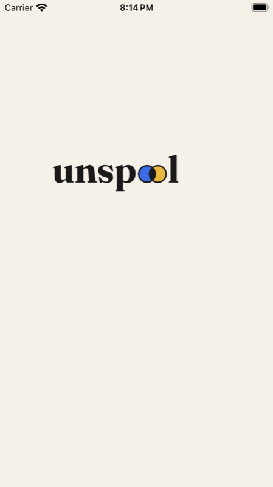 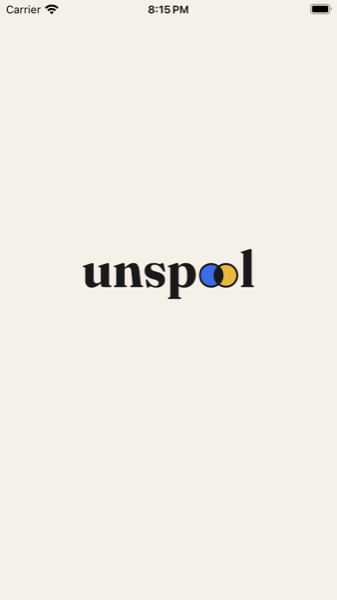

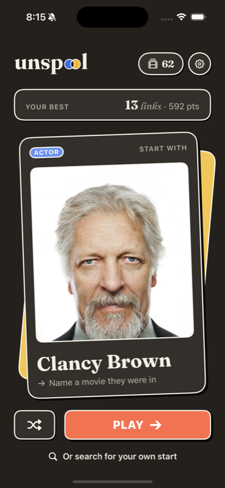

- 60/60 tests passed. Three commits at 20:17: **`15ce38c`** "Rename to Unspool: two-circle icon, wordmark, mark and film strip", **`ee10166`** "Deal the home screen's start as a real card", **`689344b`** "Insert Unspool as 0.6.0 and push later milestones down one".
- Differences from the mock that Claude called out: the PLAY text is white (the shared coral button style that "Play again" also uses), not ink. The shuffle animation was never seen running, because Claude couldn't tap in the simulator.

**Decision: insert 0.6.0 instead of shipping the rebrand as 0.5.x or after Foundations.** The ROADMAP's reasoning: "the name and icon were the last placeholder in the identity 0.5.0 built, and everything after this point (TestFlight, the store listing, share images, the Daily Chain's share card) carries the name. Renaming after those exist is far more expensive than renaming before." So Foundations became 0.7.0, the service 0.8.0, accounts 0.9.0, the Daily Chain 0.10.0 and friend groups 0.11.0. The roadmap's own rule allowed it: "if milestones land out of order, the version follows the work." (Note that 0.5.0 and Foundations had already swapped numbers once.)

*(Gap 20:17 → 22:38: no session activity in these transcripts. Abraham was presumably back in Claude Design, since he returned with a new mock (inferred).)*

### 2026-10-22 ~22:38 — The reversal: "the home is the first turn"

![Abraham's new mock, pasted in: "Chris Hemsworth / was in / a movie… [→]" in big Fraunces, with a round avatar and ACTOR chip above, "Someone else" and "Pick your own" links, and a footer "BEST RUN 13 links · tap the blank to start". No card and no PLAY button.](media/2b943a7f/pasted-1.png)

**Abraham (verbatim):** "what about this, I like this idea, it starts in this sort of textbox way and it transitions into our current deck way (that transition will require some good animation) but the shuffle remains the same way, talk to me about this (before building)"

Claude: "I think this is a better idea than the card, and not only because it looks different. The home screen becomes the first turn. 'Chris Hemsworth was in ___' states the rule as a sentence, so nobody needs an instruction, and there's no PLAY button because the blank is the button."

Claude wrote a long plan. Abraham's reply: **"sorry give me questions you want me to answer"**, so Claude turned it into four multiple-choice questions. His answers:

| Question | Abraham's pick | Rejected |
|---|---|---|
| When does home turn into play? | **On tapping the blank** (recommended) | On the first correct answer. It's "more magical", but it would need a second copy of the timer, shake and retry for a single turn |
| Should the sentence carry into play every turn? | **No, keep play as it is** (he overrode Claude's recommendation) | "Yes, sentence every turn": the docked input keeps the blank's look ("Fight Club *starred* an actor…") |
| Movie wording | **"Inception *starred* an actor…"** | "had an actor", "In Inception was an actor" |
| Shuffle label | **One neutral label, same motion** → "Deal again" | Label by kind ("Someone else"/"Something else") |

Claude filled the remaining defaults: "Pick your own" opens the existing search unchanged; long names shrink to fit at most three lines so **the blank never moves**; the footer reads "BEST RUN 13 *links* · tap the blank to start". Build order: static layout, then the transition, then prefetch. The dealt-card home was replaced on the same branch; the icon, rename and docs commits stayed. Abraham: "yeah".

**Decisions on how to build the handoff**
- **No `matchedGeometryEffect`.** The Reel lift had already shown that it "flies the wrong copy of a view under other layers." The Reel's approach was reused instead: both screens report frames into a `HandoffStage`, and the root draws *copies* flying between them (`Handoff.swift`, `HandoffFlight`).
- **No sideways screen push from home to play.** The push was designed for screens that are separate places, and here the home *becomes* play. Game over → Play again → home keeps the push.
- **Prefetch the first turn on deal.** `prefetchCandidates` runs once a start has been on screen for 0.4s, so the first answer is checked instantly. Two new tests cover it.

### 2026-10-22 ~22:43–23:00 — Building the sentence home and the handoff

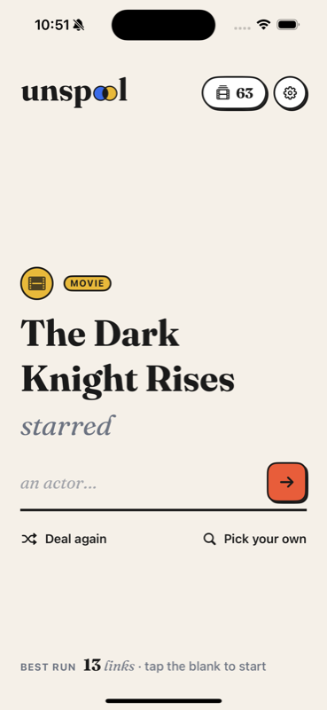

**Bug 1: the flight didn't animate.** Claude recorded the handoff (`-uiAutoHandoff`, a new DEBUG launch flag that taps the blank 2s after a deal) and pulled frames with ffmpeg:

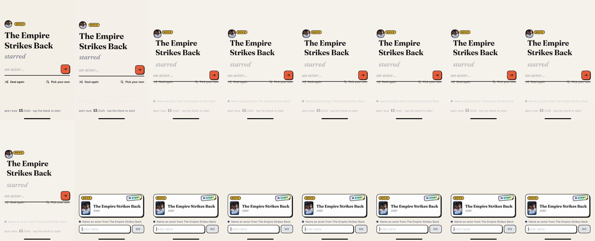

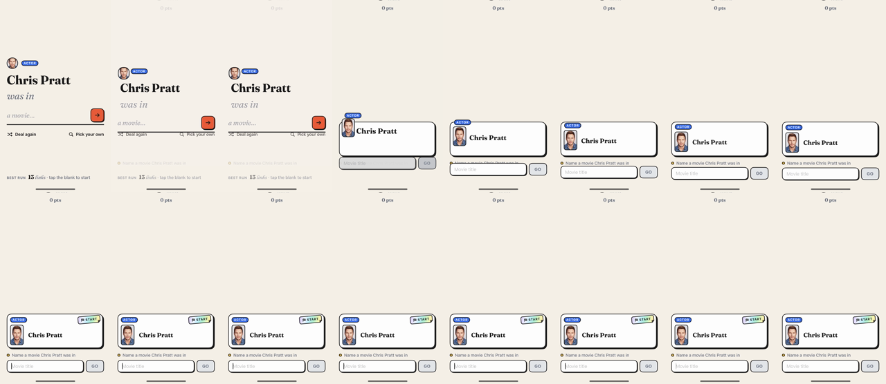

- The cause, as recorded in the ROADMAP trap: "An animated `Animatable` value didn't animate there; a time-based clock did." The flight now runs on its own `TimelineView` clock and reads the destination live every frame, which also lets it follow the card and dock as the keyboard moves them.
- **Bug 2: a stutter at the start.** "Focusing the answer box for the first time loads the keyboard and freezes the screen for about 150ms." The flight now waits out the freeze, holding still where the home pieces were. Claude added temporary `os` logging (`handoff` lines with timestamps) to find it, then removed it.
- There was also a concurrency build error: the coordinate-space name was read inside a `@Sendable` geometry closure, and a `nonisolated` constant fixed it.

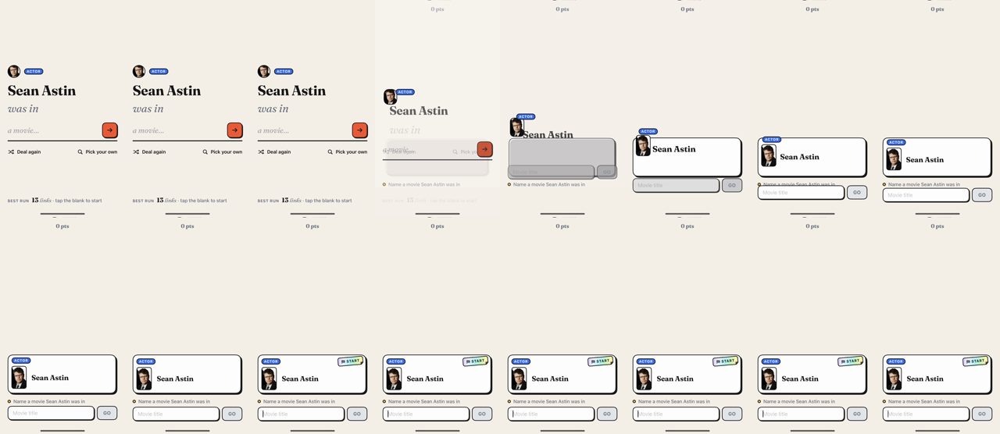

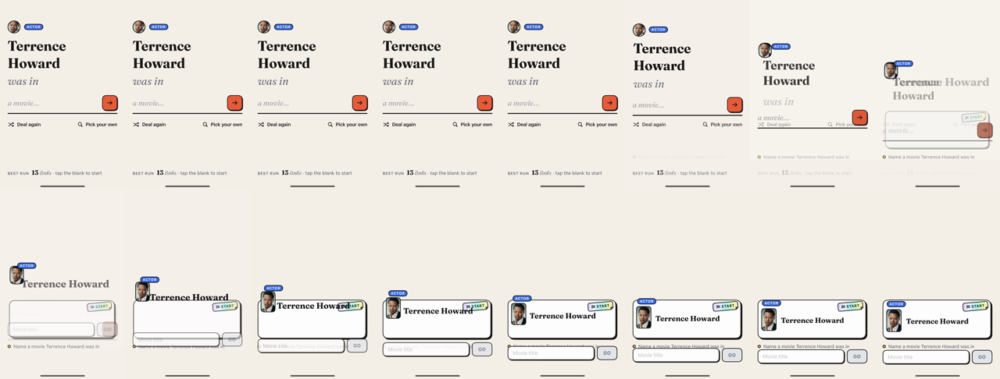

`probe_2.6.png`, `probe_3.0.png` and `probe_3.4.png` are identical tiny single frames (Sean Astin home) taken at 2.6s, 3.0s and 3.4s into a recording to find when the tap fired.

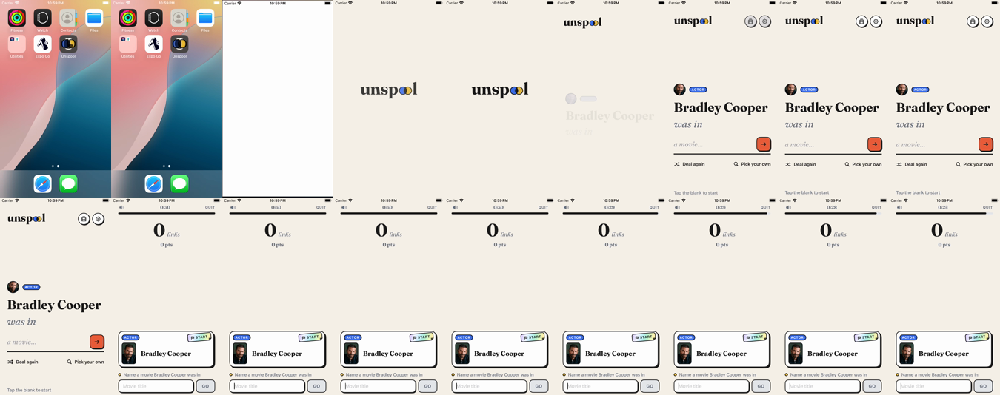
[▶ se.mp4 — the SE fresh-install recording behind that sheet](media/2b943a7f/se.mp4)

Commit **`ca813f6`** (23:00) "Make the home the first turn: a sentence that hands off into play", with 13 files and +849/−299. 62 tests passed. Claude's caveats: the simulator has a hardware keyboard, so the software keyboard rising mid-flight was never seen. The flight took 0.7s.

### 2026-10-22 ~23:01 — On his phone

Abraham: **"lets build it on my actual phone"**. A signed debug build went onto his iPhone 16 Pro, installed over the existing copy so his best run and Reel survived. His verdict a few minutes later: **"looks good"**. He then asked for `/find-animation-opportunities` and `/improve-animations` "using /emil-design-eng principles for this flow we just added".

### 2026-10-22 ~23:06 — Animation audit #1 (Emil Kowalski lens) → "lets implement all"

Claude's verdict: **"This flow needs *less* time, not more motion."**

| # | Finding | Fix shipped |
|---|---|---|
| 1 HIGH | The flight runs every game: a 0.6s spring with the swap at 0.7s, plus up to 0.45s held for the keyboard. The movement is visually done by ~0.4s, so the tail just reads as lag | `Spring(duration: 0.45, bounce: 0)`, swap at 0.55s |
| 2 HIGH | The blank row pressed with `.pressScale` (0.97), and the action fires on release, so the row **jumped from 0.97 back to 1.0 on the same frame the flight began** | The row doesn't scale; the coral arrow gets the neo press (shadow collapses, 1pt shift) |
| 3 MED | The symmetric 0.5s seed→play cross-fade left the wordmark visible against the timer row | Out in 150ms ease-out, in over 250ms after a 60ms delay |
| 4 LOW | The two name copies are visible mid-crossfade | Up to a 2pt blur peaking at the middle of the crossfade ("Emil's blur bridge") |
| 5 LOW | Deal again: exit and entry used the same bouncy `drop` spring | The old start leaves in 0.22s |
| A | The landing was silent | A soft `Haptics.selection()` when the card lands and the clock starts |
| B | First run only: the arrow nudges 3pt once, ever, and "a movie…" brightens. Only for players with no best run, so existing players never see it | — |

**Rejected:** a bigger Deal-again flourish (it's used tens of times a session), a bounce on landing ("an overshoot carries the copies past the real views they hand to"), rolling up the best-run number, shortening the once-ever intro, and animating during the keyboard-load hold ("the main thread is blocked then, so nothing would render").

Abraham: **"alright lets implement all"**. Commit **`32a33ba`** (23:09) "Tighten the handoff: shorter flight, clean release, no double exposure".

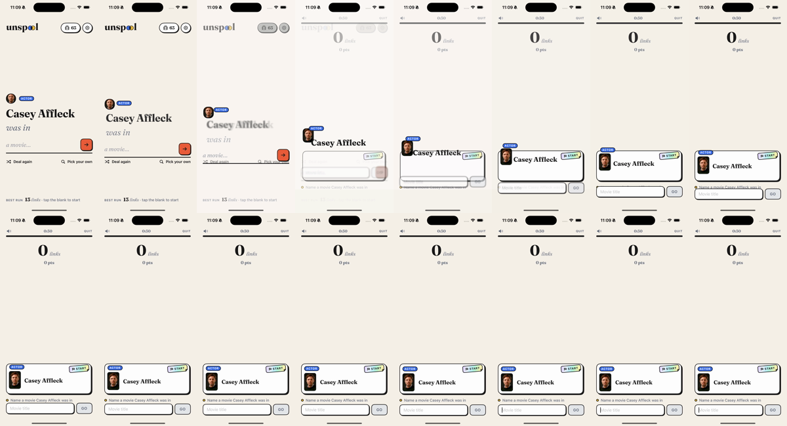
[▶ h.mp4 — the handoff recording (final version, 23:09; earlier recordings were overwritten under the same name)](media/2b943a7f/h.mp4)

Abraham: "did you build on my iphone?" Yes, `32a33ba` was installed. If the old behaviour shows, the app needs swiping away.

### 2026-10-22 ~23:18 — Merge, then "actually no lets do a /swift-review"

- Abraham: **"okay lets commit this and merge"**. That became **PR #6** → merge commit **`8def359`** (23:18), and `feature_unspool` was deleted. Claude noted that it hadn't run `/swift-review` first, as CLAUDE.md asks.
- Abraham: **"actually no lets do a /swift-review"** (after the merge). `swift-check` was clean, and the review found:
  1. **A real bug: a fast double-tap on the blank blanked the flight.** SwiftUI views at opacity 0 still take taps, so a second tap during the 150ms fade called `begin(with:)` again with empty source frames. The name, chip, avatar and blank vanished until the fallback timer fired, and `startGame` ran twice.
  2. Quitting mid-flight left the copies drawn over the game-over screen for ~0.3s.
  3. The old prefetch wasn't cancelled on Deal again, which matters given the TMDB rate limit in GROWTH.md.
  4. `HandoffArt` stale image: left alone, since "it can't happen with the code as it is".
  5. Test gaps: the prefetch fallback, and `HandoffStage`.
- Abraham: "yes". Branch `feature_handoff-fixes`, commit **`3bc7c0c`** "Guard the handoff against double taps and mid-flight quits", **PR #7** → **`8f02df1`** (23:24). The tests went from **62 → 69**: a parameterised `@Test(arguments: [.failure, .empty])`, and a new `HandoffStageTests` suite. One gotcha: the `@Test(arguments:)` table has to be `nonisolated`, because the macro reads it from outside the main actor.

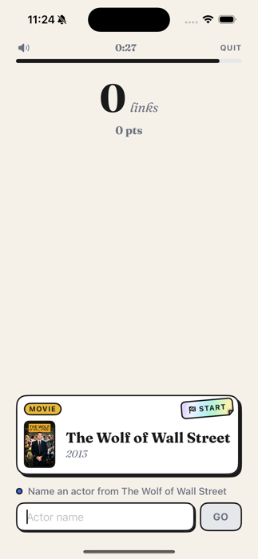

Abraham: "open on phone yes". It was installed, but the phone was locked.

### 2026-10-22 ~23:30 — "the transition to pick your own is weird and not smooth"

**Abraham (verbatim):** "actually the transition to pick your own is weird and not smooth can you take a look"

Diagnosis from 20fps recordings (`-uiOpenSearch`, a new DEBUG flag):
- The two layouts cross-faded in the same spot, so the big sentence showed through the search screen.
- The keyboard came up during the fade and pushed the fading sentence upward ("the jump you noticed").
- The header pills lingered as ghosts.

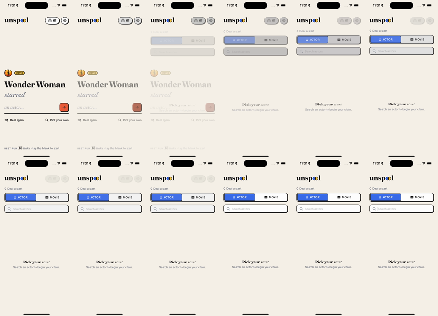

Fix, commit **`30b85f9`** (23:32) "Stage the deal ⇄ search swap…": the home clears first (0.15s), search arrives after it (0.25s, 12pt rise), and **the keyboard waits 0.3s** until search has landed.

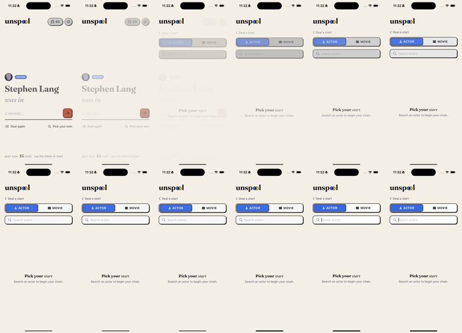

Abraham: **"for this animation /improve-animations"**. Audit #2 findings:
- MED: the "Pick your start" empty state was centred in a flexible area, so it slid up a second time when the keyboard rose. Fix: pin it to the top.
- LOW: the built-in `.easeOut` was too weak. Fix: a strong ease-out, `.timingCurve(0.23, 1, 0.32, 1)`.
- LOW: "‹ Deal a start" had no press feedback.
- LOW: `swapOut/In` duplicated `handoffExit/Enter`. Fix: merge them into one `layoutOut`/`layoutIn` pair.
- LOW: ambient `.animation` wrappers were a second source of truth. Fix: remove them.
- Missed opportunity: fade empty state → first results, but not results → results while typing ("would feel laggy").

Abraham: **"do all"**. Commit **`ac3089e`** (23:38) "Polish the search swap: still empty state, strong ease-out, one token pair".

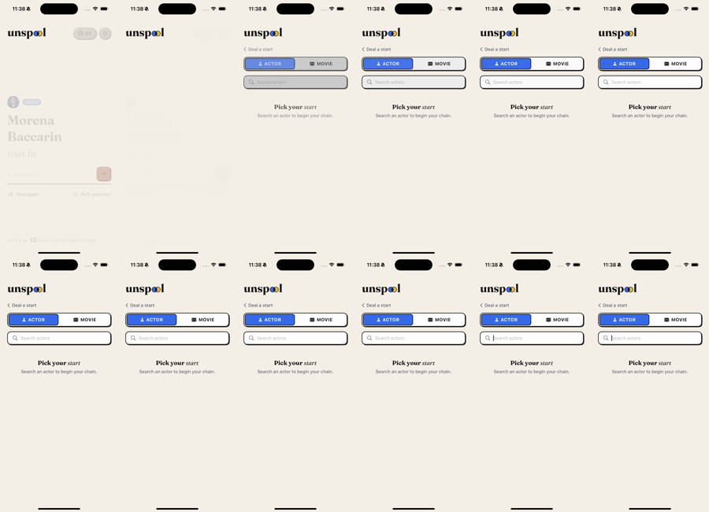
[▶ s.mp4 — search swap recording (final, 23:38)](media/2b943a7f/s.mp4)

Abraham: **"good open pr and merge"**. **PR #8** → **`0e26ec7`** (23:39). Still open: cutting 0.6.0 (the CHANGELOG has everything under `[Unreleased]`; the app still reports 0.5.3). Claude has asked three times and hasn't had an answer.

### 2026-10-22 ~23:26 (parallel session) — Reel cards as holographic cards "in space"

**Ask (verbatim):** "I want to fix up the reels to make the actor cards more cardify, so i want to also add the holographic and also card in space moving around along with phone gyro feature there what do you think — follow /emil-design-eng principles"

Claude found that the holo foil already exists (`HoloFoil`, `TiltMotion`), but the gyro only moves the *light*, the card never moves, and it only runs on lifted cards at the holo tier (11+ films): "the 'this is a physical card' feeling never shows up."

Proposal: the lifted card rotates ±8° with perspective, the shadow shifts the opposite way, the photo parallaxes 2–3pt, every lifted card gets a faint white glare while the rainbow stays holo-only ("If everything shimmers, nothing feels special"), drag-to-tilt as a fallback, and grid cards stay still. **Rejected:** an idle floating wobble, because "Motion the user didn't cause looks fake next to motion they did."

**Places where the mock conflicts with documented decisions** (Claude's calls):
1. Numbers on fronts. CLAUDE.md says "No numbers on the fronts". Keep the collector "NO. 027" (it reads as a set number) and drop the "N chains" count.
2. Per-card pastel tints would break "blue = actor". Tie the duotone colour to the tier instead.
3. Paper → Pastel → Holo is just a rename of the middle tier in `ReelTier`.
4. "Best chain with him" needs a new stored field, and should be "them"/"Best chain" because each actor's gender isn't known.

Abraham, deliberately slowing down: **"make sure we're adhering to /animation-performance and that they are /improve-animations BEFORE WE BUILD , i haven't given the chance to build yet"**

The audit mapped web rules onto SwiftUI ("animate only transform/opacity" becomes `offset`/`scaleEffect`/`rotation3DEffect`/`opacity`; "don't setState per frame" becomes "don't invalidate a big view body 30–60×/s"). Main findings:
- `LiveHoloActorCard` passes the tilt into `ReelActorCard`, so the whole card body re-runs on every gyro sample.
- `HoloFoil` moves gradients by changing `startPoint`/`endPoint`, which repaints every frame.
- The hard shadow would rotate with the card.
- A tilted card breaks `LiftFlight`'s pixel-exact landing.
- The smoothing is per-sample, not per-time, so raising the rate to 60Hz would double the drift.
- Nesting the tilt inside `FlipView` would spin the flip around a tilted axis.
- The game-over sticker keeps re-rendering under the Reel sheet. Confirmed at `GameOverView.swift:128`.
- There's no `CADisableMinimumFrameDurationOnPhone`, so the display link is capped at 60Hz.
- Rule: no `drawingGroup()` up front.

Abraham: "yes go ahead". **Five plans were written to `plans/` (21:43–21:45 UTC = 23:43–23:45 local).** One sign was fixed in 005 during writing: the release spring's velocity is the drag's velocity itself, not its negative.

Abraham: **"Yeah build all brother"**. Branch `feature_reel-tilt` was created (23:48), and `DisplayLink.swift` and `CardTilt.swift` were written. ReelCards.swift, HoloSticker.swift, Theme.swift and GameOverView.swift were edited, and CollectionView.swift gained a DEBUG `-uiLiftFirst` launch argument to lift the first card for screenshots. The build succeeded with warnings treated as errors, and **69 tests passed**. The 120Hz key **didn't land**: Xcode ignores `INFOPLIST_KEY_CADisableMinimumFrameDurationOnPhone`, as plan 001 anticipated, so it was reverted and **the tilt runs at 60Hz for now**. Simulator screenshots `lift.png`/`tilt.png` were taken but aren't in media. At ~23:54 the session was updating CHANGELOG/CLAUDE.md/ARCHITECTURE docs.

### 2026-10-22 ~23:49 — "What are the things in our plan that we want to do"

A short side session. Claude first listed plans 001–005. Abraham: **"i mean tmore high level, like metrics and multipleayer etc etc"**. Claude then summarised the ROADMAP, and the "Where things stand" section below uses it. It also spotted a stale line: ROADMAP 0.5.0 still says the Cards and Tiles styles stay as a setting, but they were removed. Claude offered to fix that.

---

### Where things stand right now (2026-10-22 ~23:55)

- **`main` = `0e26ec7`** (PR #8). Unspool rebrand, sentence home, handoff, handoff fixes and search swap are all merged. **0.6.0 is not cut**: the CHANGELOG still lists everything under `[Unreleased]` and `MARKETING_VERSION` is still 0.5.3. Claude asked "Should I do that now?" and got no answer.
- **Branch `feature_reel-tilt`, uncommitted:**
  - modified: `CollectionView.swift` (+11, the `-uiLiftFirst` hook), `GameOverView.swift` (sticker pauses under the sheet), `HoloSticker.swift` (+/−100, display-clock `TiltMotion`, transform-moved `HoloFoil`), `ReelCards.swift` (+129/−33, leaf-view tilt, table shadow, drag), `Theme.swift` (+10, tilt springs incl. `tiltRelease`)
  - new: `DisplayLink.swift`, `CardTilt.swift`, `plans/`, `diary/`
  - 220 insertions / 67 deletions in tracked files. It builds and 69 tests pass on the simulator, but **it hasn't been tried on a real iPhone**, and that's the only place the gyro can be judged.
- **Plans** (`plans/README.md`; all still marked **TODO** in the files, although the code for them has been written, inferred from the diff and transcript):

| # | Plan | Severity | Depends | State |
|---|---|---|---|---|
| 001 | Run the tilt on the display clock (time-based smoothing, sticker pauses under the sheet, 120Hz key) | MED | — | Implemented; the 120Hz key was reverted, so 60Hz |
| 002 | Move the holo foil by transform (oversized gradient slid with `offset`, `hueRotation` kept) | HIGH | — | Implemented |
| 003 | The lifted card tilts from leaf views (`CardTilt` via environment; ±8°; outside the flip; flat for flights) | HIGH | 001, 002 | Implemented (inferred) |
| 004 | Table shadow for the lifted card (doesn't rotate, slides opposite, narrows during the flip) | HIGH | 003 | Implemented (inferred) |
| 005 | Drag to tilt, spring back with the flick | MED | 001, 003 | Implemented (inferred) |

- The rules the plans encode: only leaf views read the per-frame tilt; per-frame motion moves pixels and never redraws them; one clock; the card flies flat; no `drawingGroup()` up front; verify on a real iPhone.
- Not decided yet from the mock: the new card front (collector number, name plate, tier duotone) and the stats back. Claude's suggested order was tilt first, then the front, then the back.
- **The higher-level plan** (from 8aa6b002):
  - 0.7.0 Foundations: remote backup, `OSLog` in 18 places that swallow errors, crash reports, TestFlight, device id, deal-pool disk cache.
  - 0.8.0 The service: TMDB proxy first, because the shared key saturates at about 2 cold launches per second; then publishable content; Sentry.
  - 0.9.0 Accounts: anonymous play first, Sign in with Apple optional.
  - 0.10.0 Daily Chain: playtest on paper first.
  - 0.11.0 Friend groups: the multiplayer piece; invite-only.
  - 1.0.0 Launch.
  - Metrics stay deliberately light: OSLog, then Sentry, then App Store Connect campaign links, plus an activation event (first run reaching 3 or more links).
  - **Global leaderboards are dropped permanently**: "an AI can produce a valid long chain on request". Pass & Play comes after 1.0.
  - The roadmap estimates 6–9 months to launch at 5–10 hours a week.
- **Open checks:** the software keyboard rising mid-flight on a device; the trademark and App Store availability of "Unspool"; the stale ROADMAP 0.5.0 line.

### Decision log

| Time (local) | Decision | Rationale | Source |
|---|---|---|---|
| 18:22 | A Design System artifact built from code, not a standalone Claude Design project | The standalone product closes Dec 14, 2026; the artifact feeds designs and decks | 4227355d |
| 18:26 | Rebuild the design system on his personal account | Abraham: "connect to a diffrent claude account of mine" | 4227355d |
| 19:57 | Name **Unspool** | "film coming off a reel and a chain playing out… one word… ownable"; "Movie Chain" described only the mechanic | 2b943a7f, CHANGELOG |
| 20:07 | Cream-tile two-circle icon; reel-holes alternate rejected | A coral tile with a yellow circle read as Mastercard; the holes read as buttons or a face at 29–60px | 2b943a7f, ROADMAP |
| 20:07 | Bundle id and "chain" code vocabulary unchanged | Players never see them | 2b943a7f |
| 20:08 | Share squares 🟪 → 🟨 | Leftover from the old purple; movies are yellow | 15ce38c |
| 20:17 | Insert 0.6.0 = Unspool; shift Foundations onward down one | Everything after this carries the name; renaming later is far costlier; "the version follows the work" | 689344b, ROADMAP |
| 22:40 | Replace the dealt-card home (built 2.5h earlier) with the sentence home | The sentence teaches the rule without a button; "the blank is the button" | 2b943a7f |
| 22:43 | Transition fires on tapping the blank, not on the first answer | Avoids a second copy of the timer/shake/retry for one turn | AskUserQuestion |
| 22:43 | Play screen does NOT become a sentence | Abraham's pick, overriding Claude's recommendation | AskUserQuestion |
| 22:43 | "starred" for movies; one neutral "Deal again" label | Mirrors "was in"; one label for both kinds | AskUserQuestion |
| 22:43 | Flight of copies via `HandoffStage`, not `matchedGeometryEffect`; cross-fade instead of a push | Lesson from the Reel lift; home *becomes* play | 2b943a7f |
| 22:55 | Drive the flight from its own `TimelineView` clock; hold through the ~150ms keyboard-load freeze | An `Animatable` value didn't animate; the first focus blocks the main thread | ROADMAP traps |
| 23:07 | Shorten the flight (0.45s spring / 0.55s swap), no press-scale on the blank, asymmetric fades, landing haptic, once-ever nudge | Seen every run, so "needs less time, not more motion" | audit #1 |
| 23:18 | Merge PR #6 before swift-review, then review afterwards | Abraham changed his mind ("actually no lets do a /swift-review") | 2b943a7f |
| 23:22 | Fix double-tap, mid-flight quit and stale prefetch; skip the HandoffArt item | The first three are reachable; the last one can't happen today | swift-review |
| 23:31 | Stage the search swap: old out, new in, keyboard last (0.3s) | Overlap plus keyboard mid-fade caused the "jump" | 30b85f9 |
| 23:37 | One `layoutOut`/`layoutIn` token pair, strong ease-out curve | Two names for one idea; built-in easeOut too weak | ac3089e |
| 23:27 | Gyro tilt only on the lifted card; grid stays still; no idle wobble | The grid is seen often; motion the user didn't cause looks fake | 628e4dd2 |
| 23:27 | Keep the collector number, drop "N chains", tint by tier, not per card | "No numbers on fronts" rule; blue = actor | 628e4dd2 |
| 23:30 | Audit and plan before building tilt | Abraham: "BEFORE WE BUILD" | 628e4dd2 |
| 23:52 | Revert the 120Hz Info.plist key; accept 60Hz | Xcode ignores the `INFOPLIST_KEY_` form | 628e4dd2 raw |

### Story material

- **Built and binned in one evening.** The dealt-card home took about 10 minutes to build (20:08–20:17), matched the Claude Design mock, survived SE and dark-mode checks, and was replaced 2.5 hours later by a mock Abraham drew himself. The ROADMAP keeps the receipt: "*A dealt-card home … was built first and replaced the same day: the sentence teaches the rule without a button.*"
- **The Mastercard moment.** The first icon had a coral tile with blue and yellow overlapping circles. Claude flagged it as Mastercard at small sizes, and by the next round Claude Design had answered with a cream tile and a reels alternate. The reels lost because the holes looked "like buttons or a face".
- **The logo is the rule.** "The black overlap *is* the link": the actor circle and the movie circle overlap, and that overlap stands in for the "oo" in "unspool".
- **"sorry give me questions you want me to answer"**: Abraham cut a wall of design prose down to four multiple-choice questions, and overrode Claude on one of them (the play screen stays as it is).
- **Animation that wouldn't animate.** The first handoff recording showed the copies holding still and then snapping. The fix was to stop trusting SwiftUI's animation system and give the flight its own clock. The second invisible villain was the keyboard's first load freezing the main thread for ~150ms.
- **The simulator can't show the thing that matters.** It has a hardware keyboard (so no software keyboard rises) and no gyro. Both the handoff and the tilt work came with "please check on a phone", and Abraham did: "lets build it on my actual phone", then "looks good".
- **Review after merge.** "okay lets commit this and merge", then minutes later "actually no lets do a /swift-review", which found a real double-tap bug (views at opacity 0 still take taps).
- **Restraint as a theme.** Both audits rejected more animation: "This flow needs *less* time, not more motion." The rejected list includes a bounce on landing, a number roll-up and a flashier Deal again.
- **"BEFORE WE BUILD"**: for the tilt work, Abraham insisted on a performance audit and written plans before any code, then said "Yeah build all brother."
- **Numbers:** 3 PRs merged in 21 minutes (23:18, 23:24, 23:39). Tests went 60 → 62 → 69. The flight went 0.7s → 0.55s. The keyboard-load freeze is ~150ms. The search keyboard delay is 0.3s. ca813f6 was +849/−299 across 13 files. The tilt is ±8° at 60Hz. There are 22 design-system components. Two new DEBUG flags in this era: `-uiAutoHandoff` and `-uiOpenSearch`, plus `-uiLiftFirst` on the tilt branch.
- **Process loop worth writing about:** design in Claude Design, then a design system artifact as the bridge, then a build, then frame-by-frame ffmpeg contact sheets of simulator recordings, then a phone build, then an Emil-style audit, then implementation. Claude "watches" animations by tiling 20fps frames into one PNG.

### Media index

- `media/external/Unspool-Brand@2x.png`: Claude Design brand sheet (coral icon, wordmark, small sizes, film strip). The rebrand kickoff, ~19:56.
- `media/external/Unspool-Home-Dealt-card-@2x.png`: Claude Design dealt-card home mock (Brad Pitt card, YOUR BEST bar, PLAY).
- `media/external/Unspool-Home-first-run@2x.png`: first-run variant with the "How long can you keep the chain alive?" tagline.
- `media/external/Unspool-Home-on-iPhone-SE@2x.png`: SE-height variant; search becomes a text link.
- `media/2b943a7f/assets_i1.png`: cream two-circle icon (chosen).
- `media/2b943a7f/assets_i2.png`: dark icon variant.
- `media/2b943a7f/assets_i3.png`: reel-holes alternate icon (rejected).
- `media/2b943a7f/assets_i4.png`: tinted/grayscale icon variant.
- `media/2b943a7f/home1.png`: built dealt-card home on iPhone 16 sim (Jared Leto), 20:13.
- `media/2b943a7f/se1.png`: dealt-card home on SE fresh install, first-run tagline (Jessica Chastain).
- `media/2b943a7f/se0.png`: SE intro frame with the off-centre wordmark (bug).
- `media/2b943a7f/se00.png`: SE intro frame after the fix, centred.
- `media/2b943a7f/dark.png`: dealt-card home in dark mode (Clancy Brown).
- `media/2b943a7f/pasted-1.png`: Abraham's sentence-home mock ("Chris Hemsworth was in a movie…"), 22:38.
- `media/2b943a7f/s1.png`: built sentence home, movie form ("The Dark Knight Rises starred an actor…").
- `media/2b943a7f/overview.png`: contact sheet of the first handoff recording (launch → deal → play).
- `media/2b943a7f/dense.png`: dense frames showing the flight holding still and then snapping (bug).
- `media/2b943a7f/dense2.png`: dense frames after the first fix attempt (Chris Pratt).
- `media/2b943a7f/dense3.png`: dense frames after the own-clock fix (Sean Astin).
- `media/2b943a7f/dense4.png`: dense frames showing the name double-exposure mid-flight (Terrence Howard).
- `media/2b943a7f/probe_2.6.png`, `probe_3.0.png`, `probe_3.4.png`: identical timing-probe thumbnails of the Sean Astin home.
- `media/2b943a7f/se_over.png`: SE fresh-install sheet (icon, intro, first-run footer, handoff).
- `media/2b943a7f/se.mp4`: SE fresh-install recording.
- `media/2b943a7f/after.png`: handoff after audit #1 (Casey Affleck), shorter flight.
- `media/2b943a7f/h.mp4`: handoff recording (final version at 23:09).
- `media/2b943a7f/smoke.png`: smoke test after the PR #7 guards; play screen at 0:27.
- `media/2b943a7f/swap.png`: Pick-your-own swap before the fix, with overlap (Wonder Woman).
- `media/2b943a7f/swap2.png`: swap after staging (Stephen Lang).
- `media/2b943a7f/swap3.png`: swap after polish (Morena Baccarin).
- `media/2b943a7f/s.mp4`: search swap recording (final, 23:38).
- `media/628e4dd2/pasted-1.png`: Abraham's Reel card mock, Paper → Pastel → Holo fronts plus a stats back.
